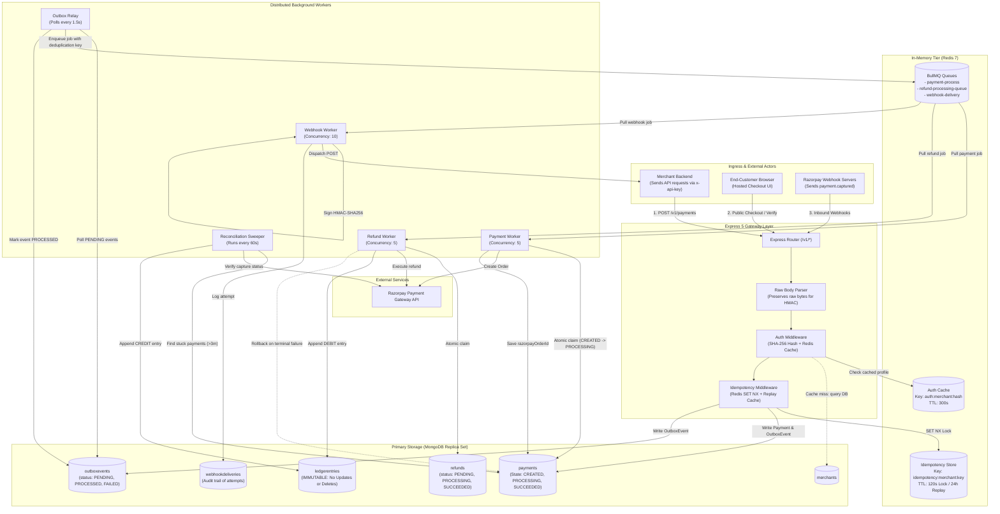
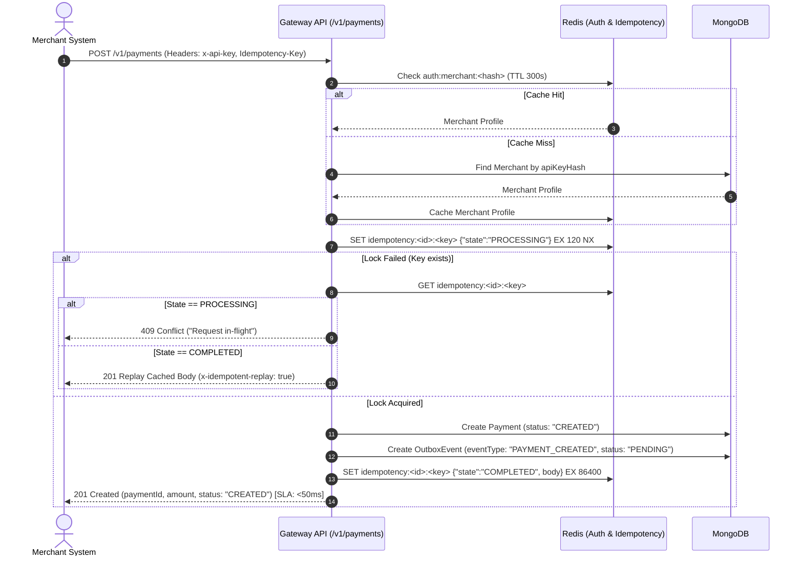
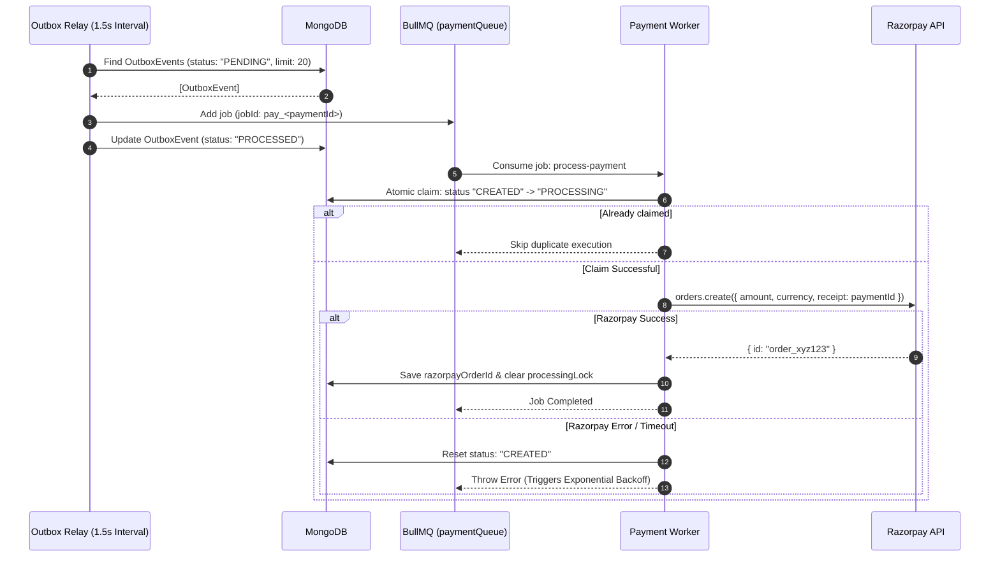
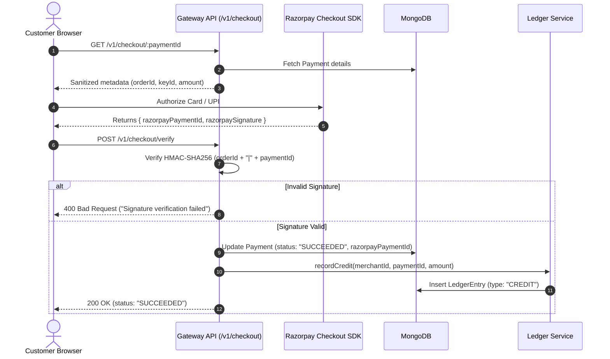
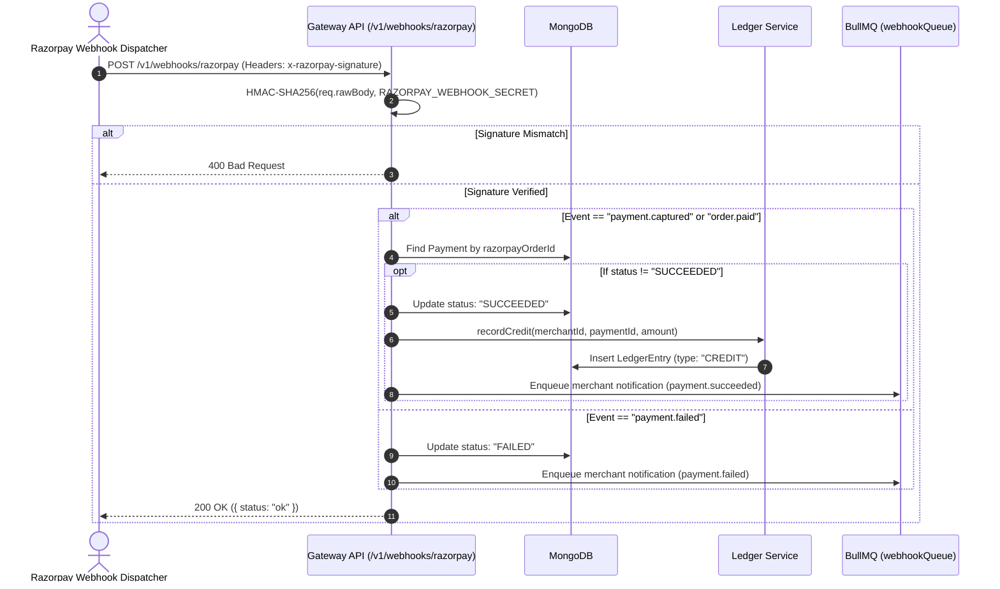
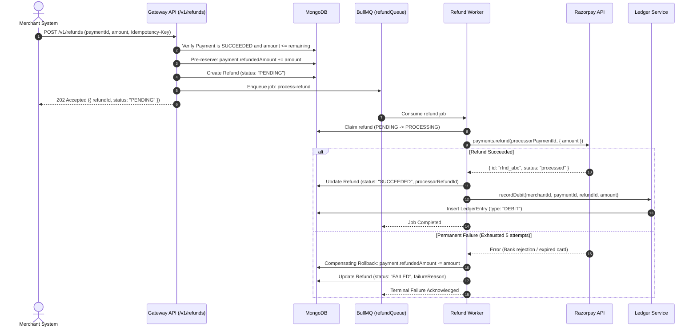
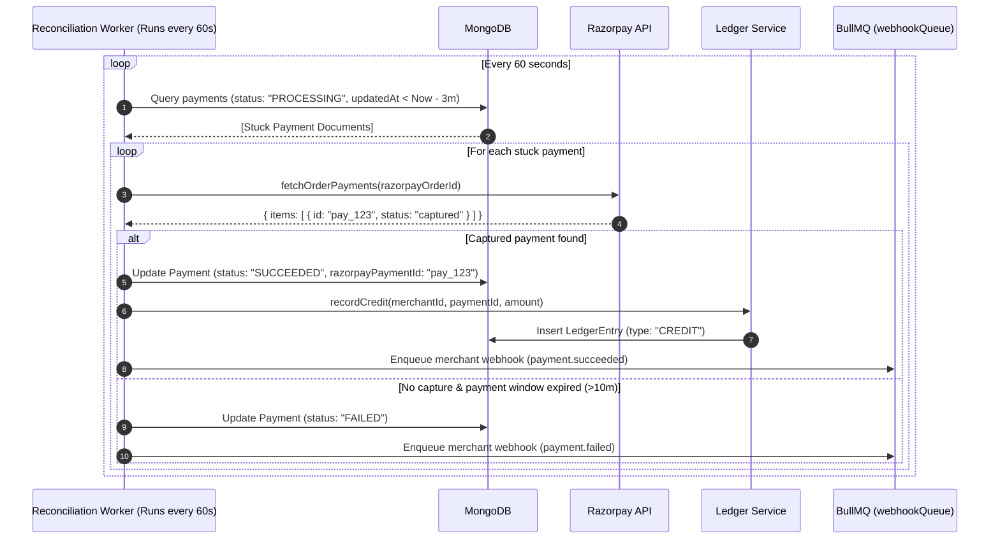
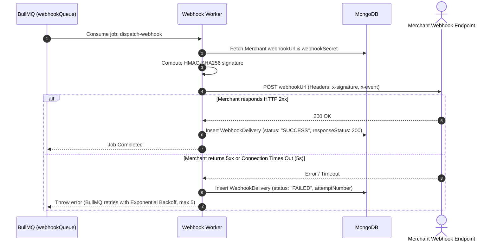
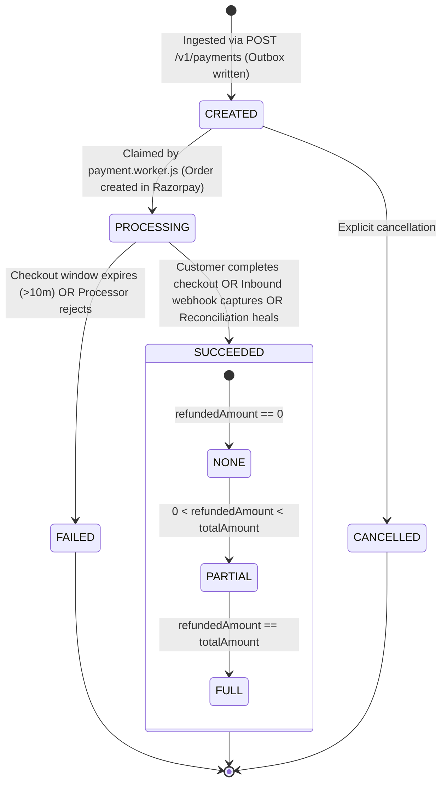
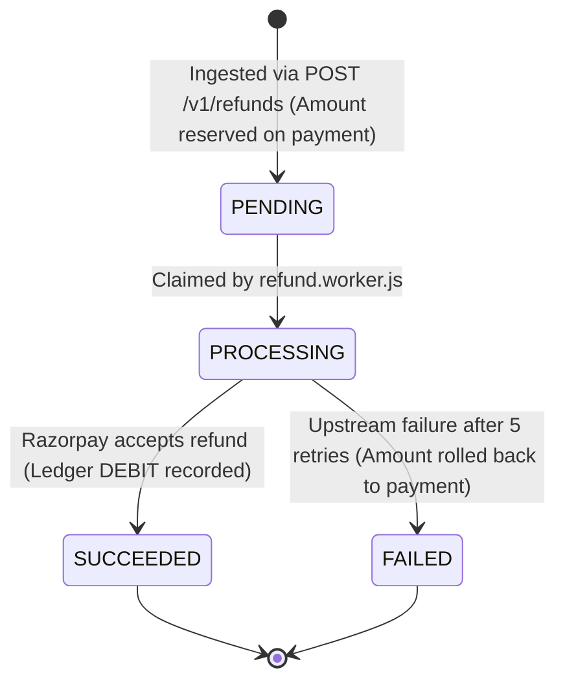

# 🏛️ Distributed Systems Architecture & Engineering Specification

> **An in-depth technical specification of the distributed failure handling, transactional guarantees, asynchronous processing, idempotency controls, and double-entry ledger mechanics powering the Event-Driven Payment Gateway.**

---

## 📑 Table of Contents

1. [Executive Summary & Mental Model](#1-executive-summary--mental-model)
2. [High-Level System Topology Diagram](#2-high-level-system-topology-diagram)
3. [The 7 Core Architectural Pillars](#3-the-7-core-architectural-pillars)
   - [Pillar 1: Two-Tier Distributed Idempotency](#pillar-1-two-tier-distributed-idempotency)
   - [Pillar 2: Transactional Outbox Pattern](#pillar-2-transactional-outbox-pattern)
   - [Pillar 3: Worker Concurrency & Atomic Task Claims](#pillar-3-worker-concurrency--atomic-task-claims)
   - [Pillar 4: Immutable Double-Entry Financial Ledger](#pillar-4-immutable-double-entry-financial-ledger)
   - [Pillar 5: Asynchronous Refund Engine with Compensating Rollbacks](#pillar-5-asynchronous-refund-engine-with-compensating-rollbacks)
   - [Pillar 6: Self-Healing Reconciliation Engine](#pillar-6-self-healing-reconciliation-engine)
   - [Pillar 7: Cryptographic Webhook Security (Inbound & Outbound)](#pillar-7-cryptographic-webhook-security-inbound--outbound)
4. [End-to-End Execution Sequence Diagrams](#4-end-to-end-execution-sequence-diagrams)
   - [Flow 1: Payment Ingestion & Fast API Return](#flow-1-payment-ingestion--fast-api-return)
   - [Flow 2: Outbox Polling & Upstream Order Creation](#flow-2-outbox-polling--upstream-order-creation)
   - [Flow 3: Customer Checkout & Cryptographic Signature Verification](#flow-3-customer-checkout--cryptographic-signature-verification)
   - [Flow 4: Inbound Webhook Processing](#flow-4-inbound-webhook-processing)
   - [Flow 5: Partial / Full Refund Lifecycle with Saga Rollback](#flow-5-partial--full-refund-lifecycle-with-saga-rollback)
   - [Flow 6: Autonomous Reconciliation Sweep](#flow-6-autonomous-reconciliation-sweep)
   - [Flow 7: Outbound Webhook Delivery with Exponential Backoff](#flow-7-outbound-webhook-delivery-with-exponential-backoff)
5. [State Machines & Entity Lifecycles](#5-state-machines--entity-lifecycles)
   - [Payment State Machine](#payment-state-machine)
   - [Refund State Machine](#refund-state-machine)
6. [Distributed Failure Modes & Disaster Recovery Matrix](#6-distributed-failure-modes--disaster-recovery-matrix)
7. [Codebase Reference Map](#7-codebase-reference-map)

---

## 1. Executive Summary & Mental Model

### The 3-Tier Mental Model
To understand this system on the first read, picture it as three distinct, loosely coupled layers operating asynchronously:

```
┌────────────────────────────────────────────────────────────────────────┐
│  TIER 1: FAST INGRESS GATEWAY (<50ms SLA)                              │
│  - Verifies merchant API keys against Redis in 1ms.                    │
│  - Acquires atomic Redis lock on Idempotency-Key.                      │
│  - Persists Payment (CREATED) + OutboxEvent (PENDING) in one DB write. │
│  - Immediately returns HTTP 201 Created to caller.                     │
└───────────────────────────────────┬────────────────────────────────────┘
                                    │ (Asynchronous Polling Relay)
┌───────────────────────────────────▼────────────────────────────────────┐
│  TIER 2: EVENT-DRIVEN RELAY & DISTRIBUTED QUEUES (BullMQ)              │
│  - Outbox Relay discovers PENDING events every 1.5s.                   │
│  - Enqueues jobs into Redis BullMQ with deterministic deduplication.   │
│  - Worker pools claim jobs atomically with processing locks.           │
│  - Communicates with upstream processor (Razorpay) via retries.        │
└───────────────────────────────────┬────────────────────────────────────┘
                                    │ (Verified Payment / Refund Success)
┌───────────────────────────────────▼────────────────────────────────────┐
│  TIER 3: IMMUTABLE DOUBLE-ENTRY LEDGER & RECONCILIATION                │
│  - Database driver rejects UPDATE and DELETE operations on entries.    │
│  - Balance is calculated dynamically: SUM(Credits) - SUM(Debits).      │
│  - Background sweeper heals lost or abandoned payments every 60s.      │
│  - Outbound webhooks dispatch HMAC-signed events to merchants.         │
└────────────────────────────────────────────────────────────────────────┘
```

### Why Naive Payment Gateways Fail
1. **Synchronous Upstream HTTP Calls**: Calling Stripe/Razorpay inside the API route ties up HTTP server threads. If the upstream takes 8 seconds or times out, the client crashes or retries, causing duplicate charges.
2. **Dual-Write Vulnerability**: Saving to a database and then calling a message queue are two separate operations. If the server crashes between them, the payment is orphaned forever.
3. **In-Place Balance Mutation**: Doing `merchant.balance += amount` destroys auditability. If a bug occurs, there is no way to mathematically prove why a balance is what it is.

---

## 2. High-Level System Topology Diagram



---

## 3. The 7 Core Architectural Pillars

### Pillar 1: Two-Tier Distributed Idempotency
- **Source Code**: [backend/src/middleware/idempotency.js](file:///d:/Backend/Backend%20Projects/Event-Driven%20Payment%20Gateway%20&%20Ledger%20Engine/backend/src/middleware/idempotency.js)
- **The Problem**: If a network glitch occurs after a merchant requests a payment, the merchant client retries. Without protection, two charges are created for the same customer.
- **The Solution**: Every mutating request requires an `Idempotency-Key` HTTP header. The engine uses Redis atomic primitives to guarantee exactly-once processing semantics:

```
Request with Idempotency-Key: "order_9988"
                     │
         Redis SET NX (120s TTL)
        ┌────────────┴────────────┐
   [Lock Acquired]          [Lock Failed]
        │                         │
  Execute Gateway          Inspect Redis Key
   Save to DB                     │
        │             ┌───────────┴───────────┐
 Cache response       │                       │
 state: COMPLETED     │                       │
 24h TTL (86400s)     ▼                       ▼
        │        State = "PROCESSING"    State = "COMPLETED"
 Return 201           │                       │
                 Return 409 Conflict     Replay original response
                 ("Request in-flight")   with header:
                                         x-idempotent-replay: true
```

#### Under the Hood:
```javascript
// 1. Atomic Lock Acquisition
const redisKey = `idempotency:${req.merchant._id}:${idempotencyKey}`;
const lockAcquired = await redisClient.set(
  redisKey,
  JSON.stringify({ state: "PROCESSING" }),
  "EX", 120, "NX"
);

// 2. Intercept response and cache for 24 hours
res.json = function (body) {
  redisClient.set(
    redisKey,
    JSON.stringify({ state: "COMPLETED", statusCode: res.statusCode, body }),
    "EX", 86400
  );
  return originalJson.call(this, body);
};
```

---

### Pillar 2: Transactional Outbox Pattern
- **Source Code**: [outbox.model.js](file:///d:/Backend/Backend%20Projects/Event-Driven%20Payment%20Gateway%20&%20Ledger%20Engine/backend/src/modules/payments/outbox.model.js), [outbox.relay.js](file:///d:/Backend/Backend%20Projects/Event-Driven%20Payment%20Gateway%20&%20Ledger%20Engine/backend/src/workers/outbox.relay.js)
- **The Problem**: "Dual-Write Vulnerability". If an API writes to MongoDB and then tries to publish directly to Redis/BullMQ, a power outage or restart between these two steps will cause the event to be permanently lost.
- **The Solution**: The controller persists the entity (`Payment`) and an `OutboxEvent` document in MongoDB. The HTTP request terminates cleanly in under 50ms. An autonomous Outbox Relay polls pending records and relays them to BullMQ:

```
[HTTP Request] ────────► MongoDB: Insert Payment + OutboxEvent (PENDING)
                                  │
                                  ▼
[Outbox Relay] ────────► Polls PENDING events (FIFO limit 20)
(Runs every 1.5s)                 │
                                  ├──► Pushes to BullMQ (Job ID: `pay_${paymentId}`)
                                  └──► Marks OutboxEvent: PROCESSED
```

#### Deduplication Guarantee:
Even if the relay crashes right after enqueueing, BullMQ uses deterministic job IDs (`jobId: pay_${paymentId}`). If an event is re-enqueued, BullMQ automatically ignores the duplicate.

---

### Pillar 3: Worker Concurrency & Atomic Task Claims
- **Source Code**: [payment.worker.js](file:///d:/Backend/Backend%20Projects/Event-Driven%20Payment%20Gateway%20&%20Ledger%20Engine/backend/src/workers/payment.worker.js)
- **The Problem**: Multiple worker instances running concurrently could pick up the same job and trigger redundant upstream processor API calls.
- **The Solution**: An atomic `findOneAndUpdate` state transition guarantees single-worker execution:

```javascript
const payment = await Payment.findOneAndUpdate(
  {
    _id: paymentId,
    status: "CREATED", // Atomic check: only claim if not yet taken
  },
  {
    status: "PROCESSING",
    processingLock: {
      workerId: `worker_${os.hostname()}_${process.pid}`,
      lockedAt: new Date(),
    },
  },
  { returnDocument: "after" }
);

if (!payment) return; // Another worker already claimed this task
```
- If Razorpay order creation succeeds, `razorpayOrderId` is saved and the lock is cleared.
- If it fails, `status` resets to `CREATED` and BullMQ's exponential backoff triggers a retry (up to 3 attempts).

---

### Pillar 4: Immutable Double-Entry Financial Ledger
- **Source Code**: [ledger.model.js](file:///d:/Backend/Backend%20Projects/Event-Driven%20Payment%20Gateway%20&%20Ledger%20Engine/backend/src/modules/ledger/ledger.model.js), [ledger.service.js](file:///d:/Backend/Backend%20Projects/Event-Driven%20Payment%20Gateway%20&%20Ledger%20Engine/backend/src/modules/ledger/ledger.service.js)
- **The Problem**: Traditional systems store a mutable balance (e.g. `merchant.balance = 5000`). If a database update fails mid-way, or concurrent threads update the balance at the same instant, money is lost or created out of thin air.
- **The Solution**: 
  1. **Zero Mutable State**: There is no balance column in the database.
  2. **Append-Only Journal**: Every monetary change is recorded as an immutable `CREDIT` or `DEBIT` entry.
  3. **Driver-Level Immutability Guard**: Any attempt to run an update or delete query throws an error immediately:

```javascript
// Strict Driver-Level Immutability Guard
ledgerEntrySchema.pre(
  ["updateOne", "updateMany", "findOneAndUpdate", "deleteOne", "deleteMany"],
  function () {
    throw new Error("LEDGER_IMMUTABILITY_VIOLATION: Ledger entries cannot be modified or deleted.");
  }
);
```

#### Real-Time Mathematical Balance Calculation:
When `/v1/ledger/balance` is requested, MongoDB computes the sum via an aggregation pipeline:

$$\text{Available Balance} = \sum \text{Credits} - \sum \text{Debits}$$

```javascript
const pipeline = [
  { $match: { merchantId: new mongoose.Types.ObjectId(merchantId) } },
  {
    $group: {
      _id: "$currency",
      totalCredits: { $sum: { $cond: [{ $eq: ["$type", "CREDIT"] }, "$amount", 0] } },
      totalDebits: { $sum: { $cond: [{ $eq: ["$type", "DEBIT"] }, "$amount", 0] } },
    },
  },
  {
    $project: {
      availableBalance: { $subtract: ["$totalCredits", "$totalDebits"] },
      totalCredits: 1,
      totalDebits: 1,
    },
  },
];
```

---

### Pillar 5: Asynchronous Refund Engine with Compensating Rollbacks
- **Source Code**: [refund.service.js](file:///d:/Backend/Backend%20Projects/Event-Driven%20Payment%20Gateway%20&%20Ledger%20Engine/backend/src/modules/refunds/refund.service.js), [refund.worker.js](file:///d:/Backend/Backend%20Projects/Event-Driven%20Payment%20Gateway%20&%20Ledger%20Engine/backend/src/workers/refund.worker.js)
- **The Problem**: A merchant issues two concurrent refund requests for ₹500 on a ₹800 payment. If not coordinated, both pass validation, refunding ₹1,000 (an overdraft). Furthermore, if the upstream bank rejects the refund, money must not be locked forever.
- **The Solution (Saga with Compensating Action)**:
  1. **Pre-Reservation**: During ingestion, the requested amount is atomically added to `payment.refundedAmount`. If `(refundedAmount + requested) > amount`, the request is immediately rejected.
  2. **Asynchronous Execution**: The Refund Worker invokes Razorpay's refund API with up to 5 exponential backoff retries.
  3. **Success**: An immutable **DEBIT** entry is recorded in the Ledger.
  4. **Compensating Rollback**: If Razorpay permanently rejects the refund after exhausting all 5 attempts:
     ```javascript
     // Compensating rollback restores the refundable balance
     await Payment.findByIdAndUpdate(refund.paymentId, {
       $inc: { refundedAmount: -refund.amount }
     });
     refund.status = "FAILED";
     await refund.save();
     ```

---

### Pillar 6: Self-Healing Reconciliation Engine
- **Source Code**: [reconciliation.worker.js](file:///d:/Backend/Backend%20Projects/Event-Driven%20Payment%20Gateway%20&%20Ledger%20Engine/backend/src/workers/reconciliation.worker.js)
- **The Problem**: In real-world e-commerce, a customer authorizes payment in Razorpay and closes the browser window before the checkout verification callback runs. If Razorpay's webhook is delayed or dropped, the payment is stuck in `PROCESSING` forever.
- **The Solution**: An autonomous sweeper runs every 60 seconds to detect and heal abandoned payments:

```
[Reconciliation Sweeper (Runs every 60s)]
                     │
   Find payments where:
   - status == "PROCESSING"
   - razorpayOrderId != null
   - updatedAt < (Now - 3 minutes)
                     │
   Query Razorpay API: fetchOrderPayments(razorpayOrderId)
                     │
      ┌──────────────┴──────────────┐
  [Captured Payment Found]    [No Capture Found]
      │                             │
  Update Payment -> SUCCEEDED       Was payment created > 10m ago?
  Append Ledger CREDIT              ┌───────┴───────┐
  Dispatch merchant webhook        Yes              No
                                    │               │
                            Update -> FAILED    Leave for next
                            Dispatch webhook       sweep
```

---

### Pillar 7: Cryptographic Webhook Security (Inbound & Outbound)
- **Source Code**: [razorpay.webhook.js](file:///d:/Backend/Backend%20Projects/Event-Driven%20Payment%20Gateway%20&%20Ledger%20Engine/backend/src/modules/webhooks/razorpay.webhook.js), [webhook.worker.js](file:///d:/Backend/Backend%20Projects/Event-Driven%20Payment%20Gateway%20&%20Ledger%20Engine/backend/src/workers/webhook.worker.js)

#### 1. Inbound Webhooks (From Razorpay to Gateway)
- Express JSON parser preserves the unparsed byte string buffer in `req.rawBody`.
- Middleware computes:
  $$\text{Expected Signature} = \text{HMAC-SHA256}(\text{req.rawBody}, \text{RAZORPAY\_WEBHOOK\_SECRET})$$
- If `expectedSignature !== req.headers["x-razorpay-signature"]`, the request is rejected with `400 Bad Request`.

#### 2. Outbound Webhooks (From Gateway to Merchants)
- Whenever a payment succeeds, fails, or refunds, a job is pushed to BullMQ's `webhookQueue`.
- The Webhook Worker generates an HMAC signature using the merchant's private `webhookSecret`:
  ```javascript
  const signature = crypto
    .createHmac("sha256", merchant.webhookSecret)
    .update(JSON.stringify(payload))
    .digest("hex");
  ```
- Posts to `merchant.webhookUrl` with headers:
  - `x-signature: sha256=<signature>`
  - `x-event: payment.succeeded`
- Delivery attempts, status codes, and latency are recorded in `webhookdeliveries` for audit logging. If the merchant server fails, BullMQ retries up to 5 times.

---

## 4. End-to-End Execution Sequence Diagrams

### Flow 1: Payment Ingestion & Fast API Return



---

### Flow 2: Outbox Polling & Upstream Order Creation



---

### Flow 3: Customer Checkout & Cryptographic Signature Verification



---

### Flow 4: Inbound Webhook Processing



---

### Flow 5: Partial / Full Refund Lifecycle with Saga Rollback



---

### Flow 6: Autonomous Reconciliation Sweep



---

### Flow 7: Outbound Webhook Delivery with Exponential Backoff



---

## 5. State Machines & Entity Lifecycles

### Payment State Machine



### Refund State Machine



---

## 6. Distributed Failure Modes & Disaster Recovery Matrix

| # | Failure Scenario | Exact Root Cause | Immediate Defense Mechanism | Recovery & Eventual Consistency |
| :---: | :--- | :--- | :--- | :--- |
| **1** | **User double-clicks "Pay"** | Latency hesitation or mobile retry | Redis atomic `SET NX` lock on `idempotency:<id>:<key>` | Returns HTTP `409 Conflict` if in-flight; returns cached HTTP `201` if already finished. |
| **2** | **Server crashes during payment write** | Power outage or container restart | Atomic MongoDB session write | MongoDB commits either both `Payment` and `OutboxEvent` or neither. No partial writes. |
| **3** | **Worker crashes while creating order** | Out of memory (OOM) or SIGKILL | Atomic document claim lock | BullMQ detects worker stall. `processingLock` timestamps allow lock reassignment. |
| **4** | **Customer drops internet after paying** | User closes browser on success screen | Reconciliation Sweeper | Sweeper queries Razorpay after 3 minutes, detects captured status, and records ledger credit. |
| **5** | **Merchant webhook endpoint crashes** | Merchant server maintenance (500/503) | BullMQ exponential backoff | Retries delivery 5 times: 3s, 6s, 12s, 24s, 48s. Every attempt is logged in MongoDB. |
| **6** | **Bug attempts to mutate past ledger entry** | Unauthorized code or database mutation | Mongoose pre-hook guard | Schema hooks intercept `updateOne`, `deleteMany`, etc., throwing `LEDGER_IMMUTABILITY_VIOLATION`. |
| **7** | **Processor rejects partial refund** | Card expired or bank account closed | Compensating Saga Rollback | Worker catches terminal failure, decrements `payment.refundedAmount`, and restores refundable balance. |
| **8** | **Redis restarts unexpectedly** | Redis memory flush or container reboot | MongoDB Source-of-Truth | BullMQ reconnects automatically. Outbox relay re-polls any pending events from MongoDB. |

---

## 7. Codebase Reference Map

Direct clickable links to implementation files in the repository:

| Functional Area | Source Code Link | Primary Role |
| :--- | :--- | :--- |
| **Server Entrypoint** | [app.js](file:///d:/Backend/Backend%20Projects/Event-Driven%20Payment%20Gateway%20&%20Ledger%20Engine/backend/src/app.js) | Express 5 setup, security headers, raw body parser, and route mounting |
| **Redis Singleton** | [redis.js](file:///d:/Backend/Backend%20Projects/Event-Driven%20Payment%20Gateway%20&%20Ledger%20Engine/backend/src/config/redis.js) | ioredis client configuration and connection event listeners |
| **Database Connection** | [db.js](file:///d:/Backend/Backend%20Projects/Event-Driven%20Payment%20Gateway%20&%20Ledger%20Engine/backend/src/config/db.js) | Mongoose replica set connection handler |
| **API Authentication** | [auth.js](file:///d:/Backend/Backend%20Projects/Event-Driven%20Payment%20Gateway%20&%20Ledger%20Engine/backend/src/middleware/auth.js) | `x-api-key` SHA-256 hashing and Redis caching (TTL 300s) |
| **Distributed Idempotency** | [idempotency.js](file:///d:/Backend/Backend%20Projects/Event-Driven%20Payment%20Gateway%20&%20Ledger%20Engine/backend/src/middleware/idempotency.js) | Atomic `SET NX` locks and 24-hour response replay |
| **Payment Ingestion** | [payment.controller.js](file:///d:/Backend/Backend%20Projects/Event-Driven%20Payment%20Gateway%20&%20Ledger%20Engine/backend/src/modules/payments/payment.controller.js) | Validates input, saves payment + outbox event (< 50ms response) |
| **Outbox Relay** | [outbox.relay.js](file:///d:/Backend/Backend%20Projects/Event-Driven%20Payment%20Gateway%20&%20Ledger%20Engine/backend/src/workers/outbox.relay.js) | Polls pending outbox records every 1.5s and enqueues to BullMQ |
| **Payment Worker** | [payment.worker.js](file:///d:/Backend/Backend%20Projects/Event-Driven%20Payment%20Gateway%20&%20Ledger%20Engine/backend/src/workers/payment.worker.js) | Claims jobs atomically, invokes Razorpay SDK, updates order ID |
| **Double-Entry Ledger Model** | [ledger.model.js](file:///d:/Backend/Backend%20Projects/Event-Driven%20Payment%20Gateway%20&%20Ledger%20Engine/backend/src/modules/ledger/ledger.model.js) | Blocks updates & deletes with `LEDGER_IMMUTABILITY_VIOLATION` |
| **Dynamic Balance Service** | [ledger.service.js](file:///d:/Backend/Backend%20Projects/Event-Driven%20Payment%20Gateway%20&%20Ledger%20Engine/backend/src/modules/ledger/ledger.service.js) | Aggregation pipeline calculating `SUM(Credits) - SUM(Debits)` |
| **Refund Engine & Saga** | [refund.worker.js](file:///d:/Backend/Backend%20Projects/Event-Driven%20Payment%20Gateway%20&%20Ledger%20Engine/backend/src/workers/refund.worker.js) | Pre-reserves balance, invokes processor, handles compensating rollback |
| **Reconciliation Sweeper** | [reconciliation.worker.js](file:///d:/Backend/Backend%20Projects/Event-Driven%20Payment%20Gateway%20&%20Ledger%20Engine/backend/src/workers/reconciliation.worker.js) | Sweeps stuck payments older than 3 minutes every 60 seconds |
| **Webhook Delivery Worker** | [webhook.worker.js](file:///d:/Backend/Backend%20Projects/Event-Driven%20Payment%20Gateway%20&%20Ledger%20Engine/backend/src/workers/webhook.worker.js) | Signs HMAC-SHA256 headers and executes HTTP POST with retries |
| **Hosted Checkout Portal** | [CheckoutPage.jsx](file:///d:/Backend/Backend%20Projects/Event-Driven%20Payment%20Gateway%20&%20Ledger%20Engine/frontend/src/pages/CheckoutPage.jsx) | Customer interface triggering the Razorpay Checkout Modal |
