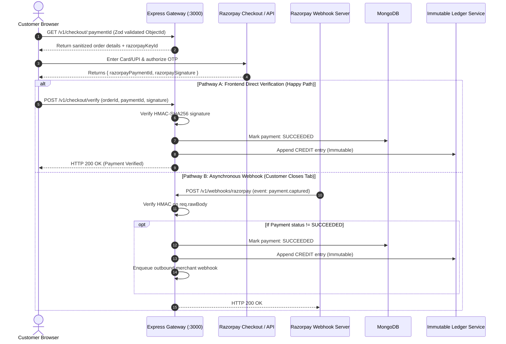

# 💳 Event-Driven Payment Gateway & Ledger Engine
> **High-Performance, Fault-Tolerant Distributed Payment & Double-Entry Accounting System**

---

## 📌 Executive Summary

This system acts as a resilient financial bridge between **Merchants**, **End Customers**, and **Upstream Banks (Razorpay)**. It handles mission-critical financial transactions with eight non-negotiable architectural guarantees:

1. **Sub-50ms API Latency**: Ingests requests instantly and offloads slow banking APIs to background queues.
2. **Zero Dual-Write Inconsistencies**: Uses the **Transactional Outbox Pattern** so database writes and event publishing never go out of sync.
3. **End-to-End Idempotency**: Prevents double-charging and duplicate refunds during network retries using Redis locks and response replays.
4. **Immutable Double-Entry Ledger**: Account balances are calculated via pure append-only math (`Credits - Debits`), with zero mutable balance columns.
5. **Self-Healing Dual-Phase Reconciliation**: Automatically recovers dropped payments and purges orphaned initializations if network breaks after OTP authorization.
6. **Zero-Trust SSRF Defense**: Prevents host pivoting and cloud metadata credential leaks (`169.254.169.254`) by validating all webhook URLs and redirect paths against RFC 1918 private subnets and DNS rebinding attacks.
7. **Type-Safe Contract Enforcement**: Centralized Zod schema validation layer rigorously guards `params`, `query`, and `body` before request execution.
8. **Terminal Poison Job Containment**: BullMQ retry exhaustion triggers automated compensation rollbacks and explicit terminal failure states (`FAILED`) rather than infinite loops.

---

## 🛠️ Technology Stack

| Layer | Technology | Key Responsibility |
| :--- | :--- | :--- |
| **API Gateway** | Node.js (ESM) + Express 5 | Async REST ingress, sub-50ms response SLA, centralized error handling |
| **Validation Layer** | Zod v3 | Schema definition, type coercion, ObjectId validation, structured RFC 7807 error formatting |
| **Network Security** | Custom SSRF Guard (`node:dns`, `node:net`) | RFC 1918/3927 private IP filtering, DNS rebinding checks, protocol gating |
| **Database** | MongoDB 7 (Replica Set) | ACID multi-document transactions, durable document store |
| **Cache & Distributed Locks** | Redis 7 (ioredis) | SHA-256 API key caching, atomic `SET NX` locks, 24h idempotent replays |
| **Job Queue & Workers** | BullMQ 6 | Distributed FIFO queues, exponential backoff retries, terminal failure handling |
| **Payment Processor** | Razorpay SDK | Upstream banking processor for order creation, capture, and refunds |
| **Automated Testing** | Vitest 5 | 55 isolated unit tests across security, SSRF, validation, ledger, and sagas |
| **Observability** | Prometheus + Grafana | Live PromQL metrics (`/metrics`), outbox lag, queue depth gauges, dashboards |
| **Frontend UI** | React 18 + Vite + Tailwind | Merchant dashboard, customer checkout modal, live ledger viewer |

---

## 🏗️ High-Level System Architecture

```mermaid
flowchart TB
    subgraph Ingress["1. Ingress Clients"]
        Merchant["Merchant Client\n(Headers: x-api-key, Idempotency-Key)"]
        Customer["Customer Browser\n(Hosted Checkout UI)"]
        RazorpayHooks["Razorpay Webhook Servers\n(payment.captured, order.paid)"]
    end

    subgraph Gateway["2. Express 5 Gateway Layer (:3000)"]
        Router["Express Router (/v1/*)"]
        RawBodyMid["Raw Body Buffer Parser\n(Preserves bytes for HMAC)"]
        ZodMid["Zod Validation Middleware\n(params, query, body)"]
        AuthMid["Auth Middleware\n(SHA-256 Hash + Redis Cache)"]
        IdempMid["Idempotency Middleware\n(Redis SET NX + 24h Replay)"]
        SSRFGuard["SSRF Guard\n(DNS & Private IP Filter)"]
    end

    subgraph Memory["3. Redis 7 (In-Memory)"]
        AuthCache[("Auth Cache\nauth:merchant:hash")]
        IdempStore[("Idempotency Lock\nidempotency:merchant:key")]
        BullQueues[("BullMQ Queues\n- payment-process\n- refund-processing\n- webhook-delivery")]
    end

    subgraph Storage["4. MongoDB 7 (ACID Replica Set)"]
        DBPayments[("payments\n(CREATED, PROCESSING, SUCCEEDED, FAILED)")]
        DBOutbox[("outboxevents\n(PENDING, PROCESSED)")]
        DBRefunds[("refunds\n(PENDING, PROCESSING, SUCCEEDED, FAILED)")]
        DBLedger[("ledgerentries\n(IMMUTABLE: Append-Only)")]
    end

    subgraph Workers["5. Asynchronous Background Engines"]
        Relay["Outbox Relay\n(Polls every 1.5s)"]
        PayWorker["Payment Worker\n(Concurrency: 5, Terminal Failures)"]
        RefWorker["Refund Worker\n(Concurrency: 5, Saga Rollback)"]
        ReconSweeper["Reconciliation Sweeper\n(Dual-Phase: Stuck & Orphans)"]
        WebWorker["Webhook Worker\n(Concurrency: 10, SSRF Guarded)"]
    end

    subgraph External["6. Upstream Bank API"]
        RazorpayAPI["Razorpay Payment Gateway"]
    end

    %% Ingress connections
    Merchant -->|"POST /v1/payments"| Router
    Customer -->|"GET/POST /v1/checkout/*"| Router
    RazorpayHooks -->|"POST /v1/webhooks/razorpay"| Router

    Router --> RawBodyMid --> ZodMid --> AuthMid
    AuthMid -.->|"1ms Cache Hit"| AuthCache
    AuthMid --> IdempMid
    IdempMid -.->|"SET NX / Replay"| IdempStore
    IdempMid -->|"ACID Transaction Write"| Storage

    %% Outbox & Workers
    Relay -->|"Poll PENDING"| DBOutbox
    Relay -->|"Enqueue Job"| BullQueues
    BullQueues -->|"Claim Job"| PayWorker
    BullQueues -->|"Claim Job"| RefWorker
    BullQueues -->|"Claim Job"| WebWorker

    PayWorker -->|"orders.create()"| RazorpayAPI
    RefWorker -->|"payments.refund()"| RazorpayAPI
    ReconSweeper -->|"Verify stuck payments"| RazorpayAPI

    PayWorker -->|"Update status / Terminal FAILED"| DBPayments
    RefWorker -->|"Append DEBIT / Compensate Rollback"| Storage
    ReconSweeper -->|"Append CREDIT / Fail Or    WebWorker --> SSRFGuard
    WebWorker -->|"Signed POST"| Merchant
```

---

## 🔄 End-to-End Project Flows

### 1. Payment Creation Flow (<50ms SLA)
When a merchant creates a payment, the API never calls Razorpay synchronously. It validates input, saves locally, commits an outbox event, and offloads processing to the background.

```
[Merchant Client] 
   │  1. POST /v1/payments (Headers: x-api-key, Idempotency-Key)
   ▼
[Express 5 Gateway]
   │  2. Zod Schema Validation (validate(createPaymentSchema): bounds, minor units, email)
   │  3. SHA-256 API Key check (Redis In-Memory Cache ~1ms)
   │  4. Acquire Distributed Idempotency Lock (Redis SET NX, 120s TTL)
   ▼
[MongoDB ACID Multi-Document Transaction]
   ├── Inserts: Payment (status: "CREATED", amount, currency, merchantId)
   └── Inserts: OutboxEvent (status: "PENDING", aggregateId: payment._id)
   ▼
[Express 5 Gateway] ──► Returns HTTP 201 Created (<50ms SLA) with paymentId
   │
   ▼ (Autonomous 1.5s Background Relay)
[Outbox Relay Worker]
   ├── Finds PENDING OutboxEvents with deterministic indexing
   ├── Enqueues job to BullMQ paymentQueue (jobId: pay_<id>)
   └── Marks OutboxEvent as PROCESSED
   ▼
[Payment Worker (Concurrency: 5)]
   ├── Atomically claims payment (status: "CREATED" ➔ "PROCESSING", processingLock)
   ├── Calls Razorpay SDK: orders.create({ amount, currency, receipt })
   ├── Success: Saves razorpayOrderId in Payment record
   └── On Failure / Exhaustion:
         - If attemptsMade < maxAttempts: Reverts status to "CREATED" for exponential backoff
         - If attemptsMade >= maxAttempts: Atomically marks "FAILED", releases locks,
           and enqueues terminal "payment.failed" merchant webhook
```

---

### 2. Customer Checkout & Dual Verification (Zero Dropped Payments)
The system supports **two parallel paths** to confirm payments. Even if the customer closes the browser, the webhook catches it.



---

### 3. Asynchronous Refund Lifecycle (Saga Pattern & Compensating Rollback)
Refunds protect against balance overdrafts using **atomic mathematical pre-reservation** and **compensating rollback**.

```
[Merchant Client] ──► POST /v1/refunds (Idempotency-Key, paymentId, amount)
                            │
                            ▼
               [Zod Request Validation]
               (validate(createRefundSchema): paymentId, amount > 0, reason)
                            │
                            ▼
              [Atomic Pre-Reservation Guard]
              MongoDB Session Transaction:
              Payment.findOneAndUpdate(
                { _id: id, status: "SUCCEEDED", refundedAmount + requested <= amount },
                { $inc: { refundedAmount: requested } }
              )
              *If limit exceeded -> Immediately rejects with 400 Bad Request*
                            │
                            ├── Inserts: Refund (status: "PENDING")
                            └── Enqueues: BullMQ refundQueue
                            │
                            ▼
                     [Refund Worker]
                Atomically claims refund (PENDING -> PROCESSING)
                Calls Razorpay SDK: payments.refund()
                            │
               ┌────────────┴────────────┐
               ▼                         ▼
          [SUCCESS]                 [FAILURE after 5 Retries or Fatal Error]
          - Refund: "SUCCEEDED"     - Refund: "FAILED" (logs failureReason)
          - Ledger: Append DEBIT    - Compensating Rollback:
          - Webhook: refund.succeeded   $inc: { refundedAmount: -requested }
                                    - Webhook: refund.failed
```

---

### 4. Self-Healing Dual-Phase Reconciliation Sweeper
Handles edge cases where network drops occur between bank capture and gateway notification. Operates continuously every 60 seconds:

```
[Cron Timer (Every 60s)]
         │
         ▼
[Reconciliation Worker: Dual-Phase Sweep]
         │
         ├─────────────────────────────────────────┐
         ▼                                         ▼
[Phase 1: Stuck PROCESSING Payments]      [Phase 2: Orphaned Incomplete Orders]
Find payments where:                      Find payments where:
- status == "PROCESSING"                  - status in ["CREATED", "PROCESSING"]
- razorpayOrderId is NOT null             - razorpayOrderId is null
- updatedAt < (Now - 3 minutes)           - updatedAt < (Now - 10 minutes)
         │                                         │
         ▼                                         ▼
Query Razorpay API: fetchOrderPayments   Mark payment: "FAILED"
         │                               Release processingLock
    ┌────┴──────────────────────────┐    Enqueue "payment.failed" webhook
    ▼                               ▼
[Captured Payment Found]       [No Payment Found]
- Set status = SUCCEEDED       - If stuck > 10m:
- Record Ledger CREDIT             Set status = FAILED
- Enqueue merchant webhook     - Else: Wait for next sweep
```

---

### 5. Outbound Merchant Webhook Delivery (SSRF Guarded)
When an event (`payment.succeeded`, `payment.failed`, `refund.succeeded`, `refund.failed`) triggers:
1. **Worker picks up job** from `webhookQueue` (Concurrency: 10).
2. **SSRF Pre-Flight Validation**: `validateWebhookUrl(merchant.webhookUrl)` validates URL scheme, strips credentials, resolves hostname via `dns.lookup`, and rejects RFC 1918 / RFC 3927 private IPs.
3. **Computes Cryptographic Signature**:
   $$\text{x-signature} = \text{HMAC-SHA256}(\text{JSON.stringify(payload)}, \text{merchant.webhookSecret})$$
4. **Dispatches POST Request** with strict 5-second timeout (`AbortSignal.timeout(5000)`).
5. **Audit Log & Exponential Backoff**: Logs delivery attempt in `webhookdeliveries`. On network failure, retries up to 5 times with exponential backoff (3s, 6s, 12s, 24s, 48s).

---

## 🧩 8 Core Engineering Mechanisms

### 1. Transactional Outbox Pattern (Dual-Write Solution)
* **File**: [payment.controller.js](file:///d:/Backend/Backend%20Projects/Event-Driven%20Payment%20Gateway%20&%20Ledger%20Engine/backend/src/modules/payments/payment.controller.js), [outbox.relay.js](file:///d:/Backend/Backend%20Projects/Event-Driven%20Payment%20Gateway%20&%20Ledger%20Engine/backend/src/workers/outbox.relay.js)
* **Problem**: Calling a message queue after a database write can fail if the app crashes between the two steps, losing the message forever.
* **Solution**: Write both `Payment` and `OutboxEvent` within a single MongoDB ACID transaction. The background `outbox.relay.js` polls `PENDING` events every 1.5s and reliably pushes them to BullMQ using deterministic job IDs (`pay_<id>`).

### 2. Two-Tier Distributed Idempotency
* **File**: [idempotency.js](file:///d:/Backend/Backend%20Projects/Event-Driven%20Payment%20Gateway%20&%20Ledger%20Engine/backend/src/middleware/idempotency.js)
* **Problem**: Network retries from clients could cause duplicate charges.
* **Solution**:
  1. **Locking (In-Flight)**: `SET idempotency:<merchantId>:<key> {"state":"PROCESSING"} EX 120 NX`. If the key exists, returns `409 Conflict`.
  2. **Replay (Completed)**: When the request finishes, the response body and status code are cached for 24 hours. Retries return the cached response with `x-idempotent-replay: true`.

### 3. Immutable Double-Entry Ledger
* **File**: [ledger.model.js](file:///d:/Backend/Backend%20Projects/Event-Driven%20Payment%20Gateway%20&%20Ledger%20Engine/backend/src/modules/ledger/ledger.model.js), [ledger.service.js](file:///d:/Backend/Backend%20Projects/Event-Driven%20Payment%20Gateway%20&%20Ledger%20Engine/backend/src/modules/ledger/ledger.service.js)
* **Problem**: Updating a mutable column like `merchant.balance += 500` is vulnerable to race conditions and leaves no audit trail.
* **Solution**:
  - Balances are **never stored as numbers**. They are calculated on-the-fly via MongoDB aggregation:
    $$\text{Balance} = \sum \text{Credits} - \sum \text{Debits}$$
  - Driver-level guards throw `LEDGER_IMMUTABILITY_VIOLATION` on any `updateOne` or `deleteOne`.
  - Partial unique indexes guarantee only **1 CREDIT per payment** and **1 DEBIT per refund**.

### 4. Distributed Saga with Compensating Rollbacks
* **File**: [refund.service.js](file:///d:/Backend/Backend%20Projects/Event-Driven%20Payment%20Gateway%20&%20Ledger%20Engine/backend/src/modules/refunds/refund.service.js), [refund.worker.js](file:///d:/Backend/Backend%20Projects/Event-Driven%20Payment%20Gateway%20&%20Ledger%20Engine/backend/src/workers/refund.worker.js)
* **Problem**: Distributed transactions cannot span external bank APIs. If Razorpay rejects a refund, reserved funds cannot remain locked.
* **Solution**: The gateway pre-reserves the refund amount atomically. If Razorpay permanently fails after 5 retries, the worker executes a compensating rollback: `$inc: { refundedAmount: -refund.amount }`.

### 5. Atomic Claim Locks in Workers
* **File**: [payment.worker.js](file:///d:/Backend/Backend%20Projects/Event-Driven%20Payment%20Gateway%20&%20Ledger%20Engine/backend/src/workers/payment.worker.js), [refund.worker.js](file:///d:/Backend/Backend%20Projects/Event-Driven%20Payment%20Gateway%20&%20Ledger%20Engine/backend/src/workers/refund.worker.js)
* **Problem**: Multiple concurrent worker instances could pull the same job and place duplicate orders in Razorpay.
* **Solution**: Workers use atomic state transitions:
  ```javascript
  const payment = await Payment.findOneAndUpdate(
    { _id: paymentId, status: "CREATED" },
    { status: "PROCESSING", processingLock: { workerId, lockedAt: new Date() } },
    { returnDocument: "after" }
  );
  if (!payment) return; // Another worker already claimed the task
  ```

### 6. Enterprise Zero-Trust SSRF Defense Layer
* **File**: [ssrfValidator.js](file:///d:/Backend/Backend%20Projects/Event-Driven%20Payment%20Gateway%20&%20Ledger%20Engine/backend/src/utils/ssrfValidator.js)
* **Problem**: Outbound webhooks and customer redirect URLs allow malicious callers to target internal services (`127.0.0.1:6379`, `169.254.169.254` AWS IMDS metadata).
* **Solution**:
  - Rejects loopback addresses (`127.0.0.0/8`, `::1`), private networks (`10.0.0.0/8`, `172.16.0.0/12`, `192.168.0.0/16`), and link-local subnets (`169.254.0.0/16`).
  - Pre-flight DNS resolution before dispatch to neutralize DNS rebinding attacks.
  - Rejects embedded URL credentials and restricts protocols to `https:` (production) and `http:` (local dev).

### 7. Centralized Type-Safe Schema Validation (Zod)
* **File**: [validate.middleware.js](file:///d:/Backend/Backend%20Projects/Event-Driven%20Payment%20Gateway%20&%20Ledger%20Engine/backend/src/middleware/validate.middleware.js), [validations/index.js](file:///d:/Backend/Backend%20Projects/Event-Driven%20Payment%20Gateway%20&%20Ledger%20Engine/backend/src/validations/index.js)
* **Problem**: Unvalidated types or malicious payloads crash backend controllers or cause subtle MongoDB cast errors.
* **Solution**:
  - Strict middleware validation of `req.body`, `req.query`, and `req.params`.
  - Reusable schemas for 24-char ObjectIds, pagination bounds, email addresses, and minor-unit amounts.
  - Normalized RFC-compliant `400 Bad Request` responses with exact field error arrays.

### 8. Terminal Poison Job Containment & Orphan Cleanup
* **File**: [payment.worker.js](file:///d:/Backend/Backend%20Projects/Event-Driven%20Payment%20Gateway%20&%20Ledger%20Engine/backend/src/workers/payment.worker.js), [reconciliation.worker.js](file:///d:/Backend/Backend%20Projects/Event-Driven%20Payment%20Gateway%20&%20Ledger%20Engine/backend/src/workers/reconciliation.worker.js)
* **Problem**: Jobs failing permanently cycle through retries endlessly, locking payments in indefinite `PROCESSING` states.
* **Solution**:
  - Workers detect `attemptsMade >= maxAttempts`, mark entity `FAILED`, persist explicit `failureReason`, and unlock concurrency locks.
  - Dual-phase reconciliation sweeper purges orphaned orders older than 10 minutes.

---

## 🧪 Automated Testing Architecture (Vitest)

The engine features an isolated, zero-network-dependency unit test suite executed via Vitest. The test matrix comprises **55 automated test assertions** running in **< 1.5 seconds**:

```
backend/tests/unit/
├── validation.test.js      # 19 tests: Zod schemas, ObjectId rules, RFC error formatting
├── security.test.js        # 9 tests: SSRF private IP blocking, DNS rebinding, HMAC signatures
├── middleware.test.js      # 14 tests: API key SHA-256 caching, Redis SET NX distributed locks
├── ledger.test.js          # 7 tests: Append-only immutability, aggregation balance calculations
└── refund.test.js          # 6 tests: Pre-reservation boundary guards, saga compensating rollbacks
```

### Key Verification Guarantees
1. **SSRF Blocking**: Verified against `127.0.0.1`, `10.0.0.1`, `192.168.1.1`, `169.254.169.254`, `localhost`, and internal domain resolutions.
2. **Double-Entry Invariant**: Verifies mathematical invariant $\sum \text{Credits} - \sum \text{Debits}$ and blocks `updateOne` / `deleteOne` with `LEDGER_IMMUTABILITY_VIOLATION`.
3. **Idempotency Replay**: Validates that concurrent identical calls yield `409 Conflict`, while completed requests replay cached responses with `x-idempotent-replay: true`.
4. **Saga Recovery**: Validates automatic balance reversal upon simulated bank processor decline.

---

## 📊 Database Schema & Key Collections

```
┌────────────────────────────┐         ┌────────────────────────────┐
│         merchants          │         │          payments          │
├────────────────────────────┤         ├────────────────────────────┤
│ _id: ObjectId              │◄────────┤ merchantId: ObjectId       │
│ apiKeyHash: String (Unique)│         │ amount: Number (paise)     │
│ webhookUrl: String         │         │ currency: String ("INR")   │
│ webhookSecret: String      │         │ status: CREATED|PROCESSING │
└────────────────────────────┘         │         SUCCEEDED|FAILED   │
                                       │ razorpayOrderId: String    │
                                       │ refundedAmount: Number     │
                                       └──────────────┬─────────────┘
                                                      │
         ┌────────────────────────────────────────────┴───────────────────────────┐
         ▼                                                                        ▼
┌────────────────────────────┐                                  ┌────────────────────────────┐
│        outboxevents        │                                  │          refunds           │
├────────────────────────────┤                                  ├────────────────────────────┤
│ _id: ObjectId              │                                  │ _id: ObjectId              │
│ aggregateId: String        │                                  │ paymentId: ObjectId        │
│ eventType: String          │                                  │ amount: Number             │
│ status: PENDING|PROCESSED  │                                  │ status: PENDING|PROCESSING │
│ Index: {status, createdAt} │                                  │         SUCCEEDED|FAILED   │
└────────────────────────────┘                                  └─────────────┬──────────────┘
                                                                              │
                                ┌─────────────────────────────────────────────┘
                                ▼
┌───────────────────────────────────────────────────────────────┐
│                         ledgerentries                         │
├───────────────────────────────────────────────────────────────┤
│ _id: ObjectId                                                 │
│ merchantId: ObjectId                                          │
│ paymentId: ObjectId                                           │
│ refundId: ObjectId (Optional)                                 │
│ type: "CREDIT" | "DEBIT"                                      │
│ amount: Number                                                │
│ createdAt: Date (Immutable, no updatedAt)                     │
│ Unique Index: { paymentId: 1, type: 1 } (type=CREDIT)         │
│ Unique Index: { refundId: 1, type: 1 } (refundId != null)     │
└───────────────────────────────────────────────────────────────┘
```

---

## 📁 Project Directory & Key Files

| Module / Path | File | Primary Responsibility |
| :--- | :--- | :--- |
| **Server & Ingress** | [app.js](file:///d:/Backend/Backend%20Projects/Event-Driven%20Payment%20Gateway%20&%20Ledger%20Engine/backend/src/app.js) | Server boot, DB/Redis setup, routes mounting, Graceful Shutdown |
| | [auth.js](file:///d:/Backend/Backend%20Projects/Event-Driven%20Payment%20Gateway%20&%20Ledger%20Engine/backend/src/middleware/auth.js) | SHA-256 API Key verification with 300s Redis cache |
| | [idempotency.js](file:///d:/Backend/Backend%20Projects/Event-Driven%20Payment%20Gateway%20&%20Ledger%20Engine/backend/src/middleware/idempotency.js) | Redis `SET NX` in-flight lock (120s) + cached response replay (24h) |
| | [validate.middleware.js](file:///d:/Backend/Backend%20Projects/Event-Driven%20Payment%20Gateway%20&%20Ledger%20Engine/backend/src/middleware/validate.middleware.js) | Zod request validation wrapper for `params`, `query`, and `body` |
| | [validations/index.js](file:///d:/Backend/Backend%20Projects/Event-Driven%20Payment%20Gateway%20&%20Ledger%20Engine/backend/src/validations/index.js) | Centralized Zod schemas & ObjectId regex rules |
| | [ssrfValidator.js](file:///d:/Backend/Backend%20Projects/Event-Driven%20Payment%20Gateway%20&%20Ledger%20Engine/backend/src/utils/ssrfValidator.js) | RFC 1918 / RFC 3927 private IP and DNS rebinding protector |
| **Payments** | [payment.controller.js](file:///d:/Backend/Backend%20Projects/Event-Driven%20Payment%20Gateway%20&%20Ledger%20Engine/backend/src/modules/payments/payment.controller.js) | Ingests payment + writes Outbox record in ACID transaction |
| | [payment.worker.js](file:///d:/Backend/Backend%20Projects/Event-Driven%20Payment%20Gateway%20&%20Ledger%20Engine/backend/src/workers/payment.worker.js) | BullMQ worker: creates Razorpay order asynchronously + terminal failure guard |
| **Checkout & Webhooks** | [checkout.controller.js](file:///d:/Backend/Backend%20Projects/Event-Driven%20Payment%20Gateway%20&%20Ledger%20Engine/backend/src/modules/checkout/checkout.controller.js) | Public checkout session & direct HMAC signature verification |
| | [razorpay.webhook.js](file:///d:/Backend/Backend%20Projects/Event-Driven%20Payment%20Gateway%20&%20Ledger%20Engine/backend/src/modules/webhooks/razorpay.webhook.js) | Handles inbound Razorpay `payment.captured` webhooks |
| **Ledger** | [ledger.service.js](file:///d:/Backend/Backend%20Projects/Event-Driven%20Payment%20Gateway%20&%20Ledger%20Engine/backend/src/modules/ledger/ledger.service.js) | Records CREDIT/DEBIT; calculates live balance via aggregation |
| | [ledger.model.js](file:///d:/Backend/Backend%20Projects/Event-Driven%20Payment%20Gateway%20&%20Ledger%20Engine/backend/src/modules/ledger/ledger.model.js) | Prevents updates/deletes with `LEDGER_IMMUTABILITY_VIOLATION` |
| **Refunds** | [refund.service.js](file:///d:/Backend/Backend%20Projects/Event-Driven%20Payment%20Gateway%20&%20Ledger%20Engine/backend/src/modules/refunds/refund.service.js) | Pre-reserves balance atomically; dispatches refund job |
| | [refund.worker.js](file:///d:/Backend/Backend%20Projects/Event-Driven%20Payment%20Gateway%20&%20Ledger%20Engine/backend/src/workers/refund.worker.js) | Executes Razorpay refund; triggers compensating rollback on failure |
| **Relays & Cron** | [outbox.relay.js](file:///d:/Backend/Backend%20Projects/Event-Driven%20Payment%20Gateway%20&%20Ledger%20Engine/backend/src/workers/outbox.relay.js) | Polls `PENDING` outbox records every 1.5s & pushes to BullMQ |
| | [reconciliation.worker.js](file:///d:/Backend/Backend%20Projects/Event-Driven%20Payment%20Gateway%20&%20Ledger%20Engine/backend/src/workers/reconciliation.worker.js) | Dual-phase auto-heal: Stuck processing payments & orphaned orders |
| | [webhook.worker.js](file:///d:/Backend/Backend%20Projects/Event-Driven%20Payment%20Gateway%20&%20Ledger%20Engine/backend/src/workers/webhook.worker.js) | Signs HMAC and delivers outbound webhooks with SSRF guard |
| **Testing** | [vitest.config.js](file:///d:/Backend/Backend%20Projects/Event-Driven%20Payment%20Gateway%20&%20Ledger%20Engine/backend/vitest.config.js) | Vitest test runner configuration |
| | [validation.test.js](file:///d:/Backend/Backend%20Projects/Event-Driven%20Payment%20Gateway%20&%20Ledger%20Engine/backend/tests/unit/validation.test.js) | Request validation & error response unit tests (19 tests) |
| | [security.test.js](file:///d:/Backend/Backend%20Projects/Event-Driven%20Payment%20Gateway%20&%20Ledger%20Engine/backend/tests/unit/security.test.js) | SSRF defense & HMAC signature tests (9 tests) |
| | [middleware.test.js](file:///d:/Backend/Backend%20Projects/Event-Driven%20Payment%20Gateway%20&%20Ledger%20Engine/backend/tests/unit/middleware.test.js) | Auth caching & idempotency lock tests (14 tests) |
| | [ledger.test.js](file:///d:/Backend/Backend%20Projects/Event-Driven%20Payment%20Gateway%20&%20Ledger%20Engine/backend/tests/unit/ledger.test.js) | Double-entry accounting & immutability tests (7 tests) |
| | [refund.test.js](file:///d:/Backend/Backend%20Projects/Event-Driven%20Payment%20Gateway%20&%20Ledger%20Engine/backend/tests/unit/refund.test.js) | Saga compensation & refund limits tests (6 tests) |

---

## ⚡ Quick Verification Commands (cURL & Tests)

#### 1. Run Automated Unit Tests (55 Tests)
```bash
cd backend
npm test
```
*Executes all 55 tests in under 1.5 seconds.*

#### 2. Register a Merchant (SSRF Validated)
```bash
curl -X POST http://localhost:3000/v1/merchants \
  -H "Content-Type: application/json" \
  -d '{"name": "Demo Store", "email": "store@example.com", "webhookUrl": "https://webhook.site/test"}'
```
*Saves and prints `apiKey` and `webhookSecret`.*

#### 3. Create Payment (<50ms SLA, Zod Validated)
```bash
curl -X POST http://localhost:3000/v1/payments \
  -H "Content-Type: application/json" \
  -H "x-api-key: <API_KEY>" \
  -H "Idempotency-Key: order_tx_001" \
  -d '{"amount": 50000, "currency": "INR", "customerEmail": "user@example.com"}'
```

#### 4. Test Idempotency Replay
Re-run the exact command above with the same `Idempotency-Key`.
*Notice header `x-idempotent-replay: true` and identical instantaneous response.*

#### 5. Check Real-Time Ledger Balance
```bash
curl -X GET http://localhost:3000/v1/ledger/balance \
  -H "x-api-key: <API_KEY>"
```
*Returns live computed balance (`Credits - Debits`).*

#### 6. Check Prometheus Observability Metrics
```bash
curl -X GET http://localhost:3000/metrics
```
*Returns real-time queue depths, latency histograms, and outbox lag gauges.*
