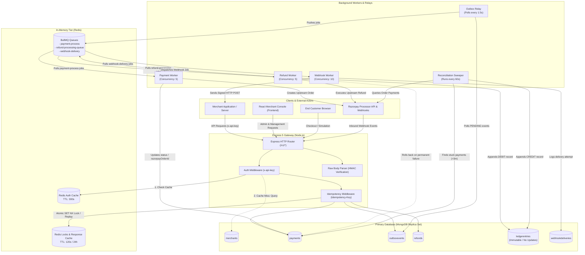
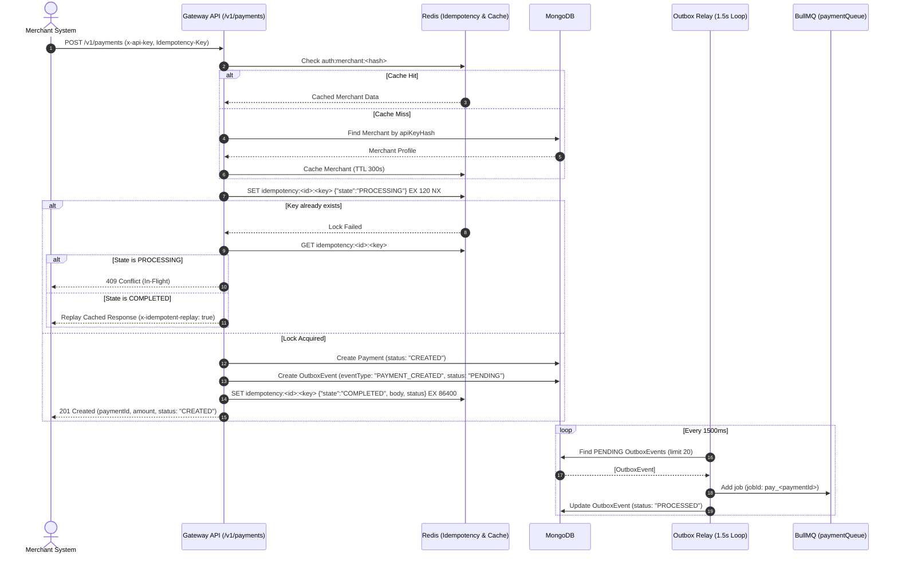
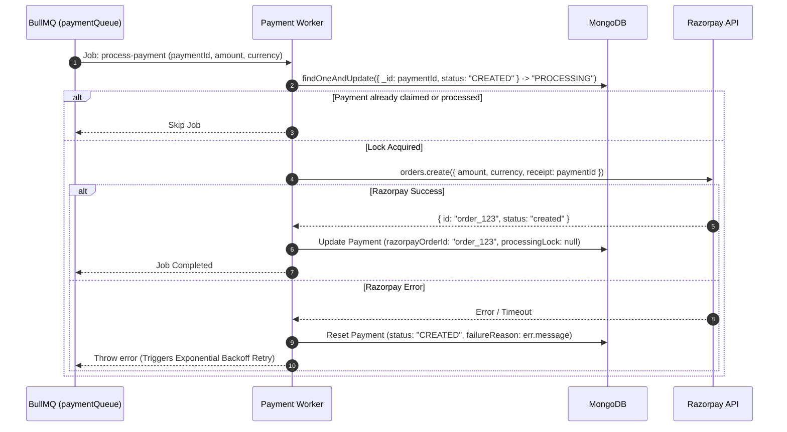
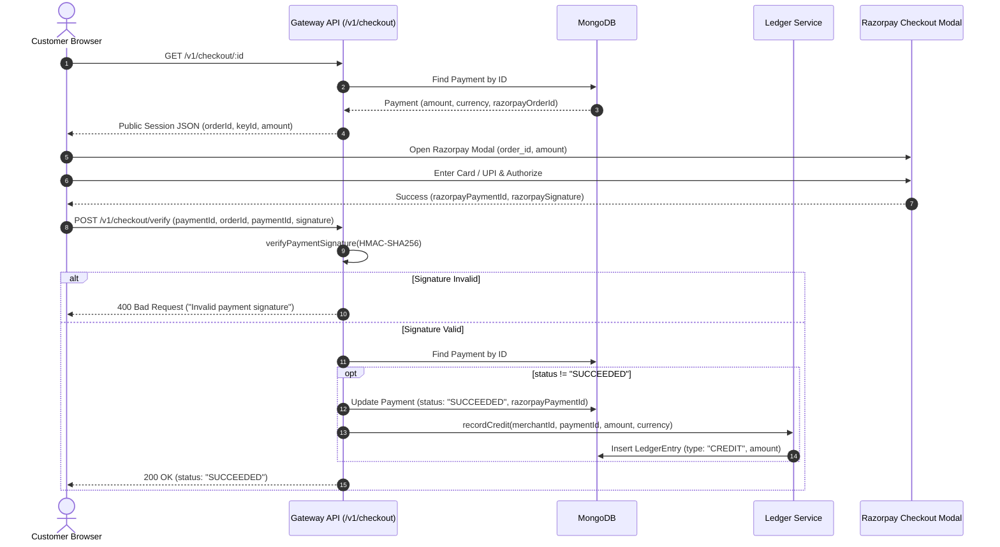
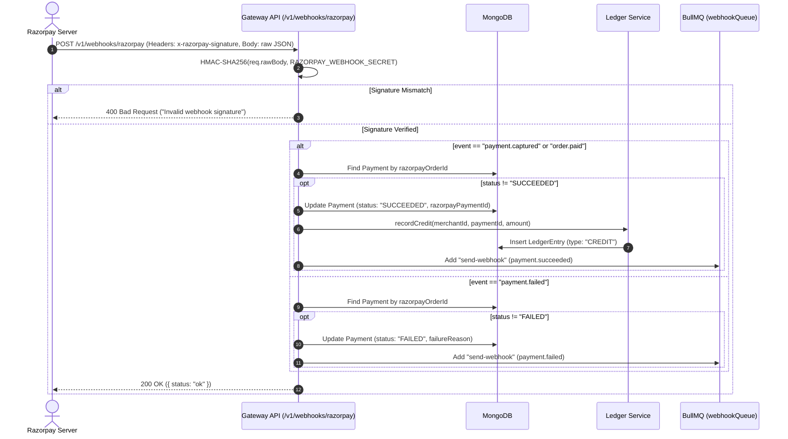
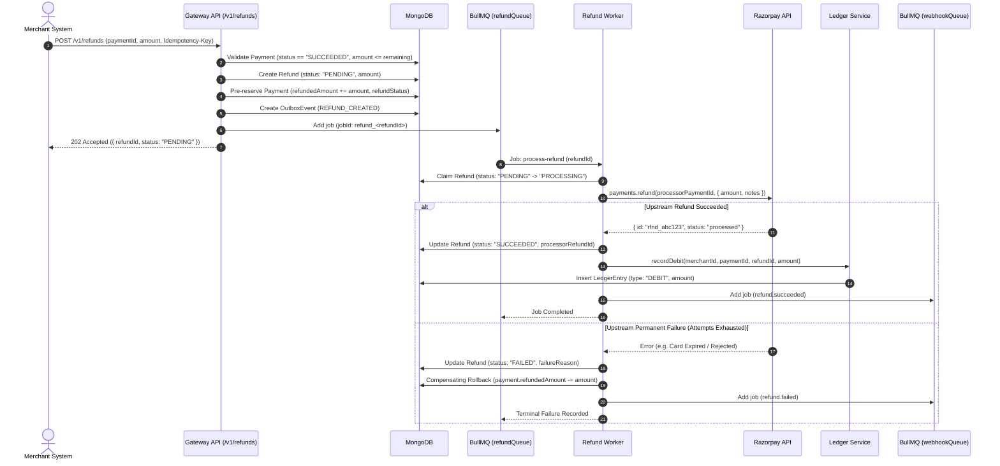
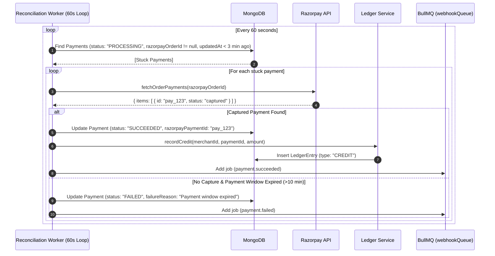
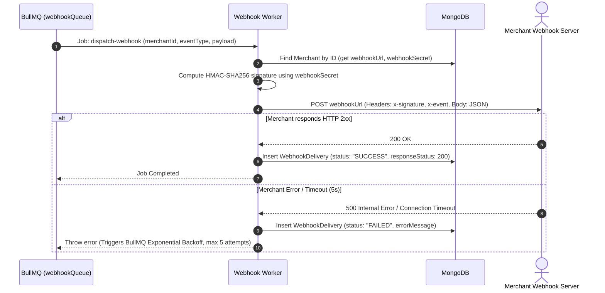
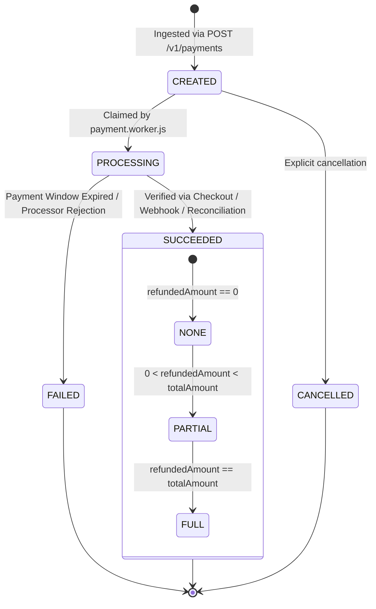
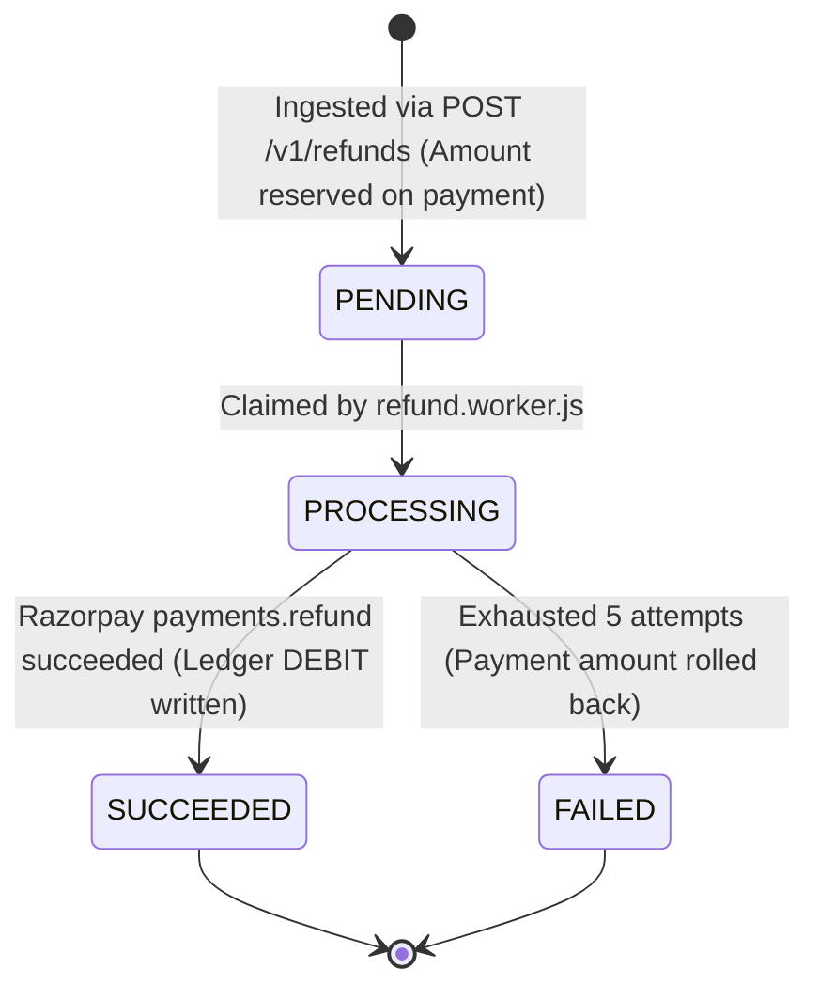

# 🏛 System Architecture & Engineering Deep Dive

> An architectural specification of the distributed failure handling, transactional guarantees, asynchronous processing, idempotency controls, and double-entry ledger mechanics powering the **Event-Driven Payment Gateway & Ledger Engine**.

---

## 📑 Table of Contents

- [1. High-Level Architecture Overview](#1-high-level-architecture-overview)
- [2. System Architecture Diagram](#2-system-architecture-diagram)
- [3. Major System Components](#3-major-system-components)
  - [3.1 API Gateway & Routing Layer](#31-api-gateway--routing-layer)
  - [3.2 Authentication & Key Verification](#32-authentication--key-verification)
  - [3.3 Distributed Idempotency Layer](#33-distributed-idempotency-layer)
  - [3.4 Transactional Outbox Pattern](#34-transactional-outbox-pattern)
  - [3.5 Message Queues & Worker Concurrency](#35-message-queues--worker-concurrency)
  - [3.6 Double-Entry Append-Only Financial Ledger](#36-double-entry-append-only-financial-ledger)
  - [3.7 Asynchronous Refund Engine](#37-asynchronous-refund-engine)
  - [3.8 Self-Healing Reconciliation Sweeper](#38-self-healing-reconciliation-sweeper)
  - [3.9 Webhook Delivery & Cryptographic Verification](#39-webhook-delivery--cryptographic-verification)
  - [3.10 Customer Checkout Engine](#310-customer-checkout-engine)
- [4. End-to-End Data Flows](#4-end-to-end-data-flows)
  - [Flow 1: Payment Ingestion & Outbox Relay](#flow-1-payment-ingestion--outbox-relay)
  - [Flow 2: Payment Worker & Upstream Order Creation](#flow-2-payment-worker--upstream-order-creation)
  - [Flow 3: Customer Checkout & Cryptographic Verification](#flow-3-customer-checkout--cryptographic-verification)
  - [Flow 4: Inbound Razorpay Webhook Handling](#flow-4-inbound-razorpay-webhook-handling)
  - [Flow 5: Asynchronous Refund Lifecycle](#flow-5-asynchronous-refund-lifecycle)
  - [Flow 6: Autonomous Reconciliation Sweep](#flow-6-autonomous-reconciliation-sweep)
  - [Flow 7: Outbound Webhook Delivery & Retries](#flow-7-outbound-webhook-delivery--retries)
- [5. State Machines & Entity Lifecycles](#5-state-machines--entity-lifecycles)
  - [Payment State Machine](#payment-state-machine)
  - [Refund State Machine](#refund-state-machine)
- [6. Distributed Failure Modes & Recovery Matrix](#6-distributed-failure-modes--recovery-matrix)
- [7. Codebase Reference Map](#7-codebase-reference-map)

---

## 1. High-Level Architecture Overview

In high-volume payment processing, naive architectures that perform third-party HTTP requests inside synchronous web requests suffer from three critical distributed systems problems:

1. **The Dual-Write Problem**: Saving a payment record to a database and publishing an event to a message broker are two separate operations. If the server crashes after the database write but before the queue publish, the payment is orphaned and never processed.
2. **In-Place Balance Mutation**: Modifying account balances directly (`merchant.balance += amount`) destroys historical auditability. If race conditions occur or transactions fail partially, proving the mathematical balance is impossible.
3. **The Indeterminate Network State**: Network requests to payment processors can time out. Did the upstream processor charge the card before the connection broke? Retrying blindly causes duplicate charges; failing blindly loses revenue.

This system resolves these challenges through an event-driven, decoupled architecture:
- **Fast HTTP Ingestion**: HTTP request handlers perform lightweight validation and local database writes, returning a response in under 50ms.
- **Transactional Outbox**: Events (`PAYMENT_CREATED`, `REFUND_CREATED`) are stored as database documents in the same database context as the business entities, eliminating dual-writes.
- **Asynchronous Worker Pools**: Background workers consume jobs from Redis-backed BullMQ queues with exponential backoff retries.
- **Strictly Append-Only Ledger**: Balances are calculated by summing immutable debit and credit entries.
- **Background Reconciliation**: An autonomous sweeper polls the processor API for payments stuck in `PROCESSING` status to heal state discrepancies without manual intervention.

---

## 2. System Architecture Diagram



---

## 3. Major System Components

### 3.1 API Gateway & Routing Layer
The HTTP server is implemented using Express 5 in [app.js](file:///d:/Backend/Backend%20Projects/Event-Driven%20Payment%20Gateway%20&%20Ledger%20Engine/backend/src/app.js). It configures:
- **Security**: [helmet](https://helmetjs.github.io/) adds HTTP response headers to prevent common attack vectors; [cors](https://github.com/expressjs/cors) manages browser cross-origin requests.
- **Raw Body Preservation**: Configured inside `express.json`:
  ```javascript
  express.json({
    verify: (req, res, buf) => {
      req.rawBody = buf.toString("utf8");
    },
  });
  ```
  Preserving the unparsed `req.rawBody` buffer is critical for verifying incoming Razorpay webhook signatures against HMAC-SHA256 digests.
- **Route Namespace**:
  - `/health` — Public server status.
  - `/v1/merchants` — Registration and profile.
  - `/v1/payments` — Merchant payment ingestion and verification.
  - `/v1/checkout` — Public customer checkout sessions.
  - `/v1/ledger` — Financial audit entries and aggregated balance.
  - `/v1/refunds` — Partial/full refund creation and status.
  - `/v1/webhooks` — Upstream processor webhook reception.

---

### 3.2 Authentication & Key Verification
Implemented in [auth.js](file:///d:/Backend/Backend%20Projects/Event-Driven%20Payment%20Gateway%20&%20Ledger%20Engine/backend/src/middleware/auth.js):
- **API Key Format**: When a merchant registers via [merchant.controller.js](file:///d:/Backend/Backend%20Projects/Event-Driven%20Payment%20Gateway%20&%20Ledger%20Engine/backend/src/modules/merchants/merchant.controller.js), the gateway generates a cryptographically random 24-byte hex string prefixed with `key_` (e.g., `key_6a9b4c...`).
- **One-Way Hashing**: The database stores only the SHA-256 hash (`apiKeyHash`). The raw key is never stored in plaintext and is only returned to the merchant once upon creation.
- **Two-Tier Verification with Redis Caching**:
  1. Incoming requests present the key in the `x-api-key` header.
  2. The middleware computes the SHA-256 hash: `keyHash = hashKey(apiKey)`.
  3. Redis is checked for the key: `auth:merchant:${keyHash}`.
  4. **Cache Hit**: `req.merchant` is populated directly from the cached JSON without touching the database.
  5. **Cache Miss**: MongoDB queries [Merchant](file:///d:/Backend/Backend%20Projects/Event-Driven%20Payment%20Gateway%20&%20Ledger%20Engine/backend/src/modules/merchants/merchant.model.js) for `{ apiKeyHash: keyHash, status: "ACTIVE" }`. If found, the merchant profile is cached in Redis with a 300-second (5-minute) TTL (`EX 300`).

---

### 3.3 Distributed Idempotency Layer
Implemented in [idempotency.js](file:///d:/Backend/Backend%20Projects/Event-Driven%20Payment%20Gateway%20&%20Ledger%20Engine/backend/src/middleware/idempotency.js), this middleware protects state-changing endpoints (`POST /v1/payments`, `POST /v1/refunds`):

1. **Header Identification**: Reads `Idempotency-Key` or `x-idempotency-key`. If missing, the request is immediately rejected with HTTP `400 Bad Request`.
2. **Atomic Lock Acquisition**:
   The middleware attempts to write to Redis using the `SET` command with the `NX` (Not Exists) flag and a 120-second TTL:
   ```javascript
   const redisKey = `idempotency:${req.merchant._id}:${idempotencyKey}`;
   const lockAcquired = await redisClient.set(
     redisKey,
     JSON.stringify({ state: "PROCESSING" }),
     "EX",
     120,
     "NX"
   );
   ```
3. **Collision & Replay Handling**:
   - **Case A (`lockAcquired === null` and `state === "PROCESSING"`)**: Another request with the identical key is actively in-flight. The gateway responds immediately with `HTTP 409 Conflict: A request with this Idempotency-Key is currently in-flight`.
   - **Case B (`lockAcquired === null` and `state === "COMPLETED"`)**: The request has already been executed. The middleware intercepts the call, injects the header `x-idempotent-replay: true`, and replays the original cached `statusCode` and `body` without re-executing business logic.
4. **Response Caching**:
   If the lock is acquired, the middleware intercepts `res.json`. When the controller finishes, the response body and status code are written to `redisKey` with `state: "COMPLETED"` and a 24-hour TTL (86,400 seconds).

---

### 3.4 Transactional Outbox Pattern
Implemented via [outbox.model.js](file:///d:/Backend/Backend%20Projects/Event-Driven%20Payment%20Gateway%20&%20Ledger%20Engine/backend/src/modules/payments/outbox.model.js) and [outbox.relay.js](file:///d:/Backend/Backend%20Projects/Event-Driven%20Payment%20Gateway%20&%20Ledger%20Engine/backend/src/workers/outbox.relay.js):

- **Problem Addressed**: In distributed architectures, writing to a database and publishing an event to a message queue are two separate network operations. If the application crashes between the two, data is corrupted or lost.
- **Solution**: The HTTP controller writes both the domain entity (e.g. `Payment`) and an `OutboxEvent` to MongoDB.
- **Outbox Relay**:
  - [startOutboxRelay](file:///d:/Backend/Backend%20Projects/Event-Driven%20Payment%20Gateway%20&%20Ledger%20Engine/backend/src/workers/outbox.relay.js#L50-L53) starts an asynchronous background timer that executes [processOutboxBatch](file:///d:/Backend/Backend%20Projects/Event-Driven%20Payment%20Gateway%20&%20Ledger%20Engine/backend/src/workers/outbox.relay.js#L7-L48) every 1,500ms.
  - It fetches up to 20 events with `status: "PENDING"`, sorted by `createdAt: 1` (FIFO order).
  - An `isRunning` mutex flag guarantees that long-running relay batches do not overlap.
  - Events are enqueued into BullMQ queues using deterministic deduplication keys:
    - `jobId: pay_${event.payload.paymentId}` for `paymentQueue`
    - `jobId: refund_${event.payload.refundId}` for `refundQueue`
  - Once enqueued, `event.status` is marked `PROCESSED`.

---

### 3.5 Message Queues & Worker Concurrency
Implemented using [BullMQ](https://bullmq.io/) over Redis connections:

| Queue | Queue Name | Worker File | Concurrency | Retry Configuration |
| :--- | :--- | :--- | :--- | :--- |
| `paymentQueue` | `payment-process` | [payment.worker.js](file:///d:/Backend/Backend%20Projects/Event-Driven%20Payment%20Gateway%20&%20Ledger%20Engine/backend/src/workers/payment.worker.js) | 5 workers | 3 attempts, exponential backoff (2000ms base) |
| `refundQueue` | `refund-processing-queue` | [refund.worker.js](file:///d:/Backend/Backend%20Projects/Event-Driven%20Payment%20Gateway%20&%20Ledger%20Engine/backend/src/workers/refund.worker.js) | 5 workers | 5 attempts, exponential backoff (3000ms base) |
| `webhookQueue` | `webhook-delivery` | [webhook.worker.js](file:///d:/Backend/Backend%20Projects/Event-Driven%20Payment%20Gateway%20&%20Ledger%20Engine/backend/src/workers/webhook.worker.js) | 10 workers | 5 attempts, exponential backoff (3000ms base) |

#### Atomic Worker Claims
To prevent two workers from processing the same payment simultaneously (for example, if a job is delayed or re-delivered):
```javascript
const payment = await Payment.findOneAndUpdate(
  { _id: paymentId, status: "CREATED" },
  {
    status: "PROCESSING",
    processingLock: { workerId: workerId, lockedAt: new Date() },
  },
  { returnDocument: "after" }
);
if (!payment) return; // Another worker claimed or finished this job
```
If the lock is acquired, the worker contacts the Razorpay API to generate the order, saves `razorpayOrderId`, and clears the lock. If Razorpay throws an error, the worker resets `status = "CREATED"` and throws the error to trigger BullMQ's exponential backoff.

---

### 3.6 Double-Entry Append-Only Financial Ledger
Implemented in [ledger.model.js](file:///d:/Backend/Backend%20Projects/Event-Driven%20Payment%20Gateway%20&%20Ledger%20Engine/backend/src/modules/ledger/ledger.model.js) and [ledger.service.js](file:///d:/Backend/Backend%20Projects/Event-Driven%20Payment%20Gateway%20&%20Ledger%20Engine/backend/src/modules/ledger/ledger.service.js):

#### 1. Schema Immutability Enforcement
Ledger records are permanent legal audit events. Modifying or deleting ledger records is blocked at the schema level:
```javascript
ledgerEntrySchema.pre(
  ["updateOne", "updateMany", "findOneAndUpdate", "deleteOne", "deleteMany"],
  function () {
    throw new Error("LEDGER_IMMUTABILITY_VIOLATION: Ledger entries cannot be modified or deleted.");
  }
);
```
Furthermore, `timestamps` is configured as `{ createdAt: true, updatedAt: false }`, ensuring no update timestamp can ever exist.

#### 2. Dynamic Balance Aggregation
There is **no mutable balance field** in the database. A merchant's balance is derived dynamically via a MongoDB aggregation pipeline:
```javascript
const pipeline = [
  { $match: { merchantId: new mongoose.Types.ObjectId(merchantId) } },
  {
    $group: {
      _id: "$currency",
      totalCredits: {
        $sum: { $cond: [{ $eq: ["$type", "CREDIT"] }, "$amount", 0] },
      },
      totalDebits: {
        $sum: { $cond: [{ $eq: ["$type", "DEBIT"] }, "$amount", 0] },
      },
    },
  },
  {
    $project: {
      currency: "$_id",
      availableBalance: { $subtract: ["$totalCredits", "$totalDebits"] },
      totalCredits: 1,
      totalDebits: 1,
      _id: 0,
    },
  },
];
```
This guarantees mathematical integrity: `Available Balance = Total Credits - Total Debits`.

---

### 3.7 Asynchronous Refund Engine
Implemented across [refund.service.js](file:///d:/Backend/Backend%20Projects/Event-Driven%20Payment%20Gateway%20&%20Ledger%20Engine/backend/src/modules/refunds/refund.service.js) and [refund.worker.js](file:///d:/Backend/Backend%20Projects/Event-Driven%20Payment%20Gateway%20&%20Ledger%20Engine/backend/src/workers/refund.worker.js):

1. **Validation & Pre-Reservation**:
   - Verifies the payment has `status: "SUCCEEDED"`.
   - Checks that requested `refundAmount <= (payment.amount - payment.refundedAmount)`.
   - Creates a [Refund](file:///d:/Backend/Backend%20Projects/Event-Driven%20Payment%20Gateway%20&%20Ledger%20Engine/backend/src/modules/refunds/refund.model.js) record with `status: "PENDING"`.
   - Pre-reserves the amount on the payment document (`refundedAmount += refundAmount`), setting `refundStatus` to `"PARTIAL"` or `"FULL"`.
   - Emits an outbox event and enqueues `process-refund` into BullMQ.
2. **Worker Processing**:
   - Atomically claims the refund record (`status: "PENDING" -> "PROCESSING"`).
   - Calls Razorpay API: `razorpayClient.payments.refund(refund.processorPaymentId, { amount, notes })`.
   - Upon success:
     - Sets `refund.status = "SUCCEEDED"` and stores `processorRefundId`.
     - Appends an immutable **DEBIT** entry to the ledger via [recordDebit](file:///d:/Backend/Backend%20Projects/Event-Driven%20Payment%20Gateway%20&%20Ledger%20Engine/backend/src/modules/ledger/ledger.service.js#L29-L52).
     - Dispatches a `refund.succeeded` event to the `webhookQueue`.
3. **Failure Compensation**:
   - If the upstream call fails repeatedly and exhausts all 5 BullMQ retry attempts:
     - Marks `refund.status = "FAILED"`.
     - **Compensating Rollback**: Automatically decrements the payment's `refundedAmount`:
       ```javascript
       await Payment.findByIdAndUpdate(refund.paymentId, {
         $inc: { refundedAmount: -refund.amount },
       });
       ```
     - Recalculates `payment.refundStatus` (`NONE`, `PARTIAL`, or `FULL`).
     - Dispatches a `refund.failed` event to the `webhookQueue`.

---

### 3.8 Self-Healing Reconciliation Sweeper
Implemented in [reconciliation.worker.js](file:///d:/Backend/Backend%20Projects/Event-Driven%20Payment%20Gateway%20&%20Ledger%20Engine/backend/src/workers/reconciliation.worker.js):

- **Problem Addressed**: Customers might close their browser immediately after payment, or network disruptions might prevent the checkout verification call or webhook from reaching the server. The payment remains stuck in `PROCESSING` status.
- **Sweeper Execution**:
  - Runs automatically every 60 seconds (`setInterval(runReconciliationSweep, 60000)`).
  - Finds payments where:
    ```javascript
    {
      status: "PROCESSING",
      razorpayOrderId: { $ne: null },
      updatedAt: { $lt: new Date(Date.now() - 3 * 60 * 1000) } // Older than 3 minutes
    }
    ```
  - For each stuck payment, calls Razorpay: `fetchOrderPayments(payment.razorpayOrderId)`.
  - **Resolution A (Captured Payment Found)**:
    - Updates payment `status: "SUCCEEDED"`.
    - Appends a **CREDIT** entry to the ledger via `recordCredit`.
    - Dispatches a `payment.succeeded` webhook to the merchant.
  - **Resolution B (No Capture & Payment Window Expired > 10 min)**:
    - Marks payment `status: "FAILED"`.
    - Sets `failureReason = "Payment window expired without capture"`.
    - Dispatches a `payment.failed` webhook to the merchant.

---

### 3.9 Webhook Delivery & Cryptographic Verification

#### Inbound Webhooks ([razorpay.webhook.js](file:///d:/Backend/Backend%20Projects/Event-Driven%20Payment%20Gateway%20&%20Ledger%20Engine/backend/src/modules/webhooks/razorpay.webhook.js))
- Receives events from Razorpay at `POST /v1/webhooks/razorpay`.
- Computes the expected signature:
  ```javascript
  const expectedSignature = crypto
    .createHmac("sha256", process.env.RAZORPAY_WEBHOOK_SECRET)
    .update(req.rawBody)
    .digest("hex");
  ```
- If the signature matches:
  - For `payment.captured` / `order.paid`: marks payment `SUCCEEDED`, writes ledger credit, and schedules merchant webhook.
  - For `payment.failed`: marks payment `FAILED`, saves reason, and schedules merchant webhook.

#### Outbound Webhooks ([webhook.worker.js](file:///d:/Backend/Backend%20Projects/Event-Driven%20Payment%20Gateway%20&%20Ledger%20Engine/backend/src/workers/webhook.worker.js))
- Consumes jobs from `webhookQueue` (`concurrency: 10`).
- Generates an HMAC-SHA256 signature using the merchant's private `webhookSecret`:
  ```javascript
  const signature = crypto
    .createHmac("sha256", merchant.webhookSecret)
    .update(JSON.stringify(payload))
    .digest("hex");
  ```
- Dispatches an HTTP `POST` to `merchant.webhookUrl` with headers:
  - `Content-Type: application/json`
  - `x-signature: sha256=${signature}`
  - `x-event: ${eventType}`
- Uses `AbortSignal.timeout(5000)` (5-second timeout).
- Every attempt is recorded in the [WebhookDelivery](file:///d:/Backend/Backend%20Projects/Event-Driven%20Payment%20Gateway%20&%20Ledger%20Engine/backend/src/modules/webhooks/webhook.model.js) collection (tracking `attemptNumber`, `responseStatus`, `responseBody`, and `status`).

---

### 3.10 Customer Checkout Engine
Implemented across [checkout.controller.js](file:///d:/Backend/Backend%20Projects/Event-Driven%20Payment%20Gateway%20&%20Ledger%20Engine/backend/src/modules/checkout/checkout.controller.js) and [CheckoutPage.jsx](file:///d:/Backend/Backend%20Projects/Event-Driven%20Payment%20Gateway%20&%20Ledger%20Engine/frontend/src/pages/CheckoutPage.jsx):

- **Public Endpoints**: Unlike merchant APIs, checkout routes (`GET /v1/checkout/:id` and `POST /v1/checkout/verify`) require **no merchant API key**.
- **Sanitized Session Data**: Returns amount, currency, status, customer email, `razorpayOrderId`, public `razorpayKeyId`, and merchant name. Sensitive merchant credentials remain shielded.
- **Verification**: Verifies the Razorpay signature `crypto.createHmac('sha256', secret).update(orderId + '|' + paymentId)`. Once verified, marks the payment `SUCCEEDED` and writes the ledger credit.

---

## 4. End-to-End Data Flows

### Flow 1: Payment Ingestion & Outbox Relay



---

### Flow 2: Payment Worker & Upstream Order Creation



---

### Flow 3: Customer Checkout & Cryptographic Verification



---

### Flow 4: Inbound Razorpay Webhook Handling



---

### Flow 5: Asynchronous Refund Lifecycle



---

### Flow 6: Autonomous Reconciliation Sweep



---

### Flow 7: Outbound Webhook Delivery & Retries



---

## 5. State Machines & Entity Lifecycles

### Payment State Machine



### Refund State Machine



---

## 6. Distributed Failure Modes & Recovery Matrix

| Failure Scenario | Root Cause | System Defense & Recovery Mechanism |
| :--- | :--- | :--- |
| **Merchant clicks "Pay" twice** | Network hesitation or duplicate user action | **Redis Idempotency Lock**: Second request receives HTTP 409 while in-flight, or replayed cached response if completed. |
| **Gateway crashes after payment save** | Machine reboot before queue enqueue | **Transactional Outbox**: The event is persisted in MongoDB; upon reboot, the outbox relay discovers it and pushes it to BullMQ. |
| **Worker crashes during order creation** | OOM or host termination | **Atomic Processing Lock**: The worker claims the document with `processingLock: { workerId, lockedAt }`. BullMQ retries the job; the lock resets upon failure. |
| **Customer closes tab during checkout** | Browser closed before `/verify` callback | **Reconciliation Sweeper**: Poller queries Razorpay for the order after 3 minutes, detects capture, updates status to `SUCCEEDED`, and writes ledger credit. |
| **Merchant webhook endpoint is down** | Merchant server maintenance or crash | **Exponential Backoff Retries**: BullMQ retries delivery up to 5 times with exponential backoff (`delay = 3000ms * 2^(attempt-1)`). |
| **Corrupted ledger database write** | Software bug attempting to edit historical entry | **Mongoose Immutability Guard**: Schema pre-hook rejects `updateOne`, `deleteMany`, etc., throwing `LEDGER_IMMUTABILITY_VIOLATION`. |
| **Upstream processor rejects refund** | Card issuer rejection / expired instrument | **Compensating Rollback**: After 5 attempts, the refund worker sets `status: "FAILED"`, decrements `payment.refundedAmount`, and restores refundable balance. |
| **Redis server restarts** | Ephemeral memory crash | **Persistent Fallback**: BullMQ reconnects automatically; critical business data resides safely in MongoDB replica sets. |

---

## 7. Codebase Reference Map

For direct inspection of the implementation, refer to the following repository locations:

- **Server Configuration & Entry**: [backend/src/app.js](file:///d:/Backend/Backend%20Projects/Event-Driven%20Payment%20Gateway%20&%20Ledger%20Engine/backend/src/app.js)
- **Database & Queue Connections**:
  - [backend/src/config/db.js](file:///d:/Backend/Backend%20Projects/Event-Driven%20Payment%20Gateway%20&%20Ledger%20Engine/backend/src/config/db.js)
  - [backend/src/config/redis.js](file:///d:/Backend/Backend%20Projects/Event-Driven%20Payment%20Gateway%20&%20Ledger%20Engine/backend/src/config/redis.js)
  - [backend/src/config/razorpay.js](file:///d:/Backend/Backend%20Projects/Event-Driven%20Payment%20Gateway%20&%20Ledger%20Engine/backend/src/config/razorpay.js)
- **Middleware**:
  - [backend/src/middleware/auth.js](file:///d:/Backend/Backend%20Projects/Event-Driven%20Payment%20Gateway%20&%20Ledger%20Engine/backend/src/middleware/auth.js)
  - [backend/src/middleware/idempotency.js](file:///d:/Backend/Backend%20Projects/Event-Driven%20Payment%20Gateway%20&%20Ledger%20Engine/backend/src/middleware/idempotency.js)
- **Domain Modules**:
  - **Merchants**: [merchant.model.js](file:///d:/Backend/Backend%20Projects/Event-Driven%20Payment%20Gateway%20&%20Ledger%20Engine/backend/src/modules/merchants/merchant.model.js), [merchant.controller.js](file:///d:/Backend/Backend%20Projects/Event-Driven%20Payment%20Gateway%20&%20Ledger%20Engine/backend/src/modules/merchants/merchant.controller.js), [merchant.routes.js](file:///d:/Backend/Backend%20Projects/Event-Driven%20Payment%20Gateway%20&%20Ledger%20Engine/backend/src/modules/merchants/merchant.routes.js)
  - **Payments & Outbox**: [payment.model.js](file:///d:/Backend/Backend%20Projects/Event-Driven%20Payment%20Gateway%20&%20Ledger%20Engine/backend/src/modules/payments/payment.model.js), [outbox.model.js](file:///d:/Backend/Backend%20Projects/Event-Driven%20Payment%20Gateway%20&%20Ledger%20Engine/backend/src/modules/payments/outbox.model.js), [payment.controller.js](file:///d:/Backend/Backend%20Projects/Event-Driven%20Payment%20Gateway%20&%20Ledger%20Engine/backend/src/modules/payments/payment.controller.js), [payment.routes.js](file:///d:/Backend/Backend%20Projects/Event-Driven%20Payment%20Gateway%20&%20Ledger%20Engine/backend/src/modules/payments/payment.routes.js)
  - **Ledger**: [ledger.model.js](file:///d:/Backend/Backend%20Projects/Event-Driven%20Payment%20Gateway%20&%20Ledger%20Engine/backend/src/modules/ledger/ledger.model.js), [ledger.service.js](file:///d:/Backend/Backend%20Projects/Event-Driven%20Payment%20Gateway%20&%20Ledger%20Engine/backend/src/modules/ledger/ledger.service.js), [ledger.routes.js](file:///d:/Backend/Backend%20Projects/Event-Driven%20Payment%20Gateway%20&%20Ledger%20Engine/backend/src/modules/ledger/ledger.routes.js)
  - **Refunds**: [refund.model.js](file:///d:/Backend/Backend%20Projects/Event-Driven%20Payment%20Gateway%20&%20Ledger%20Engine/backend/src/modules/refunds/refund.model.js), [refund.service.js](file:///d:/Backend/Backend%20Projects/Event-Driven%20Payment%20Gateway%20&%20Ledger%20Engine/backend/src/modules/refunds/refund.service.js), [refund.controller.js](file:///d:/Backend/Backend%20Projects/Event-Driven%20Payment%20Gateway%20&%20Ledger%20Engine/backend/src/modules/refunds/refund.controller.js), [refund.routes.js](file:///d:/Backend/Backend%20Projects/Event-Driven%20Payment%20Gateway%20&%20Ledger%20Engine/backend/src/modules/refunds/refund.routes.js)
  - **Checkout**: [checkout.controller.js](file:///d:/Backend/Backend%20Projects/Event-Driven%20Payment%20Gateway%20&%20Ledger%20Engine/backend/src/modules/checkout/checkout.controller.js), [checkout.routes.js](file:///d:/Backend/Backend%20Projects/Event-Driven%20Payment%20Gateway%20&%20Ledger%20Engine/backend/src/modules/checkout/checkout.routes.js)
  - **Webhooks**: [webhook.model.js](file:///d:/Backend/Backend%20Projects/Event-Driven%20Payment%20Gateway%20&%20Ledger%20Engine/backend/src/modules/webhooks/webhook.model.js), [razorpay.webhook.js](file:///d:/Backend/Backend%20Projects/Event-Driven%20Payment%20Gateway%20&%20Ledger%20Engine/backend/src/modules/webhooks/razorpay.webhook.js), [webhook.routes.js](file:///d:/Backend/Backend%20Projects/Event-Driven%20Payment%20Gateway%20&%20Ledger%20Engine/backend/src/modules/webhooks/webhook.routes.js)
- **Queues & Workers**:
  - [backend/src/queues/payment.queue.js](file:///d:/Backend/Backend%20Projects/Event-Driven%20Payment%20Gateway%20&%20Ledger%20Engine/backend/src/queues/payment.queue.js)
  - [backend/src/queues/refund.queue.js](file:///d:/Backend/Backend%20Projects/Event-Driven%20Payment%20Gateway%20&%20Ledger%20Engine/backend/src/queues/refund.queue.js)
  - [backend/src/queues/webhook.queue.js](file:///d:/Backend/Backend%20Projects/Event-Driven%20Payment%20Gateway%20&%20Ledger%20Engine/backend/src/queues/webhook.queue.js)
  - [backend/src/workers/outbox.relay.js](file:///d:/Backend/Backend%20Projects/Event-Driven%20Payment%20Gateway%20&%20Ledger%20Engine/backend/src/workers/outbox.relay.js)
  - [backend/src/workers/payment.worker.js](file:///d:/Backend/Backend%20Projects/Event-Driven%20Payment%20Gateway%20&%20Ledger%20Engine/backend/src/workers/payment.worker.js)
  - [backend/src/workers/refund.worker.js](file:///d:/Backend/Backend%20Projects/Event-Driven%20Payment%20Gateway%20&%20Ledger%20Engine/backend/src/workers/refund.worker.js)
  - [backend/src/workers/webhook.worker.js](file:///d:/Backend/Backend%20Projects/Event-Driven%20Payment%20Gateway%20&%20Ledger%20Engine/backend/src/workers/webhook.worker.js)
  - [backend/src/workers/reconciliation.worker.js](file:///d:/Backend/Backend%20Projects/Event-Driven%20Payment%20Gateway%20&%20Ledger%20Engine/backend/src/workers/reconciliation.worker.js)
- **Frontend Console**:
  - [frontend/src/App.jsx](file:///d:/Backend/Backend%20Projects/Event-Driven%20Payment%20Gateway%20&%20Ledger%20Engine/frontend/src/App.jsx)
  - [frontend/src/lib/api.js](file:///d:/Backend/Backend%20Projects/Event-Driven%20Payment%20Gateway%20&%20Ledger%20Engine/frontend/src/lib/api.js)
