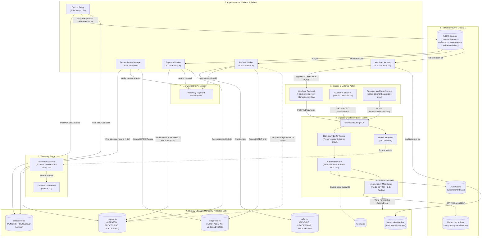
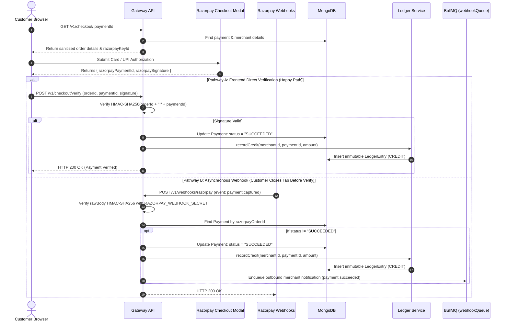
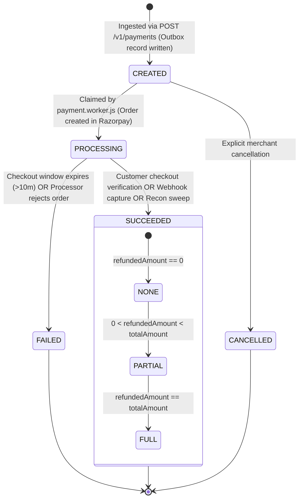
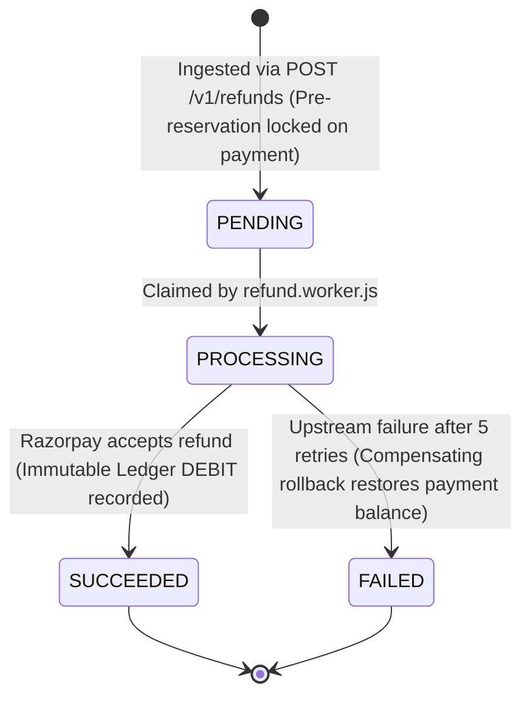

# 🏛️ Distributed Systems Architecture & Project Mastery Guide

> **A definitive, code-verified technical guide to the distributed failure handling, transactional guarantees, asynchronous processing, idempotency controls, and double-entry ledger mechanics powering the Event-Driven Payment Gateway.**

---

## 📑 Table of Contents

1. [A. Project Overview](#a-project-overview)
2. [B. System Architecture Diagram](#b-system-architecture-diagram)
3. [C. Complete Request and Data Flow](#c-complete-request-and-data-flow)
   - [1. Payment Ingestion & Asynchronous Order Creation](#1-payment-ingestion--asynchronous-order-creation)
   - [2. Customer Checkout & Dual Payment Verification](#2-customer-checkout--dual-payment-verification)
   - [3. Asynchronous Refund Lifecycle with Saga Rollback](#3-asynchronous-refund-lifecycle-with-saga-rollback)
   - [4. Self-Healing Reconciliation Sweeper](#4-self-healing-reconciliation-sweeper)
   - [5. Outbound Merchant Webhook Delivery](#5-outbound-merchant-webhook-delivery)
   - [6. Full-Stack Observability & Metrics Scraping](#6-full-stack-observability--metrics-scraping)
4. [D. Important Files & Responsibilities](#d-important-files--responsibilities)
5. [E. Database Schemas & State Management](#e-database-schemas--state-management)
   - [Collections & Indexing Strategy](#collections--indexing-strategy)
   - [Payment Lifecycle State Machine](#payment-lifecycle-state-machine)
   - [Refund Lifecycle State Machine](#refund-lifecycle-state-machine)
6. [F. Important Backend Mechanisms](#f-important-backend-mechanisms)
   - [1. API Key Authentication & Multi-Tier Caching](#1-api-key-authentication--multi-tier-caching)
   - [2. Two-Tier Distributed Idempotency](#2-two-tier-distributed-idempotency)
   - [3. Transactional Outbox Pattern](#3-transactional-outbox-pattern)
   - [4. Worker Concurrency & Atomic Task Claim Locks](#4-worker-concurrency--atomic-task-claim-locks)
   - [5. Immutable Double-Entry Financial Ledger](#5-immutable-double-entry-financial-ledger)
   - [6. Asynchronous Saga Refunds with Compensating Rollbacks](#6-asynchronous-saga-refunds-with-compensating-rollbacks)
   - [7. Self-Healing Reconciliation Sweeper](#7-self-healing-reconciliation-sweeper)
   - [8. Cryptographic Webhook Security (Inbound & Outbound)](#8-cryptographic-webhook-security-inbound--outbound)
   - [9. Production Resilience, Graceful Shutdown & Error Handling](#9-production-resilience-graceful-shutdown--error-handling)
7. [G. Failure Handling & Testing](#g-failure-handling--testing)
   - [Disaster Recovery & Failure Modes Matrix](#disaster-recovery--failure-modes-matrix)
   - [Verified Manual Testing Commands](#verified-manual-testing-commands)
   - [Automated Testing Status & Recommended Suite](#automated-testing-status--recommended-suite)
8. [H. System Design Trade-Offs & Interview Preparation](#h-system-design-trade-offs--interview-preparation)
   - [Key Architectural Trade-Offs](#key-architectural-trade-offs)
   - [High-Yield Backend Interview Questions & Answers](#high-yield-backend-interview-questions--answers)

---

## A. Project Overview

### 1. What Does This Project Do?
This project is an enterprise-grade, **event-driven payment gateway and financial ledger engine**. It acts as a resilient intermediary between merchant applications, end customers, and external payment processors (Razorpay). 

It ingests merchant payment and refund intents under strict low-latency SLAs (<50ms), decouples slow upstream banking network calls into background BullMQ worker pools, maintains an audit-proof double-entry ledger with immutable balance math, and heals dropped transactions autonomously using background reconciliation sweepers.

### 2. Real-World Use Case
In production e-commerce (e.g., Shopify, Amazon, Stripe), payment infrastructure cannot execute synchronous upstream bank requests during client HTTP requests. If an upstream processor experiences latency or network partitions, threads exhaust, clients retry aggressively, and double-charges occur. 

This engine solves these core distributed systems challenges:
- **Prevents Dual-Write Discrepancies**: Database updates and message queue publishing never get desynchronized on server crashes.
- **Eliminates Race Conditions**: Concurrent identical payments or refunds are locked and deduplicated.
- **Guarantees Audit Integrity**: Account balances are calculated via append-only mathematical aggregations rather than mutable database columns.
- **Recovers Abandoned Transactions**: If a customer closes their browser tab after paying, the system detects and reconciles the orphaned transaction automatically.

### 3. Tech Stack
| Component | Technology | Role |
| :--- | :--- | :--- |
| **Runtime & Framework** | Node.js (ES Modules) + Express 5 | Asynchronous REST gateway with native promise error propagation |
| **Primary Database** | MongoDB 7 (Replica Set) with Mongoose 9 | Document storage supporting multi-document ACID transactions |
| **In-Memory Cache & Locks** | Redis 7 (ioredis) | Auth caching, atomic `SET NX` idempotency locks, response replay cache |
| **Message Broker** | BullMQ 6 | Distributed FIFO task queues with exponential backoff retries |
| **Payment Processor** | Razorpay Node SDK | Upstream processor for order creation, payments, and refunds |
| **Observability** | Prometheus (v2.51) + Grafana (v10.4) | Live PromQL metrics scraping, queue gauges, and real-time dashboard |
| **Frontend** | React 18 + Vite + TailwindCSS | Merchant dashboard, ledger viewer, and customer checkout portal |

---

## B. System Architecture Diagram



### Component Roles Summary
- **Express 5 Gateway**: Ingress validation, API key auth, raw body parsing, distributed locking, and sub-50ms HTTP returns.
- **Redis 7**: High-speed memory store for merchant auth cache (300s TTL), short-lived distributed mutex locks (120s TTL), 24h response replay caches, and BullMQ backing store.
- **MongoDB 7 (Replica Set)**: ACID-compliant durable storage for payment records, transactional outbox events, refund states, immutable ledger entries, and webhook delivery logs.
- **Outbox Relay**: Reliable polling engine (every 1.5s) ensuring guaranteed task delivery to BullMQ queues without dual-write risk.
- **Worker Pools**: Concurrency-controlled BullMQ consumers managing communication with upstream Razorpay APIs, atomic state transitions, and retry backoffs.
- **Reconciliation Engine**: Safety net running every 60s to heal abandoned or dropped payments older than 3 minutes.
- **Prometheus & Grafana**: Pull-based observability pipeline scraping `/metrics` every 15s to monitor latency, outbox lag, queue depths, and payment throughput.

---

## C. Complete Request and Data Flow

### 1. Payment Ingestion & Asynchronous Order Creation

```
[Merchant Client] ──(1. POST /v1/payments)──► [Express Gateway]
                                                    │
                                  ┌─────────────────┴─────────────────┐
                             (Auth Check)                       (Idempotency)
                       SHA-256 Hash -> Redis Cache           SET NX Lock (120s TTL)
                                  │                                   │
                                  ▼                                   ▼
                      [MongoDB ACID Transaction]               [Immediate Response]
               - Insert Payment (status: CREATED)           HTTP 201 Created (<50ms)
               - Insert OutboxEvent (status: PENDING)       Cached in Redis (24h TTL)
                                  │
                       (Asynchronous 1.5s Poll)
                                  ▼
                            [Outbox Relay]
               - Discovers PENDING OutboxEvent
               - Enqueues to BullMQ (Job ID: pay_<id>)
               - Marks OutboxEvent: PROCESSED
                                  │
                                  ▼
                         [Payment Worker]
               - Atomic Claim (CREATED -> PROCESSING)
               - Calls Razorpay: orders.create()
               - Stores razorpayOrderId in Payment document
```

#### Step-by-Step Execution:
1. **Request Ingress**: Merchant calls `POST /v1/payments` with headers `x-api-key` and `Idempotency-Key`, passing `amount`, `currency`, and `customerEmail`.
2. **Authentication**: [auth.js](file:///d:/Backend/Backend%20Projects/Event-Driven%20Payment%20Gateway%20&%20Ledger%20Engine/backend/src/middleware/auth.js) hashes the API key (`crypto.createHash('sha256')`) and checks Redis key `auth:merchant:<hash>`. On cache miss, it queries MongoDB `merchants` collection and caches the profile for 300s.
3. **Idempotency Lock**: [idempotency.js](file:///d:/Backend/Backend%20Projects/Event-Driven%20Payment%20Gateway%20&%20Ledger%20Engine/backend/src/middleware/idempotency.js) performs `SET idempotency:<merchantId>:<key> {"state":"PROCESSING"} EX 120 NX`.
   - If key exists with `PROCESSING`, returns `409 Conflict` ("Request in-flight").
   - If key exists with `COMPLETED`, returns the cached HTTP response with header `x-idempotent-replay: true`.
4. **ACID Storage Write**: [payment.controller.js](file:///d:/Backend/Backend%20Projects/Event-Driven%20Payment%20Gateway%20&%20Ledger%20Engine/backend/src/modules/payments/payment.controller.js#L26-L67) initiates a MongoDB session transaction (`mongoose.startSession()`). It writes both:
   - `Payment` document with `status: "CREATED"`.
   - `OutboxEvent` document with `eventType: "PAYMENT_CREATED"` and `status: "PENDING"`.
5. **Immediate Client Response**: The transaction commits, the response interceptor caches the result in Redis with 24h TTL, and Express returns `HTTP 201 Created` in < 50ms.
6. **Outbox Polling**: [outbox.relay.js](file:///d:/Backend/Backend%20Projects/Event-Driven%20Payment%20Gateway%20&%20Ledger%20Engine/backend/src/workers/outbox.relay.js) executes every 1500ms, fetches up to 20 `PENDING` outbox records in FIFO order (`createdAt: 1`), and enqueues a job to BullMQ `payment-process` with a deterministic deduplication ID: `jobId: pay_<paymentId>`. It immediately updates the outbox record to `PROCESSED`.
7. **Worker Processing**: [payment.worker.js](file:///d:/Backend/Backend%20Projects/Event-Driven%20Payment%20Gateway%20&%20Ledger%20Engine/backend/src/workers/payment.worker.js#L18-L40) executes with concurrency 5. It acquires an atomic lock on the document via `Payment.findOneAndUpdate({ _id: paymentId, status: "CREATED" }, { status: "PROCESSING", processingLock: { workerId, lockedAt } })`.
8. **Upstream Order**: Worker calls Razorpay `orders.create({ amount, currency, receipt: paymentId })`. Upon success, it persists `payment.razorpayOrderId`, clears the lock, and increments Prometheus metric `payment_gw_payments_total{status="SUCCESS"}`.

---

### 2. Customer Checkout & Dual Payment Verification

The system provides **two independent pathways** to verify customer payments, ensuring no payment is lost even if customer connectivity drops:



#### Step-by-Step Verification:
1. **Checkout Session Retrieval**: Customer visits the hosted checkout portal. The browser calls `GET /v1/checkout/:id` ([checkout.controller.js](file:///d:/Backend/Backend%20Projects/Event-Driven%20Payment%20Gateway%20&%20Ledger%20Engine/backend/src/modules/checkout/checkout.controller.js#L8-L52)). The backend returns public metadata (`amount`, `currency`, `razorpayOrderId`, `razorpayKeyId`, `merchant.name`).
2. **Customer Authorization**: The frontend initializes Razorpay Checkout modal. The customer enters UPI/card credentials. Razorpay executes authorization with the issuing bank.
3. **Verification via Pathway A (Direct Verification)**:
   - Razorpay JS SDK returns `razorpay_order_id`, `razorpay_payment_id`, and `razorpay_signature`.
   - The browser calls `POST /v1/checkout/verify`.
   - [razorpay.processor.js](file:///d:/Backend/Backend%20Projects/Event-Driven%20Payment%20Gateway%20&%20Ledger%20Engine/backend/src/modules/processors/razorpay.processor.js#L45-L53) verifies the signature using `HMAC-SHA256("${orderId}|${paymentId}", RAZORPAY_KEY_SECRET)`.
   - If valid and `payment.status !== "SUCCEEDED"`, it marks payment `SUCCEEDED` and invokes [ledger.service.js](file:///d:/Backend/Backend%20Projects/Event-Driven%20Payment%20Gateway%20&%20Ledger%20Engine/backend/src/modules/ledger/ledger.service.js#L4-L27) `recordCredit()`.
4. **Verification via Pathway B (Inbound Webhook Fallback)**:
   - If the customer closes the browser before step 3 finishes, Razorpay servers dispatch `POST /v1/webhooks/razorpay` ([razorpay.webhook.js](file:///d:/Backend/Backend%20Projects/Event-Driven%20Payment%20Gateway%20&%20Ledger%20Engine/backend/src/modules/webhooks/razorpay.webhook.js)).
   - Express uses `req.rawBody` byte buffer to verify `x-razorpay-signature`.
   - On `payment.captured` or `order.paid`, it updates the payment to `SUCCEEDED`, writes the ledger credit, and enqueues a merchant webhook job. Both pathways are fully idempotent.

---

### 3. Asynchronous Refund Lifecycle with Saga Rollback

Refunds implement a distributed Saga pattern with pre-reservation and compensating rollback:

```
[Merchant] ──(POST /v1/refunds)──► [Express Gateway]
                                          │
                                 (Pre-Reservation)
                     Atomic MongoDB Update inside Transaction:
                     $inc: { refundedAmount: refundAmount }
                     Condition: (refundedAmount + refundAmount <= amount)
                                          │
                        ┌─────────────────┴─────────────────┐
                   [Outbox Event]                     [Fast-Path Queue]
               Insert REFUND_CREATED                 Push to BullMQ
               status: PENDING                       (refundQueue)
                        │                                   │
                        └─────────────────┬─────────────────┘
                                          ▼
                                   [Refund Worker]
                         Atomic Claim: PENDING -> PROCESSING
                         Calls Razorpay: payments.refund()
                                          │
                        ┌─────────────────┴─────────────────┐
                 [Razorpay Success]                  [Terminal Failure]
                 - Mark refund SUCCEEDED             - Exhausted 5 retries
                 - Record Ledger DEBIT               - Compensating Rollback:
                 - Enqueue merchant webhook            $inc: { refundedAmount: -amount }
                   (refund.succeeded)                - Mark refund FAILED
                                                     - Enqueue webhook (refund.failed)
```

1. **Ingress & Pre-Reservation**: Merchant calls `POST /v1/refunds` with `paymentId`, optional `amount`, and `Idempotency-Key` ([refund.service.js](file:///d:/Backend/Backend%20Projects/Event-Driven%20Payment%20Gateway%20&%20Ledger%20Engine/backend/src/modules/refunds/refund.service.js#L9-L84)).
2. **Mathematical Reservation Guard**: Inside a MongoDB transaction session, the service performs an atomic find-and-update:
   ```javascript
   await Payment.findOneAndUpdate({
     _id: paymentId,
     merchantId,
     status: "SUCCEEDED",
     $expr: { $lte: [{ $add: ["$refundedAmount", refundAmount] }, "$amount"] }
   }, {
     $inc: { refundedAmount: refundAmount }
   }, { session, new: true });
   ```
   If concurrent requests attempt to refund more than the unrefunded balance, the condition fails atomically and returns `400 Bad Request`.
3. **Dual Dispatch (Fast-Path + Outbox)**: Creates `Refund` (status: `PENDING`) and `OutboxEvent` (status: `PENDING`) in the transaction. After commit, it attempts a direct fast-path dispatch to `refundQueue.add(...)`. If Redis is temporarily unresponsive, the background Outbox Relay picks it up on its next 1.5s tick.
4. **Worker Execution**: [refund.worker.js](file:///d:/Backend/Backend%20Projects/Event-Driven%20Payment%20Gateway%20&%20Ledger%20Engine/backend/src/workers/refund.worker.js) atomically claims the refund (`PENDING` -> `PROCESSING`) and calls Razorpay `payments.refund(processorPaymentId, { amount })`.
5. **Success Finalization**: Upon Razorpay approval:
   - Sets `refund.status = "SUCCEEDED"`.
   - Calls `recordDebit()` to write an immutable `DEBIT` entry into the ledger.
   - Enqueues `refund.succeeded` notification to BullMQ `webhookQueue`.
6. **Compensating Action on Terminal Failure**: If Razorpay permanently rejects the refund (or all 5 exponential backoff retries fail):
   - Worker catches failure at `job.attemptsMade >= 5`.
   - Sets `refund.status = "FAILED"`.
   - Executes compensating rollback: `Payment.findByIdAndUpdate(refund.paymentId, { $inc: { refundedAmount: -refund.amount } })`.
   - Re-evaluates `refundStatus` (`NONE` or `PARTIAL`), unlocking the reserved funds for future valid refunds.

---

### 4. Self-Healing Reconciliation Sweeper

```
[Cron Timer (Every 60s)] ──► [Reconciliation Sweeper]
                                      │
                   Query MongoDB for Stuck Payments:
                   - status == "PROCESSING"
                   - razorpayOrderId != null
                   - updatedAt < (Now - 3 minutes)
                                      │
                   Query Razorpay: fetchOrderPayments(orderId)
                                      │
                        ┌─────────────┴─────────────┐
              [Captured Payment Found]      [No Capture Found]
                        │                           │
              - Set status = SUCCEEDED      Has payment been stuck > 10m?
              - Record Ledger CREDIT                ┌───────┴───────┐
              - Enqueue merchant webhook           Yes              No
                (payment.succeeded)                 │               │
                                            Set status = FAILED   Wait for next
                                            Enqueue webhook       sweep cycle
                                            (payment.failed)
```

1. **Autonomous Invocation**: [reconciliation.worker.js](file:///d:/Backend/Backend%20Projects/Event-Driven%20Payment%20Gateway%20&%20Ledger%20Engine/backend/src/workers/reconciliation.worker.js) runs every 60 seconds (`setInterval`).
2. **Identification of Orphaned Records**: Searches MongoDB for payments where `status === "PROCESSING"`, `razorpayOrderId !== null`, and `updatedAt < (Date.now() - 3 * 60 * 1000)`.
3. **Upstream Source-of-Truth Sync**: Queries Razorpay API `fetchOrderPayments(orderId)`.
4. **Healing**:
   - If an item in Razorpay has `status === "captured"`, the payment was charged at the bank but dropped before callback verification. The sweeper updates `payment.status = "SUCCEEDED"`, sets `razorpayPaymentId`, appends a ledger `CREDIT`, and dispatches a webhook.
   - If no capture is found and `payment.updatedAt < (Now - 10 minutes)`, the checkout session has expired. The sweeper transitions the payment to `FAILED` and dispatches `payment.failed`.

---

### 5. Outbound Merchant Webhook Delivery

1. **Trigger**: Occurs whenever a payment succeeds/fails, or a refund succeeds/fails.
2. **Signature Generation**: [webhook.worker.js](file:///d:/Backend/Backend%20Projects/Event-Driven%20Payment%20Gateway%20&%20Ledger%20Engine/backend/src/workers/webhook.worker.js) loads merchant `webhookUrl` and `webhookSecret`. It calculates:
   $$\text{Signature} = \text{HMAC-SHA256}(\text{JSON.stringify(payload)}, \text{merchant.webhookSecret})$$
3. **HTTP Dispatch**: Sends `POST merchant.webhookUrl` with headers:
   - `Content-Type: application/json`
   - `x-signature: sha256=<signature>`
   - `x-event: <eventType>`
   - Timeout set strictly to 5,000ms using `AbortSignal.timeout(5000)`.
4. **Audit Logging & Retries**: Every attempt records a document in `webhookdeliveries` collection with `responseStatus`, `responseBody` (capped to 500 chars), and `attemptNumber`. If the merchant server times out or returns non-2xx, BullMQ retries up to 5 times with exponential backoff.

---

### 6. Full-Stack Observability & Metrics Scraping

1. **Metrics Definition**: [metrics.js](file:///d:/Backend/Backend%20Projects/Event-Driven%20Payment%20Gateway%20&%20Ledger%20Engine/backend/src/config/metrics.js) defines Prometheus counters, histograms, and gauges using `prom-client`.
2. **Scrape Trigger**: Prometheus server polls `GET /metrics` every 15 seconds.
3. **Dynamic BullMQ Introspection**: Upon scrape arrival, `updateQueueMetrics()` dynamically queries `paymentQueue`, `refundQueue`, and `webhookQueue` for `waiting`, `active`, `completed`, `failed`, and `delayed` job counts and sets `payment_gw_queue_jobs`.
4. **Outbox Gauge**: Every outbox relay execution updates `payment_gw_outbox_pending_events`.
5. **Dashboard Rendering**: Grafana polls Prometheus and visualizes latency percentiles (P50, P95, P99), queue backlogs, payment throughput, and outbox lag alerts.

---

## D. Important Files & Responsibilities

| File Path | Primary Function / Export | Invoked By / Callers | Core Architectural Responsibility |
| :--- | :--- | :--- | :--- |
| [app.js](file:///d:/Backend/Backend%20Projects/Event-Driven%20Payment%20Gateway%20&%20Ledger%20Engine/backend/src/app.js) | `startServer()`, `gracefulShutdown()` | Node runtime (`npm start`) | Initializes DB, Redis, timers; mounts routes; handles `SIGTERM`/`SIGINT` graceful teardown. |
| [auth.js](file:///d:/Backend/Backend%20Projects/Event-Driven%20Payment%20Gateway%20&%20Ledger%20Engine/backend/src/middleware/auth.js) | `authenticateApiKey(req, res, next)` | Payment, Refund, Ledger routes | Hashes `x-api-key` (SHA-256); checks Redis cache (300s TTL); queries DB on miss. |
| [idempotency.js](file:///d:/Backend/Backend%20Projects/Event-Driven%20Payment%20Gateway%20&%20Ledger%20Engine/backend/src/middleware/idempotency.js) | `idempotency(options)` | Mutating routes (`POST /v1/payments`, `POST /v1/refunds`) | Acquires Redis `SET NX` lock (120s); replays cached HTTP responses (24h TTL) with `x-idempotent-replay`. |
| [error.middleware.js](file:///d:/Backend/Backend%20Projects/Event-Driven%20Payment%20Gateway%20&%20Ledger%20Engine/backend/src/middleware/error.middleware.js) | `errorHandler()`, `notFoundHandler()` | Express global middleware | Centralized error catcher; maps Mongoose `ValidationError`, `CastError`, and JSON syntax errors. |
| [payment.controller.js](file:///d:/Backend/Backend%20Projects/Event-Driven%20Payment%20Gateway%20&%20Ledger%20Engine/backend/src/modules/payments/payment.controller.js) | `createPayment()`, `verifyPayment()` | `payment.routes.js` | Persists `Payment` + `OutboxEvent` in MongoDB ACID transaction (<50ms response SLA). |
| [outbox.relay.js](file:///d:/Backend/Backend%20Projects/Event-Driven%20Payment%20Gateway%20&%20Ledger%20Engine/backend/src/workers/outbox.relay.js) | `startOutboxRelay()`, `processOutboxBatch()` | Background timer in `app.js` (every 1.5s) | Polls `PENDING` outbox events; publishes to BullMQ with deterministic job IDs; sets lag gauge. |
| [payment.worker.js](file:///d:/Backend/Backend%20Projects/Event-Driven%20Payment%20Gateway%20&%20Ledger%20Engine/backend/src/workers/payment.worker.js) | `paymentWorker` (BullMQ Worker) | BullMQ runtime (`payment-process`) | Claims payment atomically (`CREATED` -> `PROCESSING`); calls Razorpay `orders.create()`. |
| [checkout.controller.js](file:///d:/Backend/Backend%20Projects/Event-Driven%20Payment%20Gateway%20&%20Ledger%20Engine/backend/src/modules/checkout/checkout.controller.js) | `getCheckoutSession()`, `verifyCheckoutPayment()` | `checkout.routes.js` (Public routes) | Delivers public checkout details; verifies customer payment signatures and records ledger credit. |
| [razorpay.webhook.js](file:///d:/Backend/Backend%20Projects/Event-Driven%20Payment%20Gateway%20&%20Ledger%20Engine/backend/src/modules/webhooks/razorpay.webhook.js) | `handleRazorpayWebhook(req, res)` | Razorpay Webhook Ingress | Verifies HMAC on `req.rawBody`; updates payment to `SUCCEEDED`/`FAILED`; triggers ledger credit. |
| [refund.service.js](file:///d:/Backend/Backend%20Projects/Event-Driven%20Payment%20Gateway%20&%20Ledger%20Engine/backend/src/modules/refunds/refund.service.js) | `createRefund()` | `refund.controller.js` | Mathematical reservation on `refundedAmount`; persists `Refund` + `OutboxEvent`; dispatches job. |
| [refund.worker.js](file:///d:/Backend/Backend%20Projects/Event-Driven%20Payment%20Gateway%20&%20Ledger%20Engine/backend/src/workers/refund.worker.js) | `refundWorker` (BullMQ Worker) | BullMQ runtime (`refund-processing-queue`) | Calls Razorpay refund API; records ledger DEBIT; executes compensating rollback on terminal failure. |
| [ledger.model.js](file:///d:/Backend/Backend%20Projects/Event-Driven%20Payment%20Gateway%20&%20Ledger%20Engine/backend/src/modules/ledger/ledger.model.js) | `LedgerEntry` Mongoose Model | `ledger.service.js` | Blocks `updateOne`/`deleteOne` with `LEDGER_IMMUTABILITY_VIOLATION`; enforces partial unique indexes. |
| [ledger.service.js](file:///d:/Backend/Backend%20Projects/Event-Driven%20Payment%20Gateway%20&%20Ledger%20Engine/backend/src/modules/ledger/ledger.service.js) | `recordCredit()`, `recordDebit()`, `getBalance()` | Checkout, Webhook, Refund workers | Appends immutable ledger entries; computes mathematical balance via MongoDB aggregation pipeline. |
| [reconciliation.worker.js](file:///d:/Backend/Backend%20Projects/Event-Driven%20Payment%20Gateway%20&%20Ledger%20Engine/backend/src/workers/reconciliation.worker.js) | `runReconciliationSweep()` | Background timer in `app.js` (every 60s) | Detects stuck payments (>3m); queries Razorpay to auto-reconcile to `SUCCEEDED` or `FAILED`. |
| [webhook.worker.js](file:///d:/Backend/Backend%20Projects/Event-Driven%20Payment%20Gateway%20&%20Ledger%20Engine/backend/src/workers/webhook.worker.js) | `webhookWorker` (BullMQ Worker) | BullMQ runtime (`webhook-delivery`) | Generates HMAC-SHA256 signature; dispatches POST to merchant; logs attempts to `webhookdeliveries`. |
| [metrics.js](file:///d:/Backend/Backend%20Projects/Event-Driven%20Payment%20Gateway%20&%20Ledger%20Engine/backend/src/config/metrics.js) | `register`, `updateQueueMetrics()` | `app.js` (`/metrics` route) | Defines Prometheus counters, histograms, gauges; inspects live BullMQ job counts on demand. |

---

## E. Database Schemas & State Management

### Collections & Indexing Strategy

```
┌─────────────────────────────────┐       ┌─────────────────────────────────┐
│           merchants             │       │            payments             │
├─────────────────────────────────┤       ├─────────────────────────────────┤
│ _id: ObjectId                   │◄──────┤ merchantId: ObjectId (Indexed)  │
│ name: String                    │       │ amount: Number (paise/cents)    │
│ email: String (Unique)          │       │ currency: String (e.g. "INR")   │
│ apiKeyHash: String (Unique)     │       │ status: String (Indexed)        │
│ webhookUrl: String              │       │ customerEmail: String           │
│ webhookSecret: String           │       │ razorpayOrderId: String (Index) │
│ status: "ACTIVE" | "SUSPENDED"  │       │ razorpayPaymentId: String(Index)│
└─────────────────────────────────┘       │ refundedAmount: Number          │
                                          │ refundStatus: "NONE"|"PARTIAL"  │
                                          │ processingLock: {worker, time}  │
                                          └────────────────┬────────────────┘
                                                           │
               ┌───────────────────────────────────────────┴───────────────────────┐
               ▼                                                                   ▼
┌─────────────────────────────────┐                               ┌─────────────────────────────────┐
│          outboxevents           │                               │             refunds             │
├─────────────────────────────────┤                               ├─────────────────────────────────┤
│ _id: ObjectId                   │                               │ _id: ObjectId                   │
│ aggregateType: "PAYMENT"|"REFUND│                               │ merchantId: ObjectId (Indexed)  │
│ aggregateId: String (Indexed)   │                               │ paymentId: ObjectId (Indexed)   │
│ eventType: String               │                               │ processorPaymentId: String      │
│ payload: Object                 │                               │ processorRefundId: String(Sparse│
│ status: "PENDING"|"PROCESSED"   │                               │ amount: Number                  │
│ retryCount: Number              │                               │ status: PENDING|PROCESSING...   │
│ Compound: { status, createdAt } │                               │ Compound: { merchantId, created}│
└─────────────────────────────────┘                               └────────────────┬────────────────┘
                                                                                   │
                                  ┌────────────────────────────────────────────────┘
                                  ▼
┌─────────────────────────────────────────────────────────────────┐
│                          ledgerentries                          │
├─────────────────────────────────────────────────────────────────┤
│ _id: ObjectId                                                   │
│ merchantId: ObjectId (Indexed)                                  │
│ paymentId: ObjectId (Indexed)                                   │
│ refundId: ObjectId (Optional, Indexed)                          │
│ type: "CREDIT" | "DEBIT"                                        │
│ amount: Number                                                  │
│ currency: String                                                │
│ description: String                                             │
│ createdAt: Date (No updatedAt - IMMUTABLE)                      │
│ Partial Unique Index 1: { paymentId: 1, type: 1 } (type=CREDIT) │
│ Partial Unique Index 2: { refundId: 1, type: 1 } (refundId!=null│
└─────────────────────────────────────────────────────────────────┘
```

#### Key Schema Enforcements & Indexes:
1. **`outboxevents` Compound Index**: `{ status: 1, createdAt: 1 }` enables the Outbox Relay to retrieve the oldest pending events in FIFO order in sub-millisecond index scans.
2. **`ledgerentries` Immutability Indexing**:
   - `{ paymentId: 1, type: 1 }` with `{ partialFilterExpression: { type: "CREDIT" } }` enforces at the database level that a payment can only ever receive **one credit entry**.
   - `{ refundId: 1, type: 1 }` with `{ partialFilterExpression: { refundId: { $type: "objectId" } } }` enforces that a refund can only ever receive **one debit entry**.
   - Schema options: `timestamps: { createdAt: true, updatedAt: false }`.
3. **`merchants` Hashing Index**: `{ apiKeyHash: 1 }` unique index prevents duplicate API keys and enables fast authentication.

---

### Payment Lifecycle State Machine



---

### Refund Lifecycle State Machine



---

## F. Important Backend Mechanisms

### 1. API Key Authentication & Multi-Tier Caching
- **Source Code**: [auth.js](file:///d:/Backend/Backend%20Projects/Event-Driven%20Payment%20Gateway%20&%20Ledger%20Engine/backend/src/middleware/auth.js), [merchant.controller.js](file:///d:/Backend/Backend%20Projects/Event-Driven%20Payment%20Gateway%20&%20Ledger%20Engine/backend/src/modules/merchants/merchant.controller.js)
- **Problem Solved**: Storing raw API keys in plain text creates severe security vulnerabilities if the database is leaked. Furthermore, querying MongoDB on every high-throughput API call creates database CPU bottlenecks.
- **How It Works**:
  1. API keys are generated with 24 random bytes (`key_<48_hex_chars>`).
  2. The gateway computes `SHA-256(rawKey)` and only stores the hash in MongoDB.
  3. On request ingress, the middleware computes the hash and checks Redis key `auth:merchant:<keyHash>`.
  4. On cache hit, authentication completes in ~1ms without touching MongoDB.
  5. On cache miss, MongoDB is queried, and the merchant profile is cached in Redis with a 300-second (5-minute) TTL.
- **Limitations & Failure Scenarios**: If a merchant's API key is revoked or rotated in MongoDB, the change takes up to 300 seconds to invalidate in Redis unless an explicit cache invalidation command (`redisClient.del(cacheKey)`) is triggered.

---

### 2. Two-Tier Distributed Idempotency
- **Source Code**: [idempotency.js](file:///d:/Backend/Backend%20Projects/Event-Driven%20Payment%20Gateway%20&%20Ledger%20Engine/backend/src/middleware/idempotency.js)
- **Problem Solved**: If a client encounters a network glitch or timeout while waiting for a response, it retries. Without idempotency, duplicate payments or double refunds are created.
- **How It Works**:
  1. Requires the `Idempotency-Key` HTTP header on mutating requests (`POST`/`PATCH`).
  2. Computes Redis key: `idempotency:<merchantId>:<idempotencyKey>`.
  3. Uses Redis atomic primitive: `SET redisKey {"state":"PROCESSING"} EX 120 NX`.
  4. If the lock cannot be acquired:
     - If `state === "PROCESSING"`, returns `HTTP 409 Conflict` ("Request in-flight").
     - If `state === "COMPLETED"`, replays the original cached status code and JSON body with header `x-idempotent-replay: true`.
  5. When the request finishes, the response body and status code are cached under the same key with a 24-hour TTL (`EX 86400`).
- **Limitations & Failure Scenarios**: If the server crashes during execution, the lock remains in `PROCESSING` state until the 120-second TTL expires. The client must wait up to 2 minutes before retrying successfully. Note: In distributed systems, this pattern guarantees **at-least-once delivery with end-to-end idempotent deduplication**, not magic "exactly-once" transport.

---

### 3. Transactional Outbox Pattern
- **Source Code**: [payment.controller.js](file:///d:/Backend/Backend%20Projects/Event-Driven%20Payment%20Gateway%20&%20Ledger%20Engine/backend/src/modules/payments/payment.controller.js#L26-L67), [outbox.model.js](file:///d:/Backend/Backend%20Projects/Event-Driven%20Payment%20Gateway%20&%20Ledger%20Engine/backend/src/modules/payments/outbox.model.js), [outbox.relay.js](file:///d:/Backend/Backend%20Projects/Event-Driven%20Payment%20Gateway%20&%20Ledger%20Engine/backend/src/workers/outbox.relay.js)
- **Problem Solved**: "Dual-Write Vulnerability". If an API writes to a database and then attempts to publish to an external message queue, a crash between these two actions leaves the payment stranded in the database without any queue job to process it.
- **How It Works**:
  1. The controller opens a MongoDB session transaction (`session.startTransaction()`).
  2. It writes both the `Payment` document (`status: "CREATED"`) and an `OutboxEvent` document (`status: "PENDING"`) within the same atomic commit. Either both exist or neither exists.
  3. The HTTP response returns immediately (<50ms).
  4. An autonomous background Outbox Relay polls every 1.5s for `PENDING` events (indexed by `{ status: 1, createdAt: 1 }`).
  5. The relay enqueues the job into BullMQ using a deterministic job ID (`jobId: pay_${paymentId}`). If BullMQ already has this job, it drops the duplicate.
  6. The relay updates the outbox event to `PROCESSED`.
- **Limitations & Failure Scenarios**: Polling adds a slight latency (up to 1.5 seconds) before the worker picks up the job. If the relay process crashes after enqueueing into BullMQ but before marking the event `PROCESSED`, the event is re-enqueued on restart. BullMQ's deterministic `jobId` deduplication mitigates this.

---

### 4. Worker Concurrency & Atomic Task Claim Locks
- **Source Code**: [payment.worker.js](file:///d:/Backend/Backend%20Projects/Event-Driven%20Payment%20Gateway%20&%20Ledger%20Engine/backend/src/workers/payment.worker.js#L18-L40), [refund.worker.js](file:///d:/Backend/Backend%20Projects/Event-Driven%20Payment%20Gateway%20&%20Ledger%20Engine/backend/src/workers/refund.worker.js#L19-L28)
- **Problem Solved**: When multiple worker instances run concurrently across server nodes, two workers might pull duplicate or retried jobs for the same payment, triggering duplicate orders or refunds in Razorpay.
- **How It Works**:
  1. Workers use an atomic document state transition via `findOneAndUpdate`:
     ```javascript
     const payment = await Payment.findOneAndUpdate(
       { _id: paymentId, status: "CREATED" },
       { status: "PROCESSING", processingLock: { workerId: `worker_${os.hostname()}_${process.pid}`, lockedAt: new Date() } },
       { returnDocument: "after" }
     );
     if (!payment) return; // Task already claimed or completed by another worker
     ```
  2. If the upstream order creation succeeds, the order ID is linked and the lock is cleared.
  3. If Razorpay throws a network error, the status resets to `CREATED` and the error is re-thrown, triggering BullMQ exponential backoff.
- **Limitations & Failure Scenarios**: If a worker node crashes via `SIGKILL` or OOM while executing the Razorpay API call, the payment remains in `PROCESSING` with a stale lock. The Reconciliation Sweeper resolves this by checking payments older than 3 minutes.

---

### 5. Immutable Double-Entry Financial Ledger
- **Source Code**: [ledger.model.js](file:///d:/Backend/Backend%20Projects/Event-Driven%20Payment%20Gateway%20&%20Ledger%20Engine/backend/src/modules/ledger/ledger.model.js), [ledger.service.js](file:///d:/Backend/Backend%20Projects/Event-Driven%20Payment%20Gateway%20&%20Ledger%20Engine/backend/src/modules/ledger/ledger.service.js)
- **Problem Solved**: Storing a mutable `balance` column (e.g. `merchant.balance += 500`) destroys financial auditability. If a database update fails mid-way, or a race condition occurs, funds appear or vanish with no mathematical paper trail.
- **How It Works**:
  1. **Zero Mutable Balances**: There is no balance column anywhere in the database schema.
  2. **Append-Only Entries**: Funds collected are inserted as `CREDIT` entries. Refunds are inserted as `DEBIT` entries.
  3. **Driver-Level Immutability Guard**: Mongoose schema hooks intercept all mutation operations:
     ```javascript
     ledgerEntrySchema.pre(["updateOne", "updateMany", "findOneAndUpdate", "deleteOne", "deleteMany"], function () {
       throw new Error("LEDGER_IMMUTABILITY_VIOLATION: Ledger entries cannot be modified or deleted.");
     });
     ```
  4. **Database-Level Partial Unique Indexes**: `{ paymentId: 1, type: 1 }` uniquely enforces only one `CREDIT` per payment. `{ refundId: 1, type: 1 }` uniquely enforces only one `DEBIT` per refund.
  5. **Dynamic Aggregation Pipeline**: Current merchant balance is computed mathematically in real time:
     $$\text{Available Balance} = \sum \text{Credits} - \sum \text{Debits}$$
     ```javascript
     // Aggregation pipeline in ledger.service.js
     { $group: {
         _id: "$currency",
         totalCredits: { $sum: { $cond: [{ $eq: ["$type", "CREDIT"] }, "$amount", 0] } },
         totalDebits: { $sum: { $cond: [{ $eq: ["$type", "DEBIT"] }, "$amount", 0] } },
     }},
     { $project: { availableBalance: { $subtract: ["$totalCredits", "$totalDebits"] } } }
     ```
- **Limitations & Failure Scenarios**: As millions of ledger transactions accumulate, running full aggregation pipelines on demand can increase query latency. In large-scale enterprise deployments, periodic immutable balance snapshots (checkpoints) are used to bound the aggregation scan window.

---

### 6. Asynchronous Saga Refunds with Compensating Rollbacks
- **Source Code**: [refund.service.js](file:///d:/Backend/Backend%20Projects/Event-Driven%20Payment%20Gateway%20&%20Ledger%20Engine/backend/src/modules/refunds/refund.service.js), [refund.worker.js](file:///d:/Backend/Backend%20Projects/Event-Driven%20Payment%20Gateway%20&%20Ledger%20Engine/backend/src/workers/refund.worker.js)
- **Problem Solved**: If a merchant sends multiple parallel refund requests for ₹500 on an ₹800 payment, both could pass simple validation and trigger an overdraft of ₹1,000. Conversely, if upstream refund processing fails permanently, the reserved amount must not stay locked forever.
- **How It Works**:
  1. **Pre-Reservation**: An atomic query verifies `(refundedAmount + requested) <= amount` and immediately increments `payment.refundedAmount`.
  2. **Asynchronous Execution**: The refund worker attempts Razorpay refund execution with up to 5 exponential retries.
  3. **Compensating Action on Terminal Failure**: If Razorpay permanently rejects the refund (or all 5 attempts fail):
     ```javascript
     // refund.worker.js
     await Payment.findByIdAndUpdate(refund.paymentId, {
       $inc: { refundedAmount: -refund.amount }
     });
     refund.status = "FAILED";
     await refund.save();
     ```
     This restores the customer's refundable balance.
- **Limitations & Failure Scenarios**: During the window where the refund worker is retrying with Razorpay, the reserved amount cannot be refunded by other requests. This is by design to prevent double refunds.

---

### 7. Self-Healing Reconciliation Sweeper
- **Source Code**: [reconciliation.worker.js](file:///d:/Backend/Backend%20Projects/Event-Driven%20Payment%20Gateway%20&%20Ledger%20Engine/backend/src/workers/reconciliation.worker.js)
- **Problem Solved**: Customers frequently close their browser tab or lose connectivity immediately after entering their OTP on the payment gateway modal. If the customer callback does not run and the processor webhook is delayed or dropped, the payment stays stuck in `PROCESSING` forever.
- **How It Works**:
  1. Background cron worker wakes up every 60 seconds.
  2. Scans for payments in `PROCESSING` status that have a `razorpayOrderId` and have not been updated for > 3 minutes.
  3. Queries Razorpay API: `fetchOrderPayments(orderId)`.
  4. If Razorpay shows a `captured` transaction, marks payment `SUCCEEDED`, writes the ledger `CREDIT`, and dispatches the merchant webhook.
  5. If no capture is found and the payment is older than 10 minutes, marks payment `FAILED` and notifies the merchant.
- **Limitations & Failure Scenarios**: If Razorpay's API is experiencing an outage, the sweeper logs the error and retries the stuck payment on the next 60s sweep cycle.

---

### 8. Cryptographic Webhook Security (Inbound & Outbound)
- **Source Code**: [razorpay.webhook.js](file:///d:/Backend/Backend%20Projects/Event-Driven%20Payment%20Gateway%20&%20Ledger%20Engine/backend/src/modules/webhooks/razorpay.webhook.js), [webhook.worker.js](file:///d:/Backend/Backend%20Projects/Event-Driven%20Payment%20Gateway%20&%20Ledger%20Engine/backend/src/workers/webhook.worker.js)
- **Problem Solved**: Attackers can spoof payment capture notifications to grant products without payment, or eavesdrop on unauthenticated merchant notifications.
- **How It Works**:
  - **Inbound**: Express JSON parser preserves the unparsed byte buffer in `req.rawBody`. The handler computes `HMAC-SHA256(req.rawBody, RAZORPAY_WEBHOOK_SECRET)` and rejects mismatches with `400 Bad Request`.
  - **Outbound**: The worker signs the JSON payload with `HMAC-SHA256(payload, merchant.webhookSecret)` and sends it in the `x-signature` header. Merchants verify this header to authenticate the payload.
- **Limitations & Failure Scenarios**: If the merchant's endpoint is down, BullMQ retries 5 times with exponential backoff. If the merchant fails to respond within 5,000ms, the request times out and is marked as an attempt failure.

---

### 9. Production Resilience, Graceful Shutdown & Error Handling
- **Source Code**: [app.js](file:///d:/Backend/Backend%20Projects/Event-Driven%20Payment%20Gateway%20&%20Ledger%20Engine/backend/src/app.js#L112-L149), [error.middleware.js](file:///d:/Backend/Backend%20Projects/Event-Driven%20Payment%20Gateway%20&%20Ledger%20Engine/backend/src/middleware/error.middleware.js)
- **Problem Solved**: Abrupt server termination (e.g. Docker container stop, Kubernetes rolling update, PM2 reload) severs active HTTP connections mid-flight, leaves uncommitted MongoDB transactions, and leaks Redis locks.
- **How It Works**:
  1. **Signal Trapping**: Traps `SIGTERM` and `SIGINT`.
  2. **Order of Shutdown Operations**:
     - `server.close()` stops accepting new HTTP connections and finishes in-flight requests.
     - `clearInterval` cancels outbox polling (1.5s) and reconciliation (60s) intervals.
     - `mongoose.connection.close(false)` flushes pending database operations and closes connections cleanly.
     - `redisClient.quit()` flushes and unlinks Redis connections.
     - Force-kill safety timer (`setTimeout(15000)`) guarantees exit if a connection hangs.
  3. **Centralized Express 5 Error Handling**: Express 5 natively catches unhandled promise rejections. [error.middleware.js](file:///d:/Backend/Backend%20Projects/Event-Driven%20Payment%20Gateway%20&%20Ledger%20Engine/backend/src/middleware/error.middleware.js) intercepts Mongoose validation errors, malformed JSON, and invalid ObjectIds (`CastError`), returning standardized JSON errors without crashing the process.
- **Limitations & Failure Scenarios**: If background BullMQ worker jobs are in the middle of an external HTTP call when `SIGKILL` is sent, BullMQ will re-assign the stalled job to another worker once the lock expires.

---

## G. Failure Handling & Testing

### Disaster Recovery & Failure Modes Matrix

| # | Failure Scenario | Exact Root Cause | Immediate Defense Mechanism | Recovery & Eventual Consistency |
| :---: | :--- | :--- | :--- | :--- |
| **1** | **User double-clicks "Pay"** | Network hesitation or UI double-click | Redis atomic `SET NX` lock on `idempotency:<id>:<key>` | Returns `409 Conflict` if in-flight; returns original cached `201` if completed. |
| **2** | **Server crashes during payment write** | Container OOM or power outage | MongoDB session multi-document ACID transaction | Transaction aborts. Either both `Payment` and `OutboxEvent` are written or neither is. |
| **3** | **Worker crashes while creating order** | SIGKILL or network disconnection | Atomic `findOneAndUpdate` claim lock | Job fails in BullMQ; `processingLock` timestamps allow lock reassignment upon retry. |
| **4** | **Customer drops internet after paying** | User closes browser tab on success screen | Reconciliation Sweeper | Sweeper queries Razorpay after 3m, detects `captured` status, updates DB, records ledger credit. |
| **5** | **Merchant webhook endpoint fails** | Merchant server returning 500/503 or timing out | BullMQ exponential backoff + 5s abort signal | Retries delivery 5 times: 3s, 6s, 12s, 24s, 48s. Every attempt is logged in MongoDB. |
| **6** | **Bug attempts to mutate past ledger entry** | Unauthorized code modification | Mongoose pre-hook immutability guard | Pre-hook intercepts `updateOne`, `deleteMany`, throwing `LEDGER_IMMUTABILITY_VIOLATION`. |
| **7** | **Upstream rejects partial refund** | Customer bank account closed or card expired | Compensating Saga Rollback | Worker decrements `payment.refundedAmount` by `-refund.amount`, unlocking refundable balance. |
| **8** | **Redis restarts unexpectedly** | Redis memory flush or reboot | MongoDB as durable source of truth | BullMQ auto-reconnects. Outbox Relay re-polls any un-enqueued `PENDING` events from MongoDB. |
| **9** | **Worker backlog / Outbox stall** | Worker pool bottleneck or processor latency spike | Prometheus gauges & Grafana threshold alert | `payment_gw_outbox_pending_events` triggers visual alert (≥20); workers auto-drain queue. |
| **10** | **Container deployment / Rolling update** | SIGTERM from orchestrator (Docker/K8s) | Graceful Shutdown sequence in `app.js` | Closes HTTP listener, cancels polling timers, drains MongoDB and Redis cleanly. |

---

### Verified Manual Testing Commands

The following curl recipes are verified against the actual route and controller implementations:

#### 1. Merchant Registration (Extract API Key & Secret)
```bash
curl -X POST http://localhost:3000/v1/merchants \
  -H "Content-Type: application/json" \
  -d '{
    "name": "Acme Corp",
    "email": "dev@acme.com",
    "webhookUrl": "https://webhook.site/your-uuid"
  }'
```
*Response returns `apiKey` (e.g. `key_...`) and `webhookSecret` (e.g. `whsec_...`).*

#### 2. Create Payment with Idempotency (<50ms SLA)
```bash
curl -X POST http://localhost:3000/v1/payments \
  -H "Content-Type: application/json" \
  -H "x-api-key: <YOUR_API_KEY>" \
  -H "Idempotency-Key: test_order_1001" \
  -d '{
    "amount": 50000,
    "currency": "INR",
    "customerEmail": "customer@example.com",
    "customerPhone": "9876543210"
  }'
```
*Returns `HTTP 201 Created` with `status: "CREATED"` and `paymentId`.*

#### 3. Test Idempotency Replay
Re-run the exact same command above. Notice:
- Response header contains `x-idempotent-replay: true`.
- Status returns immediately from Redis without creating a new payment record.

#### 4. Check Dynamic Ledger Balance
```bash
curl -X GET http://localhost:3000/v1/ledger/balance \
  -H "x-api-key: <YOUR_API_KEY>"
```
*Returns calculated available balance (`totalCredits - totalDebits`).*

#### 5. Issue a Partial Refund
```bash
curl -X POST http://localhost:3000/v1/refunds \
  -H "Content-Type: application/json" \
  -H "x-api-key: <YOUR_API_KEY>" \
  -H "Idempotency-Key: refund_key_001" \
  -d '{
    "paymentId": "<PAYMENT_OBJECT_ID>",
    "amount": 25000,
    "reason": "Customer request"
  }'
```

#### 6. Inspect Prometheus Metrics
```bash
curl -X GET http://localhost:3000/metrics
```
*Displays `payment_gw_http_request_duration_seconds`, `payment_gw_outbox_pending_events`, and BullMQ queue counts.*

---

### Automated Testing Status & Recommended Suite

> [!IMPORTANT]
> **Codebase Verification**: Inspecting `backend/package.json` confirms that automated tests are currently **not implemented** (`"test": "echo \"Error: no test specified\" && exit 1"`). 

#### Recommended Testing Implementation:
To bring this engine to full test coverage, implement the following test suites using `vitest` or `jest` with `supertest` and `mongodb-memory-server`:

1. **Unit Tests**:
   - `idempotency.test.js`: Mock Redis `set` to simulate atomic lock collision (`PROCESSING`) and response replay (`COMPLETED`).
   - `ledger.model.test.js`: Assert that `LedgerEntry.updateOne()` throws `LEDGER_IMMUTABILITY_VIOLATION`.
   - `razorpay.processor.test.js`: Verify HMAC-SHA256 signature calculation with known test vectors.
2. **Integration Tests**:
   - `payment.integration.test.js`: Test `POST /v1/payments` session commit and verify that both `Payment` and `OutboxEvent` are written atomically.
   - `refund.saga.test.js`: Simulate upstream Razorpay failure and assert that `Payment.refundedAmount` rolls back correctly.
3. **End-to-End Worker Tests**:
   - `outbox.relay.test.js`: Seed `outboxevents` with `status: PENDING`, run `processOutboxBatch()`, and assert BullMQ receives the job with deduplication ID.

---

## H. System Design Trade-Offs & Interview Preparation

### Key Architectural Trade-Offs

| Decision | Chosen Approach | Alternative Considered | Why This Choice Was Made (Trade-Off) |
| :--- | :--- | :--- | :--- |
| **Outbox Dispatch** | Polling Relay (every 1.5s) | MongoDB Change Streams | Change Streams require continuous oplog tailing and replica set connections that can stall on network partitions. Polling is simpler, stateless, and predictable under load. |
| **Idempotency Storage** | Redis `SET NX` + Replay Cache | MongoDB Unique Indexes | Redis executes in < 1ms in memory, avoiding disk I/O on hot request paths. The 120s lock TTL prevents permanent deadlocks if a server crashes. |
| **Financial Ledger** | Pure Append-Only Aggregation | Mutable `merchant.balance` column | Eliminates race conditions, lost updates, and phantom money. Provides a mathematical audit trail required by financial regulators, at the cost of running aggregation queries. |
| **Payment Ingestion** | Async Upstream Order via Queue | Synchronous Razorpay Call in Route | Calling Razorpay in the HTTP route ties up Express worker threads, degrades p99 latency to > 2 seconds, and causes dual-write vulnerabilities on server crashes. |
| **Refund Failure** | Saga Compensating Rollback | Two-Phase Commit (2PC) | 2PC is not supported across external third-party HTTP APIs (Razorpay/banks). A Saga with pre-reservation and compensating balance restoration provides eventual consistency. |

---

### High-Yield Backend Interview Questions & Answers

#### Q1: "How do you solve the Dual-Write Problem between MongoDB and your message queue?"
> **Answer**: "In a naive system, saving to MongoDB and then calling BullMQ creates a split-brain vulnerability—if the server crashes after the database write, the queue message is lost forever. We solve this using the **Transactional Outbox Pattern**. In [payment.controller.js](file:///d:/Backend/Backend%20Projects/Event-Driven%20Payment%20Gateway%20&%20Ledger%20Engine/backend/src/modules/payments/payment.controller.js), we start a MongoDB session transaction and write both the `Payment` (status: `CREATED`) and an `OutboxEvent` (status: `PENDING`) in one atomic commit. An autonomous Outbox Relay polls pending events every 1.5s and publishes them to BullMQ using deterministic job IDs (`pay_${id}`) for deduplication. This guarantees that messages are never lost."

#### Q2: "Why not use a standard balance column like `balance += amount` for merchants?"
> **Answer**: "Mutable balance columns violate the fundamental principles of financial accounting. If two concurrent refunds or payments update the balance simultaneously, or if a database write fails midway, money is created or destroyed without a trace. We implement an **Immutable Double-Entry Ledger** in [ledger.model.js](file:///d:/Backend/Backend%20Projects/Event-Driven%20Payment%20Gateway%20&%20Ledger%20Engine/backend/src/modules/ledger/ledger.model.js). Balances do not exist as stored numbers; they are dynamically computed via an aggregation pipeline as $\sum \text{Credits} - \sum \text{Debits}$. Furthermore, Mongoose pre-hooks strictly reject any `updateOne` or `deleteOne` operations with `LEDGER_IMMUTABILITY_VIOLATION`, and partial unique indexes prevent duplicate credits or debits."

#### Q3: "What happens if a customer's phone loses internet right after they authorize a payment?"
> **Answer**: "This is the classic dropped-callback problem. The bank captures the customer's money, but the browser never hits `/v1/checkout/verify`. We handle this with a two-layer safety net:
> 1. **Inbound Webhooks**: Razorpay servers dispatch `payment.captured` asynchronously to `/v1/webhooks/razorpay`, which verifies the HMAC signature on the raw byte buffer and marks the payment `SUCCEEDED`.
> 2. **Reconciliation Sweeper**: If the webhook is also dropped or delayed, our background sweeper in [reconciliation.worker.js](file:///d:/Backend/Backend%20Projects/Event-Driven%20Payment%20Gateway%20&%20Ledger%20Engine/backend/src/workers/reconciliation.worker.js) runs every 60s, finds any payment stuck in `PROCESSING` older than 3 minutes, queries Razorpay's API directly, and heals the payment to `SUCCEEDED` with a corresponding ledger credit."

#### Q4: "How does your idempotency layer handle concurrent identical requests vs subsequent retries?"
> **Answer**: "We implement two-tier distributed idempotency in [idempotency.js](file:///d:/Backend/Backend%20Projects/Event-Driven%20Payment%20Gateway%20&%20Ledger%20Engine/backend/src/middleware/idempotency.js) keyed by `idempotency:<merchantId>:<key>`:
> - **In-Flight Requests**: An atomic `SET NX` acquires a 120s lock with `state: "PROCESSING"`. If a duplicate request arrives while the first is still computing, `SET NX` fails, the state is read as `PROCESSING`, and the gateway immediately returns `HTTP 409 Conflict`.
> - **Completed Requests**: When the initial request finishes, the response interceptor caches the HTTP status and body in Redis for 24 hours with `state: "COMPLETED"`. Subsequent retries fetch the cached record and replay the exact response with the header `x-idempotent-replay: true`."

#### Q5: "How does the refund engine prevent race condition overdrafts?"
> **Answer**: "We use an atomic reservation guard inside a MongoDB transaction session in [refund.service.js](file:///d:/Backend/Backend%20Projects/Event-Driven%20Payment%20Gateway%20&%20Ledger%20Engine/backend/src/modules/refunds/refund.service.js). The query checks `$expr: { $lte: [{ $add: ['$refundedAmount', refundAmount] }, '$amount'] }` and atomically increments `refundedAmount`. If parallel refund requests arrive, only the one that fits within the remaining unrefunded balance can commit; all others fail at the database level. If Razorpay permanently rejects the refund after 5 retries, the worker executes a compensating action: `$inc: { refundedAmount: -refund.amount }`, unlocking the reserved funds."
