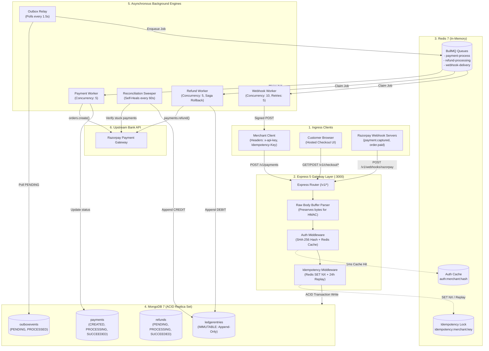
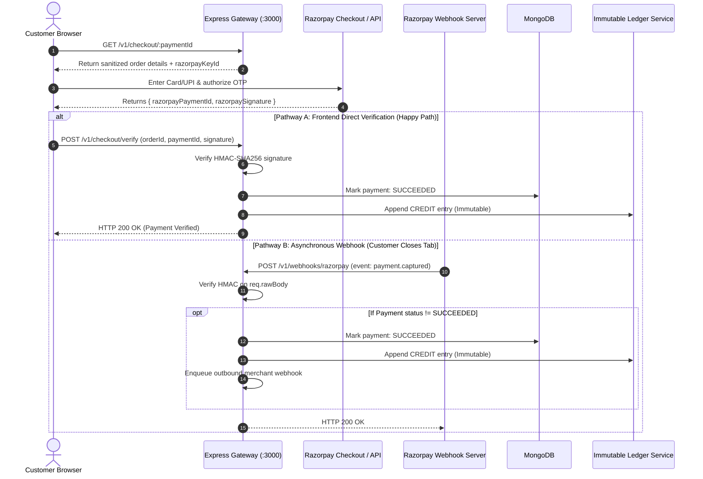

# 💳 Event-Driven Payment Gateway & Ledger Engine
> **High-Performance, Fault-Tolerant Distributed Payment & Double-Entry Accounting System**

---

## 📌 Executive Summary

This system acts as a resilient financial bridge between **Merchants**, **End Customers**, and **Upstream Banks (Razorpay)**. It handles mission-critical financial transactions with five non-negotiable guarantees:

1. **Sub-50ms API Latency**: Ingests requests instantly and offloads slow banking APIs to background queues.
2. **Zero Dual-Write Inconsistencies**: Uses the **Transactional Outbox Pattern** so database writes and event publishing never go out of sync.
3. **End-to-End Idempotency**: Prevents double-charging and duplicate refunds during network retries using Redis locks and response replays.
4. **Immutable Double-Entry Ledger**: Account balances are calculated via pure append-only math (`Credits - Debits`), with zero mutable balance columns.
5. **Self-Healing Reconciliation**: Automatically recovers dropped payments if a customer drops their network after OTP submission.

---

## 🛠️ Technology Stack

| Layer | Technology | Key Responsibility |
| :--- | :--- | :--- |
| **API Gateway** | Node.js (ESM) + Express 5 | Async REST ingress, sub-50ms response SLA, centralized error handling |
| **Database** | MongoDB 7 (Replica Set) | ACID multi-document transactions, durable document store |
| **Cache & Distributed Locks** | Redis 7 (ioredis) | SHA-256 API key caching, atomic `SET NX` locks, 24h idempotent replays |
| **Job Queue & Workers** | BullMQ 6 | Distributed FIFO queues, exponential backoff retries (concurrency: 5-10) |
| **Payment Processor** | Razorpay SDK | Upstream banking processor for order creation, capture, and refunds |
| **Observability** | Prometheus + Grafana | Live PromQL metrics (`/metrics`), outbox lag, queue depth gauges |
| **Frontend UI** | React 18 + Vite + Tailwind | Merchant dashboard, customer checkout modal, live ledger viewer |

---

## 🏗️ High-Level System Architecture



---

## 🔄 End-to-End Project Flows

### 1. Payment Creation Flow (<50ms SLA)
When a merchant creates a payment, the API never calls Razorpay synchronously. It saves locally and dispatches in the background.

```
[Merchant] 
   │  1. POST /v1/payments (x-api-key, Idempotency-Key)
   ▼
[Express Gateway]
   │  2. SHA-256 API Key check (Redis Cache ~1ms)
   │  3. Acquire Idempotency Lock (Redis SET NX, 120s)
   ▼
[MongoDB ACID Transaction]
   ├── Inserts: Payment (status: "CREATED")
   └── Inserts: OutboxEvent (status: "PENDING")
   ▼
[Express Gateway] ──► Returns HTTP 201 Created (<50ms) to Merchant
   │
   ▼ (Async 1.5s Background Poll)
[Outbox Relay]
   ├── Finds PENDING OutboxEvents
   ├── Enqueues to BullMQ (Deterministic jobId: pay_<id>)
   └── Marks OutboxEvent as PROCESSED
   ▼
[Payment Worker]
   ├── Atomically claims payment (status: "PROCESSING")
   ├── Calls Razorpay API: orders.create()
   └── Saves razorpayOrderId in Payment record
```

---

### 2. Customer Checkout & Dual Verification (Zero Dropped Payments)
The system supports **two parallel paths** to confirm payments. Even if the customer closes the browser, the webhook catches it.



---

### 3. Asynchronous Refund Lifecycle (Saga Pattern)
Refunds protect against balance overdrafts using **atomic mathematical pre-reservation** and **compensating rollback**.

```
[Merchant] ──► POST /v1/refunds (Idempotency-Key, paymentId, amount)
                     │
                     ▼
       [Atomic Pre-Reservation Guard]
       MongoDB Session Transaction:
       Payment.findOneAndUpdate(
         { _id: id, status: "SUCCEEDED", refundedAmount + requested <= amount },
         { $inc: { refundedAmount: requested } }
       )
       *If limit exceeded -> Immediately rejects with 400 Bad Request*
                     │
                     ├── Inserts: Refund (status: "PENDING")
                     └── Enqueues: BullMQ refundQueue
                     │
                     ▼
              [Refund Worker]
         Atomically claims refund (PENDING -> PROCESSING)
         Calls Razorpay: payments.refund()
                     │
        ┌────────────┴────────────┐
        ▼                         ▼
   [SUCCESS]                 [FAILURE after 5 Retries]
   - Refund: "SUCCEEDED"     - Refund: "FAILED"
   - Ledger: Append DEBIT    - Compensating Rollback:
   - Webhook: refund.succeeded   $inc: { refundedAmount: -requested }
                             - Webhook: refund.failed
```

---

### 4. Self-Healing Reconciliation Sweeper
Handles edge cases where a customer pays at the bank, but both customer browser callback and webhooks fail or drop.

```
[Cron Timer (Every 60s)]
         │
         ▼
[Reconciliation Worker]
Find payments where:
  - status == "PROCESSING"
  - razorpayOrderId is NOT null
  - updatedAt < (Now - 3 minutes)
         │
         ▼
Query Razorpay API: fetchOrderPayments(orderId)
         │
    ┌────┴──────────────────────────┐
    ▼                               ▼
[Captured Payment Found]       [No Payment Found]
- Set status = SUCCEEDED       - If stuck > 10m:
- Record Ledger CREDIT           Set status = FAILED
- Enqueue merchant webhook     - Else: Wait for next sweep
```

---

### 5. Outbound Merchant Webhook Delivery
When an event (`payment.succeeded`, `payment.failed`, `refund.succeeded`) triggers:
1. **Worker picks up job** from `webhookQueue` (Concurrency: 10).
2. **Computes Cryptographic Signature**:
   $$\text{x-signature} = \text{HMAC-SHA256}(\text{JSON.stringify(payload)}, \text{merchant.webhookSecret})$$
3. **Dispatches POST Request** with strict 5-second timeout (`AbortSignal.timeout(5000)`).
4. **Audit Log & Retry**: Logs response code and attempt number in `webhookdeliveries`. On failure, retries up to 5 times with exponential backoff (3s, 6s, 12s, 24s, 48s).

---

## 🧩 5 Core Engineering Mechanisms

### 1. Transactional Outbox Pattern (Dual-Write Solution)
* **File**: [payment.controller.js](file:///d:/Backend/Backend%20Projects/Event-Driven%20Payment%20Gateway%20&%20Ledger%20Engine/backend/src/modules/payments/payment.controller.js), [outbox.relay.js](file:///d:/Backend/Backend%20Projects/Event-Driven%20Payment%20Gateway%20&%20Ledger%20Engine/backend/src/workers/outbox.relay.js)
* **Problem**: Calling a message queue after a database write can fail if the app crashes between the two steps, losing the message forever.
* **Solution**: Write both `Payment` and `OutboxEvent` within a single MongoDB ACID transaction. The background `outbox.relay.js` polls `PENDING` events every 1.5s and reliably pushes them to BullMQ using deterministic job IDs (`pay_<id>`).

### 2. Two-Tier Distributed Idempotency
* **File**: [idempotency.js](file:///d:/Backend/Backend%20Projects/Event-Driven%20Payment%20Gateway%20&%20Ledger%20Engine/backend/src/middleware/idempotency.js)
* **Problem**: Network retries from clients could cause duplicate charges.
* **Solution**:
  1. **Locking (In-Flight)**: `SET idempotency:<merchantId>:<key> {"state":"PROCESSING"} EX 120 NX`. If the key exists, returns `409 Conflict`.
  2. **Replay (Completed)**: When the request finishes, the response body and status code are cached for 24 hours. Retries return the cached response with `x-idempotent-replay: true`.

### 3. Immutable Double-Entry Ledger
* **File**: [ledger.model.js](file:///d:/Backend/Backend%20Projects/Event-Driven%20Payment%20Gateway%20&%20Ledger%20Engine/backend/src/modules/ledger/ledger.model.js), [ledger.service.js](file:///d:/Backend/Backend%20Projects/Event-Driven%20Payment%20Gateway%20&%20Ledger%20Engine/backend/src/modules/ledger/ledger.service.js)
* **Problem**: Updating a mutable column like `merchant.balance += 500` is vulnerable to race conditions and leaves no audit trail.
* **Solution**:
  - Balances are **never stored as numbers**. They are calculated on-the-fly via MongoDB aggregation:
    $$\text{Balance} = \sum \text{Credits} - \sum \text{Debits}$$
  - Driver-level guards throw `LEDGER_IMMUTABILITY_VIOLATION` on any `updateOne` or `deleteOne`.
  - Partial unique indexes guarantee only **1 CREDIT per payment** and **1 DEBIT per refund**.

### 4. Distributed Saga with Compensating Rollbacks
* **File**: [refund.service.js](file:///d:/Backend/Backend%20Projects/Event-Driven%20Payment%20Gateway%20&%20Ledger%20Engine/backend/src/modules/refunds/refund.service.js), [refund.worker.js](file:///d:/Backend/Backend%20Projects/Event-Driven%20Payment%20Gateway%20&%20Ledger%20Engine/backend/src/workers/refund.worker.js)
* **Problem**: Distributed transactions cannot span external bank APIs. If Razorpay rejects a refund, reserved funds cannot remain locked.
* **Solution**: The gateway pre-reserves the refund amount atomically. If Razorpay permanently fails after 5 retries, the worker executes a compensating rollback: `$inc: { refundedAmount: -refund.amount }`.

### 5. Atomic Claim Locks in Workers
* **File**: [payment.worker.js](file:///d:/Backend/Backend%20Projects/Event-Driven%20Payment%20Gateway%20&%20Ledger%20Engine/backend/src/workers/payment.worker.js), [refund.worker.js](file:///d:/Backend/Backend%20Projects/Event-Driven%20Payment%20Gateway%20&%20Ledger%20Engine/backend/src/workers/refund.worker.js)
* **Problem**: Multiple concurrent worker instances could pull the same job and place duplicate orders in Razorpay.
* **Solution**: Workers use atomic state transitions:
  ```javascript
  const payment = await Payment.findOneAndUpdate(
    { _id: paymentId, status: "CREATED" },
    { status: "PROCESSING", processingLock: { workerId, lockedAt: new Date() } },
    { returnDocument: "after" }
  );
  if (!payment) return; // Another worker already claimed the task
  ```

---

## 📊 Database Schema & Key Collections

```
┌────────────────────────────┐         ┌────────────────────────────┐
│         merchants          │         │          payments          │
├────────────────────────────┤         ├────────────────────────────┤
│ _id: ObjectId              │◄────────┤ merchantId: ObjectId       │
│ apiKeyHash: String (Unique)│         │ amount: Number (paise)     │
│ webhookUrl: String         │         │ currency: String ("INR")   │
│ webhookSecret: String      │         │ status: CREATED|PROCESSING │
└────────────────────────────┘         │         SUCCEEDED|FAILED   │
                                       │ razorpayOrderId: String    │
                                       │ refundedAmount: Number     │
                                       └──────────────┬─────────────┘
                                                      │
         ┌────────────────────────────────────────────┴───────────────────────────┐
         ▼                                                                        ▼
┌────────────────────────────┐                                  ┌────────────────────────────┐
│        outboxevents        │                                  │          refunds           │
├────────────────────────────┤                                  ├────────────────────────────┤
│ _id: ObjectId              │                                  │ _id: ObjectId              │
│ aggregateId: String        │                                  │ paymentId: ObjectId        │
│ eventType: String          │                                  │ amount: Number             │
│ status: PENDING|PROCESSED  │                                  │ status: PENDING|PROCESSING │
│ Index: {status, createdAt} │                                  │         SUCCEEDED|FAILED   │
└────────────────────────────┘                                  └─────────────┬──────────────┘
                                                                              │
                                ┌─────────────────────────────────────────────┘
                                ▼
┌───────────────────────────────────────────────────────────────┐
│                         ledgerentries                         │
├───────────────────────────────────────────────────────────────┤
│ _id: ObjectId                                                 │
│ merchantId: ObjectId                                          │
│ paymentId: ObjectId                                           │
│ refundId: ObjectId (Optional)                                 │
│ type: "CREDIT" | "DEBIT"                                      │
│ amount: Number                                                │
│ createdAt: Date (Immutable, no updatedAt)                     │
│ Unique Index: { paymentId: 1, type: 1 } (type=CREDIT)         │
│ Unique Index: { refundId: 1, type: 1 } (refundId != null)     │
└───────────────────────────────────────────────────────────────┘
```

---

## 📁 Project Directory & Key Files

| Module / Path | File | Primary Responsibility |
| :--- | :--- | :--- |
| **Server & Middleware** | [app.js](file:///d:/Backend/Backend%20Projects/Event-Driven%20Payment%20Gateway%20&%20Ledger%20Engine/backend/src/app.js) | Server boot, DB/Redis setup, routes mounting, Graceful Shutdown |
| | [auth.js](file:///d:/Backend/Backend%20Projects/Event-Driven%20Payment%20Gateway%20&%20Ledger%20Engine/backend/src/middleware/auth.js) | SHA-256 API Key verification with 300s Redis cache |
| | [idempotency.js](file:///d:/Backend/Backend%20Projects/Event-Driven%20Payment%20Gateway%20&%20Ledger%20Engine/backend/src/middleware/idempotency.js) | Redis `SET NX` in-flight lock (120s) + cached response replay (24h) |
| **Payments** | [payment.controller.js](file:///d:/Backend/Backend%20Projects/Event-Driven%20Payment%20Gateway%20&%20Ledger%20Engine/backend/src/modules/payments/payment.controller.js) | Ingests payment + writes Outbox record in ACID transaction |
| | [payment.worker.js](file:///d:/Backend/Backend%20Projects/Event-Driven%20Payment%20Gateway%20&%20Ledger%20Engine/backend/src/workers/payment.worker.js) | BullMQ worker: creates Razorpay order asynchronously |
| **Checkout & Webhooks** | [checkout.controller.js](file:///d:/Backend/Backend%20Projects/Event-Driven%20Payment%20Gateway%20&%20Ledger%20Engine/backend/src/modules/checkout/checkout.controller.js) | Public checkout session & direct HMAC signature verification |
| | [razorpay.webhook.js](file:///d:/Backend/Backend%20Projects/Event-Driven%20Payment%20Gateway%20&%20Ledger%20Engine/backend/src/modules/webhooks/razorpay.webhook.js) | Handles inbound Razorpay `payment.captured` webhooks |
| **Ledger** | [ledger.service.js](file:///d:/Backend/Backend%20Projects/Event-Driven%20Payment%20Gateway%20&%20Ledger%20Engine/backend/src/modules/ledger/ledger.service.js) | Records CREDIT/DEBIT; calculates live balance via aggregation |
| | [ledger.model.js](file:///d:/Backend/Backend%20Projects/Event-Driven%20Payment%20Gateway%20&%20Ledger%20Engine/backend/src/modules/ledger/ledger.model.js) | Prevents updates/deletes with `LEDGER_IMMUTABILITY_VIOLATION` |
| **Refunds** | [refund.service.js](file:///d:/Backend/Backend%20Projects/Event-Driven%20Payment%20Gateway%20&%20Ledger%20Engine/backend/src/modules/refunds/refund.service.js) | Pre-reserves balance atomically; dispatches refund job |
| | [refund.worker.js](file:///d:/Backend/Backend%20Projects/Event-Driven%20Payment%20Gateway%20&%20Ledger%20Engine/backend/src/workers/refund.worker.js) | Executes Razorpay refund; triggers compensating rollback on failure |
| **Relays & Cron** | [outbox.relay.js](file:///d:/Backend/Backend%20Projects/Event-Driven%20Payment%20Gateway%20&%20Ledger%20Engine/backend/src/workers/outbox.relay.js) | Polls `PENDING` outbox records every 1.5s & pushes to BullMQ |
| | [reconciliation.worker.js](file:///d:/Backend/Backend%20Projects/Event-Driven%20Payment%20Gateway%20&%20Ledger%20Engine/backend/src/workers/reconciliation.worker.js) | Auto-heals stuck payments older than 3 minutes every 60s |
| | [webhook.worker.js](file:///d:/Backend/Backend%20Projects/Event-Driven%20Payment%20Gateway%20&%20Ledger%20Engine/backend/src/workers/webhook.worker.js) | Signs HMAC and delivers outbound webhooks with 5 retries |

---

## ⚡ Quick Verification Commands (cURL)

#### 1. Register a Merchant
```bash
curl -X POST http://localhost:3000/v1/merchants \
  -H "Content-Type: application/json" \
  -d '{"name": "Demo Store", "email": "store@example.com", "webhookUrl": "https://webhook.site/test"}'
```
*Saves and prints `apiKey` and `webhookSecret`.*

#### 2. Create Payment (<50ms SLA)
```bash
curl -X POST http://localhost:3000/v1/payments \
  -H "Content-Type: application/json" \
  -H "x-api-key: <API_KEY>" \
  -H "Idempotency-Key: order_tx_001" \
  -d '{"amount": 50000, "currency": "INR", "customerEmail": "user@example.com"}'
```

#### 3. Test Idempotency Replay
Re-run the exact command above with the same `Idempotency-Key`.
*Notice header `x-idempotent-replay: true` and identical instantaneous response.*

#### 4. Check Real-Time Ledger Balance
```bash
curl -X GET http://localhost:3000/v1/ledger/balance \
  -H "x-api-key: <API_KEY>"
```
*Returns live computed balance (`Credits - Debits`).*

#### 5. Check Prometheus Observability Metrics
```bash
curl -X GET http://localhost:3000/metrics
```
*Returns real-time queue depths, latency histograms, and outbox lag gauges.*
