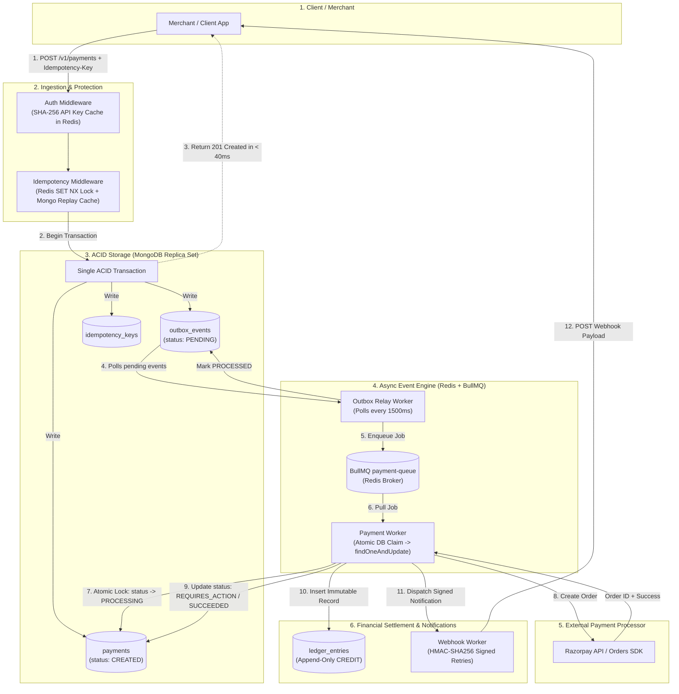
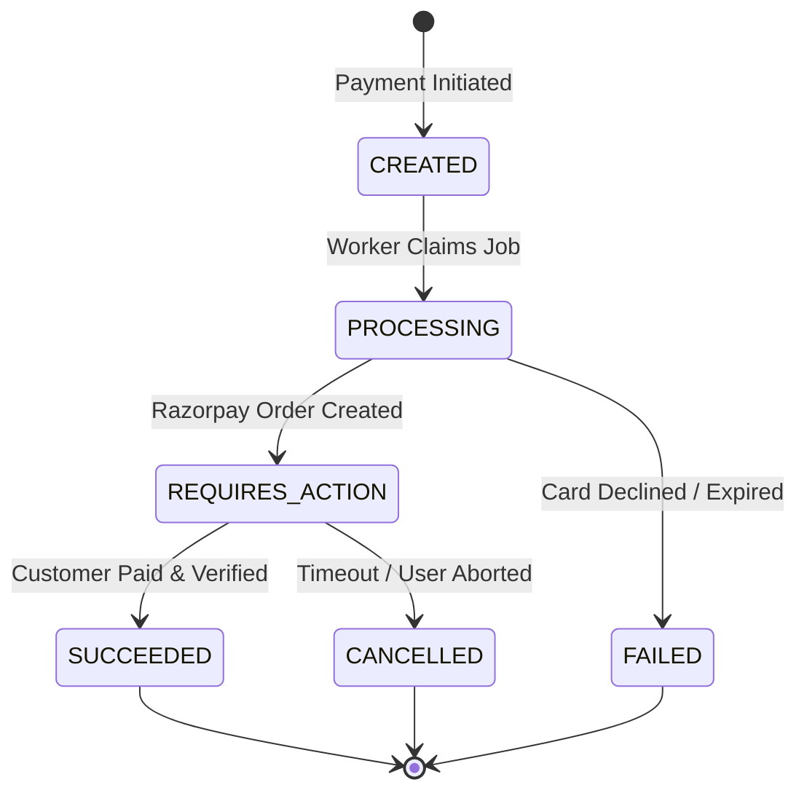

# 🏛 Architecture & Engineering Deep Dive

> This document details the architectural decisions, distributed failure handling, transactional guarantees, and concurrency controls powering the **Event-Driven Payment Gateway & Ledger Engine**.

---

## 📑 Table of Contents
1. [End-to-End Architecture Diagram](#-end-to-end-architecture-diagram)
2. [The Life of a Payment (Complete Journey)](#-the-life-of-a-payment-complete-journey)
3. [Deep Dive into Core Patterns](#-deep-dive-into-core-patterns)
   - [1. Distributed Idempotency Layer](#1-distributed-idempotency-layer)
   - [2. The Transactional Outbox Pattern](#2-the-transactional-outbox-pattern)
   - [3. Atomic Worker Claims & Concurrency Control](#3-atomic-worker-claims--concurrency-control)
   - [4. Double-Entry Append-Only Immutable Ledger](#4-double-entry-append-only-immutable-ledger)
   - [5. Payment State Machine](#5-payment-state-machine)
   - [6. Webhook Security & Dispatch Engine](#6-webhook-security--dispatch-engine)
4. [Failure Modes & Recovery Strategies](#-failure-modes--recovery-strategies)

---

## 📊 End-to-End Architecture Diagram



---

## 🚶 The Life of a Payment (Complete Journey)

```text
[Merchant] ──(1) POST /v1/payments──> [Gateway]
                                          │
                               (2) Redis SET NX lock
                                          │
                        (3) MongoDB ACID Transaction
                        ┌───────────────────────────────┐
                        │ • payment = CREATED           │
                        │ • outbox  = PENDING           │
                        │ • idemKey = SAVED             │
                        └───────────────────────────────┘
                                          │
[Merchant] <──(4) HTTP 201 CREATED (Immediate ack)
                                          │
                        (5) Outbox Relay pushes to BullMQ
                                          │
                        (6) Worker claims payment (PROCESSING)
                                          │
                        (7) Worker calls Razorpay Orders API
                                          │
                        (8) Worker records in Immutable Ledger
                                          │
[Merchant] <──(9) Webhook: payment.succeeded (Signed HMAC)
```

1. **Ingestion & Authentication:** The merchant calls `POST /v1/payments` with an `x-api-key` header and `Idempotency-Key` header. The authentication middleware validates the SHA-256 hash of the API key against a Redis cache.
2. **Idempotency Guard:** Redis evaluates `SET idem:<key> IN_FLIGHT NX EX 30`. If locked, it rejects concurrent duplicates (`409 Conflict`). If previously settled, it replays the cached response.
3. **Atomic Multi-Document Transaction:** Starts a MongoDB session and atomically writes the payment, the outbox record, and the idempotency record.
4. **Immediate Client Acknowledgment:** Returns `201 CREATED` in under 40ms.
5. **Outbox Relay:** A background loop polls pending outbox events every 1500ms, pushes them to BullMQ (`payment-queue`), and updates their status to `PROCESSED`.
6. **Atomic Worker Claim:** BullMQ worker claims the payment using an atomic `findOneAndUpdate` to prevent competing workers from double-processing.
7. **Upstream Processor:** The worker interacts with Razorpay's Orders API and attaches the upstream order ID.
8. **Ledger Settlement:** On successful capture, an append-only `CREDIT` record is created in the ledger.
9. **Webhook Dispatch:** Generates an HMAC-SHA256 signature and notifies the merchant's endpoint with exponential backoff retries.

---

## 🔬 Deep Dive into Core Patterns

### 1. Distributed Idempotency Layer

Payment APIs must guarantee that duplicate network transmissions never result in duplicate charges.

```text
Request 1 (00:00.000): POST /payments [Idempotency-Key: ORD_01] ──> Processes & caches response
Request 2 (00:00.010): POST /payments [Idempotency-Key: ORD_01] ──> 409 Conflict (Lock Active)
Request 3 (00:05.000): POST /payments [Idempotency-Key: ORD_01] ──> Returns cached response (No re-run)
```

- **In-flight Lock:** Acquired using Redis `SET key value NX EX seconds`. If a request with the same key is already in progress, additional incoming requests are immediately rejected with `409 Conflict`.
- **Response Replay:** Once completed, the final response status and payload are persisted in MongoDB with a 24-hour TTL index. Subsequent retries return the stored response without hitting business logic.

---

### 2. The Transactional Outbox Pattern

Directly publishing events to an external message queue during an HTTP request causes the **Dual-Write Hazard**:
- If the database write succeeds but the queue publish fails, the event is permanently lost.
- If the queue publish succeeds but the database transaction rolls back, phantom jobs are executed.

```javascript
// ATOMIC TRANSACTION: Both records commit together or fail together
const session = await mongoose.startSession();
session.startTransaction();

try {
  const [payment] = await Payment.create([{ ...paymentData, status: "CREATED" }], { session });
  await OutboxEvent.create([{
    eventType: "PaymentCreated",
    aggregateId: payment._id,
    payload: { paymentId: payment._id },
    status: "PENDING"
  }], { session });

  await session.commitTransaction();
} catch (error) {
  await session.abortTransaction();
} finally {
  session.endSession();
}
```

A dedicated **Outbox Relay** polls for `PENDING` outbox records and pushes them into BullMQ. If the relay process crashes mid-execution, unacknowledged records remain pending and are processed upon restart.

---

### 3. Atomic Worker Claims & Concurrency Control

In a multi-instance worker deployment, multiple workers may attempt to pull and process the same payment job concurrently.

Instead of heavy distributed table locks, we use MongoDB's document-level atomicity:

```javascript
const payment = await Payment.findOneAndUpdate(
  {
    _id: paymentId,
    status: "CREATED",
    processingLock: null
  },
  {
    $set: {
      status: "PROCESSING",
      processingLock: {
        workerId: process.env.WORKER_ID || "worker-1",
        lockedAt: new Date()
      }
    }
  },
  { new: true }
);

if (!payment) {
  // Another worker already claimed this payment; exit cleanly
  return;
}
```

Only one worker receives the updated document; all other competing workers receive `null` and terminate the duplicate job cleanly.

---

### 4. Double-Entry Append-Only Immutable Ledger

In financial accounting, account balances should **never** be updated in-place via mutations like `balance += amount`.

```text
❌ MUTATING PATTERN:
Balance = 0 ──(+100)──> Balance = 100 ──(+50)──> Balance = 150
(If balance is corrupted to 120, there is zero historical trace of who altered it!)

✅ IMMUTABLE DOUBLE-ENTRY PATTERN:
Entry 1: [CREDIT] +100  (Order #1)
Entry 2: [CREDIT] +50   (Order #2)
Entry 3: [DEBIT]  -30   (Refund #1)
Net Balance = Σ(Credits) - Σ(Debits) = 120
Every single rupee is traced to an immutable ledger transaction with audit timestamps.
```

The merchant's current balance is computed on demand via a MongoDB aggregation pipeline:

```javascript
const result = await LedgerEntry.aggregate([
  { $match: { merchantId: new mongoose.Types.ObjectId(merchantId) } },
  {
    $group: {
      _id: "$merchantId",
      totalCredit: {
        $sum: { $cond: [{ $eq: ["$direction", "CREDIT"] }, "$amount", 0] }
      },
      totalDebit: {
        $sum: { $cond: [{ $eq: ["$direction", "DEBIT"] }, "$amount", 0] }
      }
    }
  },
  {
    $project: {
      balance: { $subtract: ["$totalCredit", "$totalDebit"] }
    }
  }
]);
```

---

### 5. Payment State Machine

The payment lifecycle is enforced via a strict state machine to prevent illegal transitions:



- Payments in `SUCCEEDED`, `FAILED`, or `CANCELLED` states are immutable.
- Transitioning directly from `FAILED` to `SUCCEEDED` is prohibited.

---

### 6. Webhook Security & Dispatch Engine

- **Incoming Webhooks (from Razorpay):**
  Uses `crypto.createHmac("sha256", webhookSecret)` against the **raw request payload** to verify the `x-razorpay-signature` header before accepting payment events.
- **Outgoing Merchant Webhooks:**
  Payloads dispatched to merchant endpoints are cryptographically signed using the merchant's dedicated webhook secret.
- **Exponential Backoff:**
  Failed webhook deliveries are queued in BullMQ with exponential backoff delays (e.g. 1m, 5m, 15m, 1h) up to a maximum attempt threshold.

---

## 🛡 Failure Modes & Recovery Strategies

| Failure Scenario | Impact | Mitigation Strategy |
| :--- | :--- | :--- |
| **Merchant clicks "Pay" twice** | Network duplicate | Redis `SET NX` blocks concurrent request with `409`; subsequent requests return cached response. |
| **Server crashes after DB write** | Queue event lost | Transactional Outbox ensures event was saved in MongoDB; Outbox Relay picks it up upon reboot. |
| **Worker crashes during processing** | Payment stuck in `PROCESSING` | Reconciliation sweeper finds expired processing locks and checks Razorpay status for auto-recovery. |
| **Razorpay API times out** | Ambiguous transaction | Worker retries with processor idempotency key; status is finalized via Webhook or Reconciliation query. |
| **Merchant webhook endpoint down** | Notification delivery failure | BullMQ automatically schedules retries with exponential backoff and stores delivery attempt history. |
