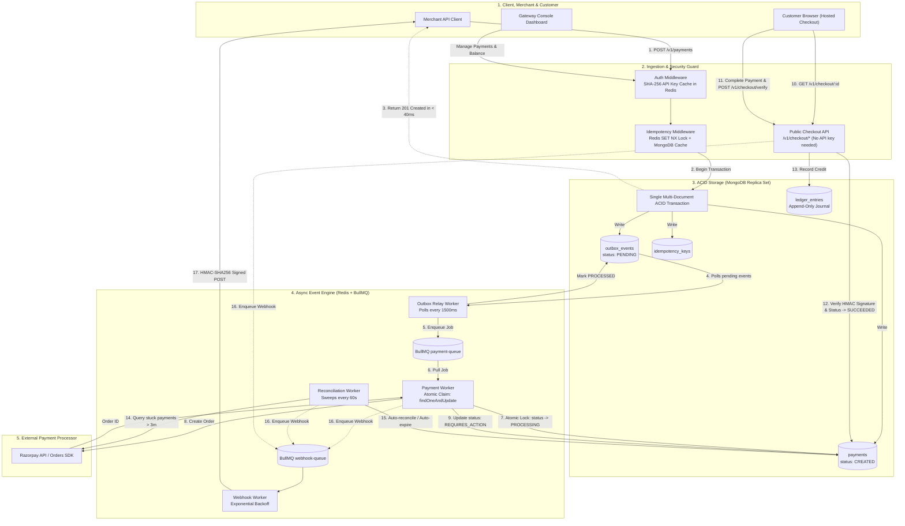
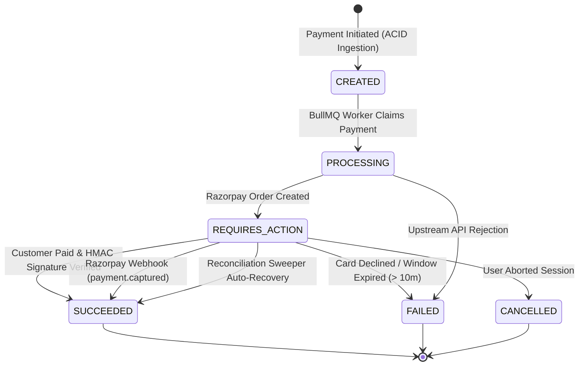
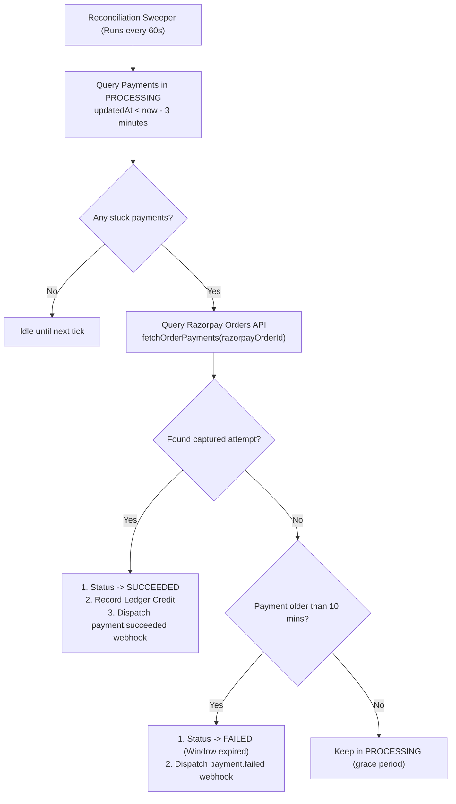

# 🏛 Architecture & Engineering Deep Dive

> This document details the architectural decisions, distributed failure handling, transactional guarantees, concurrency controls, and reconciliation mechanics powering the **Event-Driven Payment Gateway & Ledger Engine**.

---

## 📑 Table of Contents
1. [End-to-End Architecture Diagram](#-end-to-end-architecture-diagram)
2. [The Life of a Payment (Complete Journey)](#-the-life-of-a-payment-complete-journey)
3. [Deep Dive into Core Patterns](#-deep-dive-into-core-patterns)
   - [1. Distributed Idempotency Layer](#1-distributed-idempotency-layer)
   - [2. The Transactional Outbox Pattern](#2-the-transactional-outbox-pattern)
   - [3. Atomic Worker Claims & Concurrency Control](#3-atomic-worker-claims--concurrency-control)
   - [4. Double-Entry Append-Only Immutable Ledger](#4-double-entry-append-only-immutable-ledger)
   - [5. Payment State Machine & Lifecycle Transitions](#5-payment-state-machine--lifecycle-transitions)
   - [6. Self-Healing Reconciliation Engine](#6-self-healing-reconciliation-engine)
   - [7. Customer Checkout Flow & Cryptographic Verification](#7-customer-checkout-flow--cryptographic-verification)
   - [8. Webhook Security & Dispatch Engine](#8-webhook-security--dispatch-engine)
4. [Failure Modes & Recovery Matrix](#-failure-modes--recovery-matrix)

---

## 📊 End-to-End Architecture Diagram



---

## 🚶 The Life of a Payment (Complete Journey)

```text
[Merchant] ──(1) POST /v1/payments (with Idempotency-Key)──> [Gateway]
                                                                │
                                                    (2) Redis SET NX lock
                                                                │
                                            (3) MongoDB ACID Transaction
                                            ┌───────────────────────────────┐
                                            │ • payment = CREATED           │
                                            │ • outbox  = PENDING           │
                                            │ • idemKey = SAVED             │
                                            └───────────────────────────────┘
                                                                │
[Merchant] <──(4) HTTP 201 CREATED (Immediate ack < 40ms)───────┘
                                                                │
                                            (5) Outbox Relay pushes to BullMQ
                                                                │
                                            (6) Worker claims payment (PROCESSING)
                                                                │
                                            (7) Worker creates Razorpay Order
                                                status -> REQUIRES_ACTION
                                                                │
[Customer] ──(8) Opens Checkout UI (/checkout/:id)───────────────┤
[Customer] ──(9) Pays via UPI / Card / Sandbox Simulator────────┤
                                                                │
[Gateway]  ──(10) Verifies Razorpay HMAC Signature ─────────────┤
                  status -> SUCCEEDED                           │
                                                                │
                                            (11) Immutable Ledger Credit Recorded
                                                                │
[Merchant] <──(12) Webhook: payment.succeeded (Signed HMAC)─────┘
```

1. **Ingestion & Authentication:** The merchant calls `POST /v1/payments` with an `x-api-key` header and `Idempotency-Key` header. Authentication validates the SHA-256 hash of the API key against Redis.
2. **Idempotency Guard:** Redis evaluates `SET idem:<key> IN_FLIGHT NX EX 30`. If locked, it rejects concurrent duplicates (`409 Conflict`). If previously settled, it immediately replays the cached response.
3. **Atomic Multi-Document Transaction:** MongoDB starts a replica set session and atomically writes the payment document, outbox event, and idempotency cache record in one commit.
4. **Immediate Client Acknowledgment:** The client receives `201 CREATED` in under 40ms, returning the `paymentId`.
5. **Outbox Relay Dispatch:** A background process polls pending outbox events every 1500ms, pushes them to BullMQ (`payment-queue`), and flags the outbox event as `PROCESSED`.
6. **Atomic Worker Claim:** BullMQ worker claims the payment using an atomic `findOneAndUpdate` to prevent competing worker instances from double-processing.
7. **Upstream Processor Order:** The worker calls Razorpay Orders API, attaches the upstream order ID (`razorpayOrderId`), and transitions status to `REQUIRES_ACTION`.
8. **Customer Checkout Experience:** The customer opens the payment link (`/checkout/:id`) and selects UPI, Card, NetBanking, or test simulator.
9. **Cryptographic Verification:** Upon payment completion, `/v1/checkout/verify` checks the Razorpay cryptographic signature (`orderId|paymentId` signed with `RAZORPAY_KEY_SECRET`).
10. **Ledger Settlement:** When status transitions to `SUCCEEDED`, an append-only `CREDIT` record is written to the ledger collection.
11. **Self-Healing Safeguard:** If network fails during checkout, the **Reconciliation Worker** checks Razorpay's API every 60s, catching captured payments and auto-reconciling them.
12. **Merchant Webhook Dispatch:** An HMAC-SHA256 signed event payload is queued in BullMQ and delivered to the merchant's webhook URL with exponential backoff retries.

---

## 🔬 Deep Dive into Core Patterns

### 1. Distributed Idempotency Layer

Payment systems must guarantee that duplicate network transmissions never result in duplicate charges.

```text
Request 1 (00:00.000): POST /payments [Idempotency-Key: ORD_01] ──> Processes & caches response
Request 2 (00:00.010): POST /payments [Idempotency-Key: ORD_01] ──> 409 Conflict (Lock Active)
Request 3 (00:05.000): POST /payments [Idempotency-Key: ORD_01] ──> Returns cached response (No re-run)
```

- **In-flight Lock:** Acquired using Redis `SET key value NX EX 30`. If a request with the same key is already in progress, concurrent requests receive `409 Conflict`.
- **Response Replay:** Once successfully processed, the final response status and payload are persisted in MongoDB with a 24-hour TTL index. Subsequent retries return the exact cached response without hitting downstream systems.

---

### 2. The Transactional Outbox Pattern

Directly publishing events to a message queue during an HTTP request causes the **Dual-Write Hazard**:
- If the database write succeeds but the message queue write fails, the payment is orphaned.
- If the message queue publish succeeds but the database transaction rolls back, phantom jobs run.

```javascript
// ATOMIC TRANSACTION: Both records commit together or fail together
const session = await mongoose.startSession();
session.startTransaction();

try {
  const [payment] = await Payment.create([{ ...paymentData, status: "CREATED" }], { session });
  await OutboxEvent.create([{
    eventType: "PaymentCreated",
    aggregateId: payment._id,
    payload: { paymentId: payment._id },
    status: "PENDING"
  }], { session });

  await session.commitTransaction();
} catch (error) {
  await session.abortTransaction();
  throw error;
} finally {
  session.endSession();
}
```

A dedicated **Outbox Relay** polls for `PENDING` outbox records and pushes them into BullMQ. If the relay process crashes mid-execution, unacknowledged records remain pending and are processed upon restart.

---

### 3. Atomic Worker Claims & Concurrency Control

In a multi-instance worker deployment, multiple workers can attempt to pull and process the same payment job concurrently.

Instead of heavyweight distributed locks, we leverage MongoDB's document-level atomicity:

```javascript
const payment = await Payment.findOneAndUpdate(
  {
    _id: paymentId,
    status: "CREATED",
    processingLock: null
  },
  {
    $set: {
      status: "PROCESSING",
      processingLock: {
        workerId: process.env.WORKER_ID || "worker-1",
        lockedAt: new Date()
      }
    }
  },
  { new: true }
);

if (!payment) {
  // Another worker already claimed this payment; exit cleanly
  return;
}
```

Only one worker receives the updated document; all other competing workers receive `null` and terminate the duplicate job cleanly.

---

### 4. Double-Entry Append-Only Immutable Ledger

In financial accounting, account balances should **never** be updated in-place via mutations like `balance += amount`.

```text
❌ MUTATING PATTERN:
Balance = 0 ──(+100)──> Balance = 100 ──(+50)──> Balance = 150
(If balance is corrupted to 120, there is zero historical trace of who altered it!)

✅ IMMUTABLE DOUBLE-ENTRY PATTERN:
Entry 1: [CREDIT] +100  (Payment #101)
Entry 2: [CREDIT] +50   (Payment #102)
Entry 3: [DEBIT]  -30   (Refund #101)
Net Balance = Σ(Credits) - Σ(Debits) = 120
Every single rupee is traced to an immutable ledger transaction with audit timestamps.
```

The merchant's current balance is computed on demand via a MongoDB aggregation pipeline:

```javascript
const result = await LedgerEntry.aggregate([
  { $match: { merchantId: new mongoose.Types.ObjectId(merchantId) } },
  {
    $group: {
      _id: "$merchantId",
      totalCredit: {
        $sum: { $cond: [{ $eq: ["$type", "CREDIT"] }, "$amount", 0] }
      },
      totalDebit: {
        $sum: { $cond: [{ $eq: ["$type", "DEBIT"] }, "$amount", 0] }
      }
    }
  },
  {
    $project: {
      availableBalance: { $subtract: ["$totalCredit", "$totalDebit"] },
      totalCredits: "$totalCredit",
      totalDebits: "$totalDebit"
    }
  }
]);
```

---

### 5. Payment State Machine & Lifecycle Transitions

The payment lifecycle is governed by a strict unidirectional state machine:



- **Terminal States:** `SUCCEEDED`, `FAILED`, and `CANCELLED` are immutable.
- **Ledger Invariant:** A credit record is written to the ledger **if and only if** the payment transitions to `SUCCEEDED`.
- **Duplicate Protection:** Re-triggering verify or webhook on an already `SUCCEEDED` payment is a safe no-op.

---

### 6. Self-Healing Reconciliation Engine

What happens if a customer successfully authorizes a payment on Razorpay, but closes their browser before the redirect returns, or the webhook delivery is delayed?

The system runs a **Reconciliation Worker** (`reconciliation.worker.js`) every 60 seconds:



1. **Stuck Detection:** Finds all payments in `PROCESSING` status that have a `razorpayOrderId` and have not been updated for over 3 minutes.
2. **Upstream Verification:** Queries Razorpay via `orders.fetchPayments(orderId)` to retrieve all authorization attempts.
3. **Auto-Recovery:** If a captured payment attempt is found, the payment is reconciled to `SUCCEEDED`, the ledger is credited, and webhooks are fired.
4. **Auto-Expiry:** If no captured attempt exists and 10 minutes have elapsed, the payment is cleanly marked `FAILED`.

---

### 7. Customer Checkout Flow & Cryptographic Verification

The checkout system exposes public endpoints (`/v1/checkout/*`) that power the customer payment UI without exposing the merchant's private API key:

1. **Session Fetch (`GET /v1/checkout/:id`):** Returns payment amount, currency, merchant business name, and order metadata.
2. **Cryptographic Verification (`POST /v1/checkout/verify`):**
   ```javascript
   const expectedSignature = crypto
     .createHmac("sha256", process.env.RAZORPAY_KEY_SECRET)
     .update(`${razorpayOrderId}|${razorpayPaymentId}`)
     .digest("hex");

   if (expectedSignature !== razorpaySignature) {
     throw new Error("Invalid payment signature");
   }
   ```
3. **Sandbox Simulator (`POST /v1/checkout/simulate`):** Enables instant developer testing without Razorpay sandbox credentials by generating simulated test charges and triggering the real ledger credit pipeline.

---

### 8. Webhook Security & Dispatch Engine

- **Inbound Webhook Verification (from Razorpay):**
  Uses `crypto.createHmac("sha256", webhookSecret)` evaluated against the **exact raw request body buffer** to verify the `x-razorpay-signature` header before accepting events.
- **Outbound Merchant Webhook Delivery:**
  Dispatches signed HTTP POST requests to the merchant's configured URL with signature header:
  `X-Gateway-Signature: hmac_sha256(payload, merchantWebhookSecret)`.
- **Fault-Tolerant Retries:**
  Failures are caught by BullMQ workers and retried using exponential backoff (e.g. 1m, 5m, 15m, 1h) to handle temporary merchant server downtime.

---

## 🛡 Failure Modes & Recovery Matrix

| Failure Scenario | Immediate Impact | System Mitigation & Recovery |
| :--- | :--- | :--- |
| **Merchant clicks "Pay" twice** | Double-submit network retry | Redis `SET NX` locks the key. The second call receives `409 Conflict` (if in-flight) or the exact cached response (if settled). |
| **Server crashes immediately after DB write** | Outbox event not yet pushed to BullMQ | The transaction saved both Payment and `OutboxEvent` in MongoDB atomically. When the server restarts, Outbox Relay picks it up. |
| **Worker crashes during order creation** | Payment left in `PROCESSING` | Reconciliation sweeper inspects expired processing locks, queries Razorpay API, and recovers or releases the job. |
| **Customer pays but closes browser before redirect** | Gateway didn't receive redirect verification | Reconciliation worker detects the order on Razorpay within 3 minutes and auto-settles payment to `SUCCEEDED` with ledger credit. |
| **Razorpay API times out during order creation** | Ambiguous transaction state | Worker utilizes processor idempotency keys on retry; reconciliation sweep cleans up any unresolved orders. |
| **Merchant webhook endpoint returns 500** | Notification delivery failure | BullMQ automatically schedules retries with exponential backoff and tracks attempt counts in the database. |
| **Database primary failover during transaction** | Write failure | MongoDB Replica Set automatically elects a new primary; Mongoose retries write or client safely replays using Idempotency-Key. |

---

## 📖 Related Documentation
- [README.md](./README.md) — Quickstart, environment setup, and API reference
- [Phase Implementation Guides](./phases/README.md) — 9-phase guided breakdown of each architectural layer
- [Frontend README](./frontend/README.md) — Gateway Console dashboard & checkout UI guide
