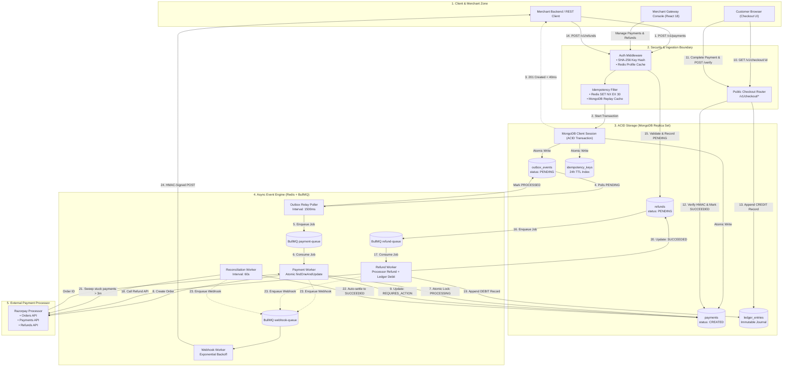
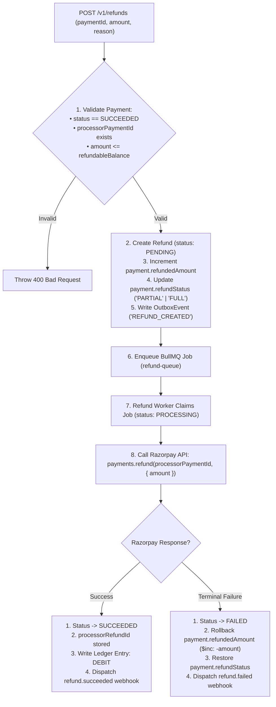
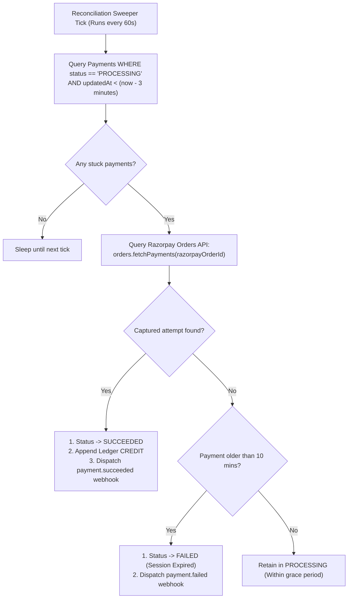
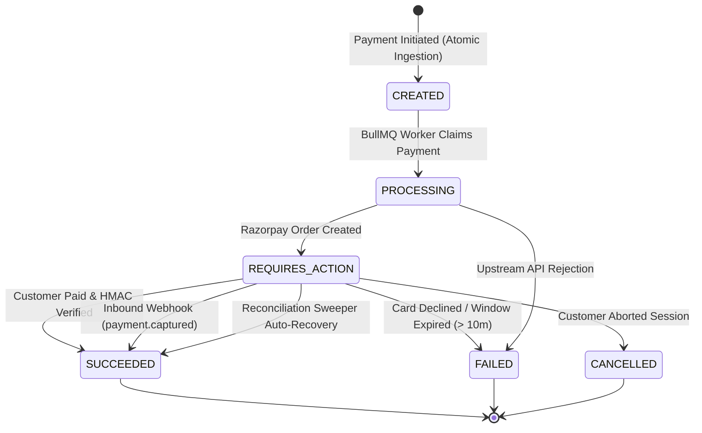
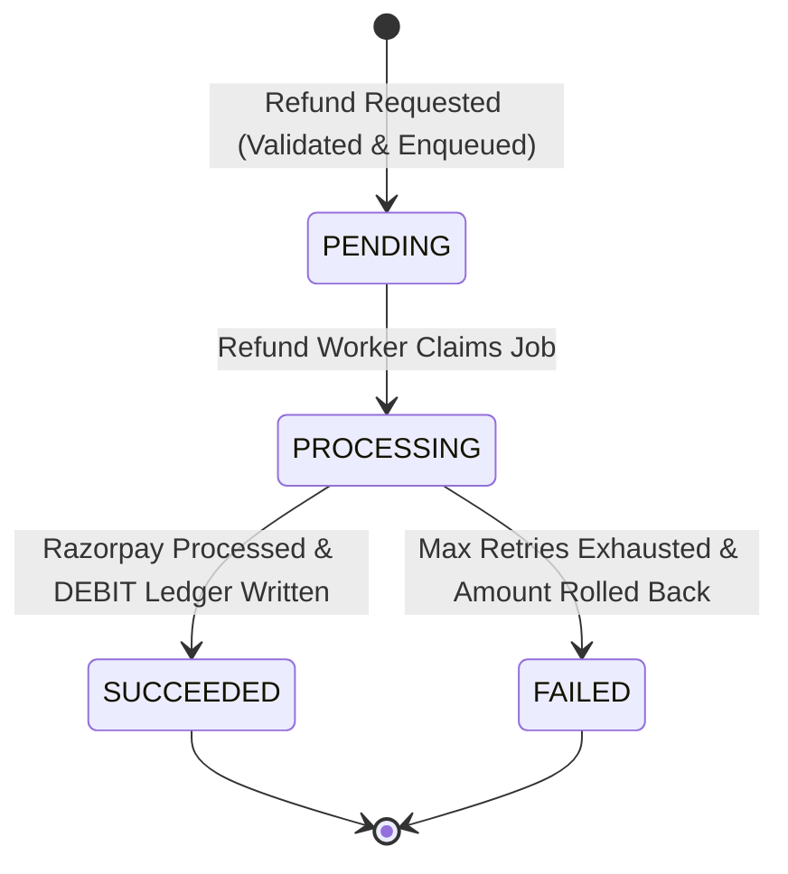

# 🏛 Architecture & Engineering Deep Dive

> A technical specification of the architectural patterns, distributed failure handling, transactional guarantees, concurrency controls, and reconciliation mechanics powering the **Event-Driven Payment Gateway & Ledger Engine**.

---

## 📑 Table of Contents
1. [Architectural Philosophy & Distributed Systems Foundations](#-architectural-philosophy--distributed-systems-foundations)
2. [End-to-End System Topology & Data Flow](#-end-to-end-system-topology--data-flow)
3. [Deep Dive into Core Architectural Pillars](#-deep-dive-into-core-architectural-pillars)
   - [Pillar 1: Two-Tier Distributed Idempotency Layer](#pillar-1-two-tier-distributed-idempotency-layer)
   - [Pillar 2: Transactional Outbox Pattern & Dual-Write Elimination](#pillar-2-transactional-outbox-pattern--dual-write-elimination)
   - [Pillar 3: Atomic Worker Claims & Concurrency Control](#pillar-3-atomic-worker-claims--concurrency-control)
   - [Pillar 4: Append-Only Immutable Double-Entry Ledger](#pillar-4-append-only-immutable-double-entry-ledger)
   - [Pillar 5: Asynchronous Refund Engine & Financial Inversion](#pillar-5-asynchronous-refund-engine--financial-inversion)
   - [Pillar 6: Autonomous Self-Healing Reconciliation Sweeper](#pillar-6-autonomous-self-healing-reconciliation-sweeper)
   - [Pillar 7: Hosted Checkout & Cryptographic HMAC Verification](#pillar-7-hosted-checkout--cryptographic-hmac-verification)
   - [Pillar 8: Webhook Security & Exponential Backoff Retries](#pillar-8-webhook-security--exponential-backoff-retries)
4. [File-by-File Engineering Blueprint & Code Flow](#-file-by-file-engineering-blueprint--code-flow)
   - [Backend Module Architecture & File Flows](#backend-module-architecture--file-flows)
   - [Frontend Console Architecture & Data Flow](#frontend-console-architecture--data-flow)
5. [State Machines & Lifecycle Transitions](#-state-machines--lifecycle-transitions)
   - [Payment State Machine](#payment-state-machine)
   - [Refund State Machine](#refund-state-machine)
6. [Exhaustive Failure Mode & Recovery Matrix](#-exhaustive-failure-mode--recovery-matrix)

---

## 🧭 Architectural Philosophy & Distributed Systems Foundations

Payment infrastructure handles real financial value across untrusted, asynchronous networks. Traditional web application patterns (such as executing third-party API calls synchronously inside an HTTP request handler, or updating account balances directly with `balance += amount`) create unacceptable systemic risks:

1. **The Dual-Write Problem:** If an application writes to a relational database and then publishes to an external message queue, one operation can succeed while the other fails (e.g. process crash, network partition). Two-Phase Commit (2PC) is prohibitively slow and unsupported across disparate modern datastores.
2. **In-Place Balance Mutation:** In-place mutations (`account.balance = newBalance`) destroy forensic history. If a race condition, integer overflow, or software bug corrupts the balance field, there is no mathematical proof of which transaction caused the discrepancy.
3. **The Indeterminate State Problem:** Networks drop packets. When an HTTP call to an upstream payment processor times out, the client cannot know whether the charge succeeded, failed, or is pending upstream. Synchronous retries risk charging the customer twice.

### Core Architectural Invariants
To eliminate these failure classes, the platform enforces five fundamental invariants:
- **Consistency over Availability for Financial Records:** Ledger entries must be strictly append-only and multi-document ACID compliant.
- **At-Least-Once Delivery with Idempotent Deduplication:** Every message is delivered at least once, and every consumer is strictly idempotent.
- **Immediate Ingestion Acknowledgment (< 40ms):** Heavy processor communication is completely decoupled from the synchronous HTTP request path.
- **Autonomous Eventual Consistency:** Background reconciliation actively audits and converges indeterminate states into finalized terminal states.
- **Zero Raw Secret Exposure:** Plaintext API keys and processor credentials never touch customer-facing browsers or unauthenticated endpoints.

---

## 📊 End-to-End System Topology & Data Flow



---

## 🔬 Deep Dive into Core Architectural Pillars

### Pillar 1: Two-Tier Distributed Idempotency Layer

Distributed payment networks must ensure that duplicate requests (caused by client retries, network glitches, or user double-clicks) never trigger duplicate charges.

```text
Request 1 (T = 0ms)  ──> Redis SET NX EX 30 (Succeeds: 'IN_FLIGHT') ──> Process & Save Cache in MongoDB
Request 2 (T = 15ms) ──> Redis SET NX EX 30 (Fails: Key Locked)    ──> HTTP 409 Conflict
Request 3 (T = 5000ms)─> Redis SET NX EX 30 (Lock Expired)         ──> MongoDB Hit ──> Replay HTTP 201
```

#### Tier 1: Fast-Path Distributed In-Flight Lock (Redis)
- When an API request arrives with an `Idempotency-Key` header, the middleware executes:
  ```javascript
  const acquired = await redisClient.set(
    `idem:${merchantId}:${idempotencyKey}`,
    "IN_FLIGHT",
    "EX",
    30,
    "NX"
  );
  ```
- If `acquired === null`, a concurrent request with the exact same idempotency key is currently executing. The middleware immediately aborts with `409 Conflict: Request currently in progress`.

#### Tier 2: Persistent Replay Cache (MongoDB)
- Upon completion of the business transaction, the HTTP response status code and JSON body are stored in the `idempotency_keys` collection with a 24-hour TTL index.
- If a client replays the same request after the Redis lock has cleared, the middleware retrieves the stored document and returns the exact identical response with the header `X-Idempotent-Replay: true`.

---

### Pillar 2: Transactional Outbox Pattern & Dual-Write Elimination

In microservices and distributed systems, publishing an event to a queue immediately after writing to a database creates the **Dual-Write Hazard**:
- **Scenario A:** Database commits, but the application crashes before publishing to BullMQ. The payment exists in the database, but no background worker ever processes it.
- **Scenario B:** The application publishes to BullMQ, but the database transaction rolls back due to a constraint violation. Workers process a phantom payment that does not exist in the database.

```javascript
// ATOMIC TRANSACTION: Both records commit together or fail together
const session = await mongoose.startSession();
session.startTransaction();

try {
  const [payment] = await Payment.create([{ ...paymentData, status: "CREATED" }], { session });
  
  await OutboxEvent.create([{
    aggregateType: "PAYMENT",
    aggregateId: payment._id.toString(),
    eventType: "PAYMENT_CREATED",
    payload: { paymentId: payment._id.toString() },
    status: "PENDING"
  }], { session });

  await session.commitTransaction();
} catch (error) {
  await session.abortTransaction();
  throw error;
} finally {
  session.endSession();
}
```

#### The Outbox Relay Process (`outbox.relay.js`)
1. An autonomous background loop polls MongoDB every 1500ms:
   ```javascript
   const pendingEvents = await OutboxEvent.find({ status: "PENDING" }).limit(50);
   ```
2. For each pending event, it pushes a job into BullMQ using a deterministic job ID (`jobId: outbox_<id>`), ensuring that BullMQ itself deduplicates any duplicate pushes.
3. Once BullMQ acknowledges ingestion, the relay updates the outbox record to `status: "PROCESSED"`.

---

### Pillar 3: Atomic Worker Claims & Concurrency Control

When multiple instances of the payment worker run across different server containers or threads, multiple workers can attempt to process the same payment job concurrently.

Rather than relying on distributed locks (like Redlock, which introduce clock-drift vulnerabilities), the engine utilizes **document-level atomicity** in MongoDB:

```javascript
const payment = await Payment.findOneAndUpdate(
  {
    _id: paymentId,
    status: "CREATED",
    "processingLock.lockedAt": null
  },
  {
    $set: {
      status: "PROCESSING",
      processingLock: {
        workerId: `worker-${process.pid}`,
        lockedAt: new Date()
      }
    }
  },
  { new: true }
);

if (!payment) {
  // Another worker instance has already claimed this payment; exit cleanly
  return;
}
```

- MongoDB executes `findOneAndUpdate` atomically at the document level.
- Exactly one worker receives the updated document; all competing workers receive `null` and terminate their jobs without performing any duplicate processor calls.

---

### Pillar 4: Append-Only Immutable Double-Entry Ledger

In traditional systems, account balances are updated with mutations like `balance += amount`. In fintech, this pattern is catastrophic:
- If an admin or bug alters a balance, there is zero historical trace of who changed it, when, or why.
- High-concurrency balance updates cause write lock contention and deadlocks.

```text
❌ MUTATING PATTERN:
Balance = 0 ──(+100)──> Balance = 100 ──(+50)──> Balance = 150
(If balance is corrupted to 120, there is zero historical trace of who altered it!)

✅ IMMUTABLE DOUBLE-ENTRY PATTERN:
Entry 1: [CREDIT] +100  (Payment #101)
Entry 2: [CREDIT] +50   (Payment #102)
Entry 3: [DEBIT]  -30   (Refund #101)
Net Balance = Σ(Credits) - Σ(Debits) = 120
Every single rupee is traced to an immutable ledger transaction with audit timestamps.
```

#### Real-Time Balance Aggregation Pipeline
The merchant's balance is dynamically computed on demand from immutable journal records:

```javascript
const [balanceSummary] = await LedgerEntry.aggregate([
  { $match: { merchantId: new mongoose.Types.ObjectId(merchantId) } },
  {
    $group: {
      _id: "$merchantId",
      totalCredits: {
        $sum: { $cond: [{ $eq: ["$type", "CREDIT"] }, "$amount", 0] }
      },
      totalDebits: {
        $sum: { $cond: [{ $eq: ["$type", "DEBIT"] }, "$amount", 0] }
      }
    }
  },
  {
    $project: {
      availableBalance: { $subtract: ["$totalCredits", "$totalDebits"] },
      totalCredits: 1,
      totalDebits: 1
    }
  }
]);
```

---

### Pillar 5: Asynchronous Refund Engine & Financial Inversion

The platform provides a complete **Phase 9 Refund Engine** that handles both full and partial refunds with strict balance guarantees:



#### Remaining Balance Calculation
The refund service checks:
$$\text{Remaining Refundable} = \text{Payment Amount} - \text{Current Refunded Amount}$$
If $\text{Requested Refund} > \text{Remaining Refundable}$, the request is rejected synchronously before any upstream calls are initiated.

#### Financial Reversal via Ledger Debit
When a refund succeeds upstream, an immutable `DEBIT` entry is recorded:
```javascript
await recordDebit({
  merchantId: refund.merchantId,
  paymentId: refund.paymentId,
  refundId: refund._id,
  amount: refund.amount,
  currency: refund.currency,
  description: `Refund executed for payment ${refund.paymentId}`
});
```
This automatically decreases the merchant's aggregated available balance without mutating previous records.

#### Compensation Rollback Mechanism
If the upstream processor permanently rejects the refund after all BullMQ retry attempts are exhausted:
1. `Refund.status` transitions to `FAILED` with `failureReason`.
2. The payment's `refundedAmount` is atomically rolled back using `$inc: { refundedAmount: -refund.amount }`.
3. The payment's `refundStatus` is recalculated (`NONE` or `PARTIAL`).
4. A `refund.failed` webhook is dispatched to notify the merchant.

---

### Pillar 6: Autonomous Self-Healing Reconciliation Sweeper

In real-world networks, customers often pay on Razorpay but close their browser tab before redirecting back to the gateway. Additionally, webhook packets may be dropped or delayed by transit firewalls.

The **Reconciliation Worker** (`reconciliation.worker.js`) executes an autonomous audit every 60 seconds:



- **Grace Period (3 minutes):** Allows active checkout sessions time to complete normally.
- **Auto-Recovery:** If Razorpay indicates the order was captured, the sweeper reconciles the payment to `SUCCEEDED` and writes the missing ledger `CREDIT` entry.
- **Auto-Expiry (10 minutes):** If no payment attempt was captured after 10 minutes, the abandoned session is cleanly marked `FAILED`.

---

### Pillar 7: Hosted Checkout & Cryptographic HMAC Verification

The customer checkout engine completely separates public customer interactions from private merchant management:

1. **Public Checkout Session (`GET /v1/checkout/:id`):** Returns only the payment amount, currency, and merchant name. Private credentials, ledger balances, and webhook secrets are never exposed.
2. **Cryptographic Signature Verification (`POST /v1/checkout/verify`):**
   ```javascript
   const body = `${razorpayOrderId}|${razorpayPaymentId}`;
   const expectedSignature = crypto
     .createHmac("sha256", process.env.RAZORPAY_KEY_SECRET)
     .update(body)
     .digest("hex");

   if (expectedSignature !== razorpaySignature) {
     throw new Error("Invalid payment signature");
   }
   ```
3. **Developer Sandbox Simulator (`POST /v1/checkout/simulate`):** Allows end-to-end testing of payment success, payment failure, and ledger settlement without requiring real bank credentials.

---

### Pillar 8: Webhook Security & Exponential Backoff Retries

- **Inbound Webhook Verification (from Razorpay):**
  Uses `crypto.createHmac("sha256", webhookSecret)` evaluated against the **exact raw request buffer** (`req.rawBody`) captured before JSON parsing. This prevents signature mismatches caused by key reordering or whitespace normalization.
- **Outbound Merchant Webhook Delivery:**
  Dispatches HTTP POST requests with header:
  `X-Gateway-Signature: HMAC_SHA256(JSON.stringify(payload), merchant.webhookSecret)`
- **Exponential Backoff:** If the merchant's server returns a non-2xx status code, BullMQ automatically schedules retries with exponential backoff (e.g. 10s, 20s, 40s, 80s, 160s).

---

## 🏗 File-by-File Engineering Blueprint & Code Flow

### Backend Module Architecture & File Flows

```text
backend/src/
├── app.js                          # Express setup, middleware chains, worker supervisors
├── config/
│   ├── db.js                       # Mongoose connection with replica set support
│   ├── logger.js                   # Winston JSON and development console logging
│   ├── razorpay.js                 # Razorpay SDK initialization
│   └── redis.js                    # ioredis client singleton
├── middleware/
│   ├── auth.js                     # API key validation with Redis caching
│   ├── idempotency.js              # Redis SET NX EX lock + MongoDB response replay
│   └── morgan.middleware.js        # Morgan HTTP access logger piped into Winston
├── modules/
│   ├── checkout/
│   │   ├── checkout.controller.js  # Public checkout data, HMAC verify & simulation
│   │   └── checkout.routes.js      # Public router definitions for /v1/checkout
│   ├── ledger/
│   │   ├── ledger.model.js         # Mongoose schema for immutable CREDIT / DEBIT records
│   │   ├── ledger.routes.js        # Routes for /v1/ledger (balance & journal entries)
│   │   └── ledger.service.js       # Transactional credit/debit writing & aggregation
│   ├── merchants/
│   │   ├── merchant.controller.js  # Merchant registration & profile retrieval
│   │   ├── merchant.model.js       # Schema storing hashed API key & webhook configs
│   │   └── merchant.routes.js      # Routes for /v1/merchants
│   ├── payments/
│   │   ├── outbox.model.js         # Transactional Outbox schema (pending/processed)
│   │   ├── payment.controller.js   # Fast payment creation & payment listing
│   │   ├── payment.model.js        # State machine schema with processing locks
│   │   └── payment.routes.js       # Routes for /v1/payments
│   ├── processors/
│   │   └── razorpay.processor.js   # Razorpay API abstractions & signature verification
│   ├── refunds/
│   │   ├── refund.controller.js    # Refund endpoint handlers & query lookups
│   │   ├── refund.model.js         # Refund schema (PENDING, PROCESSING, SUCCEEDED, FAILED)
│   │   ├── refund.routes.js        # Routes for /v1/refunds with idempotency guard
│   │   └── refund.service.js       # Refund validation, remaining balance checks, outbox write
│   └── webhooks/
│       ├── razorpay.webhook.js     # Inbound Razorpay raw-body signature verification
│       ├── webhook.model.js        # Outbound delivery logs & retry attempt tracking
│       └── webhook.routes.js       # Routes for /v1/webhooks
├── queues/
│   ├── payment.queue.js            # BullMQ "payment-queue" instance
│   ├── refund.queue.js             # BullMQ "refund-queue" instance
│   └── webhook.queue.js            # BullMQ "webhook-queue" instance
└── workers/
    ├── outbox.relay.js             # Polls outbox_events and enqueues to BullMQ
    ├── payment.worker.js           # Claims payments atomically & creates Razorpay orders
    ├── reconciliation.worker.js    # 60s periodic sweeper that heals stuck payments
    ├── refund.worker.js            # Calls Razorpay refund API & writes ledger DEBIT
    └── webhook.worker.js           # Dispatches signed webhooks with exponential retries
```

#### File-by-File Analysis (Backend)

| File | Primary Functions / Responsibilities | Inputs / Triggers | Outputs / Side Effects | Architectural Conclusion |
| :--- | :--- | :--- | :--- | :--- |
| **`app.js`** | Bootstraps Express 5 server, sets up security middleware, binds error handlers, starts background relays and sweepers. | Server startup (`npm run dev`). | Starts HTTP listener on `PORT`, connects MongoDB, starts `outbox.relay` (1500ms) and `reconciliation.worker` (60s). | Central process coordinator ensuring all components initialize deterministically. |
| **`config/db.js`** | Connects to MongoDB Replica Set via Mongoose. | Called by `app.js` during boot. | Establishes MongoDB replica connection pool; enables ACID transactions. | Enforces database transaction readiness before HTTP requests are served. |
| **`config/redis.js`** | Exports singleton `ioredis` client. | Imported by workers, queues, and idempotency middleware. | Active Redis connection with auto-reconnection logic. | In-memory backbone for distributed locks and BullMQ job queues. |
| **`middleware/auth.js`** | Authenticates merchant via `x-api-key`. | HTTP requests with `x-api-key`. | Computes SHA-256 hash; checks Redis cache; attaches `req.merchant`. | Sub-millisecond authentication with zero plaintext credential exposure. |
| **`middleware/idempotency.js`** | Distributed idempotency filter. | HTTP POST requests with `Idempotency-Key`. | Redis `SET NX EX` lock; MongoDB replay cache lookup and persistence. | Guarantees exactly-once execution for state-mutating payment and refund APIs. |
| **`modules/checkout/checkout.controller.js`** | Handles public customer checkout sessions. | `GET /v1/checkout/:id`, `POST /verify`, `POST /simulate`. | Validates HMAC signature, updates payment status, writes ledger credit, queues webhooks. | Bridges the public customer payment experience with the internal ledger engine. |
| **`modules/ledger/ledger.service.js`** | Executes append-only journal entries and calculates balances. | `recordCredit()`, `recordDebit()`, `getMerchantBalance()`. | Appends immutable records to `ledger_entries`; runs aggregation pipeline. | Eliminates balance drift; balances are always mathematically derived from history. |
| **`modules/payments/payment.service.js`** | Transactional payment ingestion. | `createPayment({ merchantId, amount, ... })`. | Atomic multi-document transaction writing Payment and OutboxEvent. | Delivers sub-40ms response latency while eliminating dual-write hazards. |
| **`modules/refunds/refund.service.js`** | Business validation and initiation of refunds. | `createRefund({ merchantId, paymentId, amount, reason })`. | Validates refundable balance; saves pending `Refund`; updates payment; enqueues BullMQ job. | Prevents over-refunds and initiates asynchronous upstream processing safely. |
| **`workers/payment.worker.js`** | Asynchronous payment processor consumer. | Jobs from `payment-queue`. | Claims payment via `findOneAndUpdate`; creates Razorpay order; sets `REQUIRES_ACTION`. | Moves slow external network calls completely out of the client request path. |
| **`workers/refund.worker.js`** | Asynchronous refund processor consumer. | Jobs from `refund-queue`. | Calls Razorpay refund API; writes ledger `DEBIT`; updates status; handles compensation rollback. | Executes financial reversals safely with automatic rollback on terminal failure. |
| **`workers/reconciliation.worker.js`**| Periodic autonomous sweeper. | Timer tick every 60 seconds. | Queries Razorpay Orders API for stuck payments; auto-settles or auto-expires. | Self-heals broken checkout sessions without requiring manual support intervention. |
| **`workers/webhook.worker.js`** | Outbound merchant webhook dispatcher. | Jobs from `webhook-queue`. | Computes HMAC signature; performs HTTP POST; executes exponential retries. | Guarantees reliable, verifiable event notification to external merchant servers. |

---

### Frontend Console Architecture & Data Flow

```text
frontend/src/
├── main.jsx                        # Entrypoint with context providers
├── App.jsx                         # React Router routes and layout structure
├── components/
│   ├── layout/
│   │   ├── AppShell.jsx            # Authenticated layout frame
│   │   ├── ProtectedRoute.jsx      # API key route protection guard
│   │   ├── SearchModal.jsx         # Global search dialog (CMD+K)
│   │   ├── Sidebar.jsx             # Collapsible navigation drawer
│   │   └── Topbar.jsx              # Status bar with health and profile
│   ├── refunds/
│   │   └── RefundModal.jsx         # Modal to initiate full or partial refund
│   └── ui/                         # Atomic design UI elements (Card, Badge, Button, etc.)
├── context/
│   ├── AuthContext.jsx             # Merchant credentials & connection state
│   └── ToastContext.jsx            # Toast alerts provider
├── hooks/
│   ├── useFetch.js                 # Polling-capable data fetching hook
│   └── useHealth.js                # Live backend health monitor hook
├── lib/
│   ├── api.js                      # Centralized typed HTTP API client
│   ├── constants.js                # App constants, navigation links & status maps
│   ├── format.js                   # Currency, timestamp & status color formatters
│   └── paymentStore.js             # Local storage persistence for simulated payments
└── pages/
    ├── CheckoutPage.jsx            # Customer hosted checkout portal
    ├── DashboardPage.jsx           # Overview metrics, charts & recent transactions
    ├── LedgerPage.jsx              # Double-entry ledger audit journal
    ├── PaymentDetailPage.jsx       # Transaction inspection & outbox event trace
    ├── PaymentsPage.jsx            # Payments table with live auto-polling
    ├── RefundsPage.jsx             # Refunds table with live auto-polling & direct search
    ├── SettingsPage.jsx            # Merchant profile & webhook secret display
    └── WebhooksPage.jsx            # Webhook delivery audit logs
```

#### Real-Time Auto-Polling Architecture (Frontend)
To maintain real-time accuracy without expensive WebSocket overhead, the frontend incorporates **smart in-flight auto-polling**:
- On [`PaymentsPage.jsx`](file:///d:/Backend/Backend%20Projects/Event-Driven%20Payment%20Gateway%20&%20Ledger%20Engine/frontend/src/pages/PaymentsPage.jsx), [`PaymentDetailPage.jsx`](file:///d:/Backend/Backend%20Projects/Event-Driven%20Payment%20Gateway%20&%20Ledger%20Engine/frontend/src/pages/PaymentDetailPage.jsx), and [`RefundsPage.jsx`](file:///d:/Backend/Backend%20Projects/Event-Driven%20Payment%20Gateway%20&%20Ledger%20Engine/frontend/src/pages/RefundsPage.jsx), an active `useEffect` checks if any item is in an in-flight status (`PENDING` or `PROCESSING`).
- If in-flight items exist, the component polls the backend every 2500ms, displaying an animated `"Live updating..."` pulse badge.
- As soon as all items transition to terminal states (`SUCCEEDED`, `FAILED`, or `CANCELLED`), polling automatically ceases, conserving network and CPU resources.

---

## 🔄 State Machines & Lifecycle Transitions

### Payment State Machine



- **Terminal States:** `SUCCEEDED`, `FAILED`, and `CANCELLED` are immutable.
- **Ledger Invariant:** A credit record is written to the ledger **if and only if** the payment transitions to `SUCCEEDED`.
- **Deduplication:** Subsequent verification or webhook calls on an already `SUCCEEDED` payment are safe, idempotent no-ops.

---

### Refund State Machine



- **Validation:** Only payments with status `SUCCEEDED` can be refunded.
- **Ledger Invariant:** An immutable `DEBIT` entry is recorded **if and only if** the refund reaches `SUCCEEDED`.
- **Compensation:** If the refund reaches `FAILED`, the payment's `refundedAmount` is decremented back to its previous state.

---

## 🛡 Exhaustive Failure Mode & Recovery Matrix

| # | Failure Scenario | Immediate Impact | System Mitigation & Recovery Mechanism |
| :-: | :--- | :--- | :--- |
| **1** | **User double-clicks "Pay"** | Duplicate HTTP requests sent within milliseconds | Redis `SET NX EX 30` locks the key on Request 1; Request 2 is immediately rejected with `409 Conflict`. |
| **2** | **Client retries request after timeout** | Same idempotency key re-sent after 5 seconds | The Redis lock has cleared, but MongoDB's `idempotency_keys` collection finds the cached response and replays it with `X-Idempotent-Replay: true`. |
| **3** | **Server crashes immediately after DB write** | Payment saved in DB, but job not pushed to BullMQ | The MongoDB multi-document transaction committed the `Payment` and `OutboxEvent` together. When the server restarts, `outbox.relay.js` polls the pending event and pushes it to BullMQ. |
| **4** | **Payment worker crashes during order creation** | Payment left in `PROCESSING` status | The `reconciliation.worker.js` detects the expired lock after 3 minutes, checks the Razorpay API, and recovers or re-enqueues the payment. |
| **5** | **Customer pays on Razorpay but closes browser** | Gateway never receives redirect verification | `reconciliation.worker.js` queries Razorpay's API every 60s, finds the captured transaction, sets status to `SUCCEEDED`, and appends the ledger `CREDIT`. |
| **6** | **Razorpay API times out during refund** | Ambiguous refund state | BullMQ automatically retries the job with exponential backoff. The upstream payment ID ensures the processor deduplicates duplicate refund attempts. |
| **7** | **Refund permanently rejected upstream** | Customer account closed / expired card | Worker catches terminal failure after 5 attempts, marks Refund `FAILED`, decrements `payment.refundedAmount`, updates `refundStatus`, and emits `refund.failed` webhook. |
| **8** | **Merchant webhook endpoint returns 500** | Notification delivery failure | BullMQ `webhook-queue` retries delivery with exponential backoff (10s, 20s, 40s, 80s, 160s) and tracks failure attempts in the database. |
| **9** | **Attacker tampers with webhook payload** | Malicious status manipulation | Inbound webhooks are validated against `RAZORPAY_WEBHOOK_SECRET` using raw request body buffers (`req.rawBody`). Invalid signatures are rejected immediately with `400 Bad Request`. |
| **10** | **MongoDB Primary node fails during transaction** | Write failure | The MongoDB Replica Set automatically elects a new primary in < 2 seconds; Mongoose driver retries write or client safely retries with the same `Idempotency-Key`. |
| **11** | **Redis crashes or restarts** | Distributed locks and queues temporarily unavailable | In-flight requests fall back gracefully; once Redis restarts, BullMQ reloads persistent queue state and resumes job consumption. |
| **12** | **Concurrent refund requests for same payment** | Risk of refunding more than original payment | The `createRefund` service uses strict validation against remaining balance, and routes enforce the distributed `idempotency()` middleware. |

---

## 📖 Related Documentation
- **[README.md](./README.md)** — Getting started guide, environment setup, and full API reference.
- **[Backend package.json](./backend/package.json)** — Backend dependencies and scripts.
- **[Frontend package.json](./frontend/package.json)** — Frontend dependencies and build configuration.
