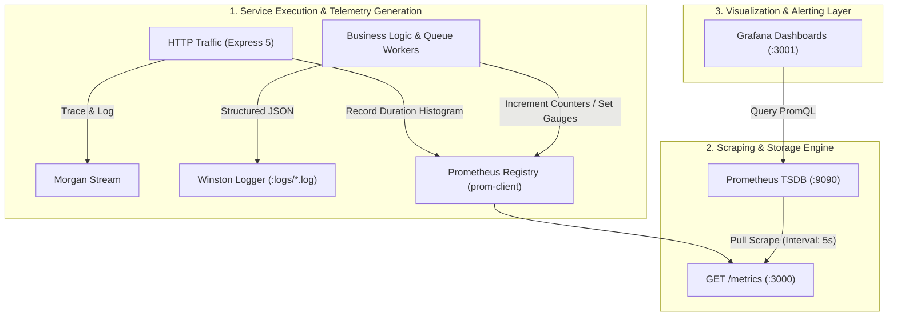

# 📊 Observability, Telemetry & Testing Specification
> **Production Telemetry Architecture, SLIs/SLOs, Metrics Pipeline, and Automated Verification Engine**

---

## 📌 1. Architectural Philosophy & Overview

In distributed financial architectures, system health cannot be inferred merely from HTTP status codes. Background queues, asynchronous outbox relays, and immutable ledger operations introduce failure modes (e.g., silent queue stalls, outbox lag, database replication delays) that require **continuous telemetry** and **deterministic test guarantees**.

This specification outlines the two core operational pillars of the Payment Gateway & Ledger Engine:
1. **Full-Stack Observability**: Multi-dimensional metrics collection (Prometheus), dynamic visualization (Grafana), and structured telemetry logging (Winston).
2. **Automated Verification**: Deterministic, zero-network-dependency unit test suite (Vitest) validating idempotency, cryptographic signatures, and double-entry mathematical invariants.

---

## 🏗️ 2. Telemetry Architecture & Data Flow



---

## 📈 3. Observability Architecture

### 3.1 Metrics Instrumentation (`prom-client`)
All metrics are registered in an isolated `client.Registry` instance within `src/config/metrics.js` using the global namespace prefix `payment_gw_`.

#### Metric Definitions & Schemas

| Metric Identifier | Type | Labels | Description & Operational Purpose |
| :--- | :--- | :--- | :--- |
| `payment_gw_http_request_duration_seconds` | **Histogram** | `method`, `route`, `status_code` | HTTP ingress latency percentiles (p50, p95, p99). Buckets: `[0.05, 0.1, 0.25, 0.5, 1, 2.5, 5]`. |
| `payment_gw_payments_total` | **Counter** | `status`, `currency` | Total count of payment intents evaluated by termination state (`COMPLETED`, `FAILED`). |
| `payment_gw_refunds_total` | **Counter** | `status` | Aggregate count of refund transactions processed through upstream gateways. |
| `payment_gw_outbox_pending_events` | **Gauge** | _None_ | **Primary Lag SLI**: Unprocessed events remaining in MongoDB transactional outbox collection. |
| `payment_gw_queue_jobs` | **Gauge** | `queue`, `status` | Dynamic BullMQ job status counts (`waiting`, `active`, `failed`, `delayed`) refreshed pre-scrape. |
| `payment_gw_webhooks_total` | **Counter** | `status` | Merchant webhook dispatch outcomes (`SUCCESS`, `FAILED`, `RETRY_EXHAUSTED`). |
| `payment_gw_nodejs_*` | **Gauge/Counter** | _Runtime_ | Default Node.js runtime instrumentation: Heap RSS, Event Loop lag, Active Handles. |

---

### 3.2 Service Level Indicators (SLIs) & Alerting Thresholds

Production alert thresholds are configured against Prometheus time-series data:

| Metric / SLI | Target Objective (SLO) | Critical Alert Threshold | PromQL Alert Expression |
| :--- | :--- | :--- | :--- |
| **API Ingress Latency** | 99% of requests < 250ms | p99 > 500ms over 2m | `histogram_quantile(0.99, sum(rate(payment_gw_http_request_duration_seconds_bucket[2m])) by (le))` |
| **Transactional Outbox Lag** | ≤ 10 pending events | > 100 pending for > 1m | `payment_gw_outbox_pending_events > 100` |
| **Dead Letter Queue (DLQ)** | 0 permanent failures | Failed jobs > 0 | `payment_gw_queue_jobs{status="failed"} > 0` |
| **Upstream Payment Failures** | Error rate < 2% | 5xx / Failures > 5% over 5m | `sum(rate(payment_gw_payments_total{status="FAILED"}[5m])) / sum(rate(payment_gw_payments_total[5m])) * 100 > 5` |

---

### 3.3 Dynamic Dashboard Provisioning (Grafana)
Grafana instances are provisioned via code (`backend/monitoring/grafana/provisioning/`) to eliminate manual configuration drift:
* **Datasource**: Declarative Prometheus bridge targeting `http://prometheus:9090` (`datasources/datasource.yaml`).
* **Dashboards**: File-provider provider (`dashboards/dashboard.yaml`) mapping directly to `definitions/payment_engine.json`.
* **Telemetry Panels**:
  1. **Throughput & Status**: Ingress request rate split by HTTP status code.
  2. **Outbox Synchronization**: Instantaneous gauge monitoring transactional outbox depth.
  3. **Queue Health Matrices**: Parallel status monitors for `payment-process`, `refund-processing-queue`, and `webhook-delivery`.
  4. **System Resources**: Event Loop Lag and Heap memory saturation.

---

### 3.4 Structured Logging Architecture (Winston + Morgan)
Logging pipelines enforce strict separation between human-readable development output and machine-indexable production audit logs (`src/config/logger.js`).

* **Development Pipeline**: High-contrast colorized formatter featuring ISO timestamps, severity level tagging, and automatic stack trace expansion.
* **Production Pipeline**: Serialized JSON streams formatted for ingestion into centralized aggregation engines (e.g., Datadog, ELK, AWS CloudWatch).
* **Transport Topology**:
  * `stdout`: Non-blocking terminal stream for container log collectors.
  * `logs/error.log`: Dedicated error sink capturing level `error` and uncaught exceptions.
  * `logs/combined.log`: Full-system operational audit log.

---

## 🧪 4. Automated Testing Specification

### 4.1 Testing Philosophy & Guarantees
The test harness is architected around **deterministic, isolated unit execution**:
1. **Zero Real Network / Database Dependency**: All Redis, MongoDB transactions, and Razorpay API boundaries are virtualized via Vitest spies and mocks, preventing flaky runs caused by network latency or state pollution.
2. **Strict Mock Isolation**: `clearMocks: true` and `restoreMocks: true` in `vitest.config.js` guarantee zero cross-test state leakage.
3. **Execution Speed**: Full suite executes 31 critical financial tests in **< 1.2 seconds**.

---

### 4.2 Test Suite Matrix & Financial Invariant Coverage

```
backend/tests/unit/
├── middleware.test.js      # Ingress security, Auth caching, Distributed Idempotency
├── ledger.test.js          # Double-Entry Ledger rules & balance derivation math
├── refund.test.js          # Refund state machine, over-refund guardrails, saga compensations
└── security.test.js        # Webhook HMAC SHA-256 signature verification & replay defenses
```

#### Detailed Test Coverage Breakdown

| Test Suite | Primary Module | Critical Test Cases & Invariants Tested |
| :--- | :--- | :--- |
| **`middleware.test.js`** | `authenticateApiKey`<br>`idempotency`<br>`errorHandler` | • Rejection of requests lacking `x-api-key`<br>• Sub-millisecond authorization via Redis SHA-256 cache hits<br>• Fallback to MongoDB on cache miss & subsequent cache hydration<br>• Non-mutating HTTP methods (`GET`, `HEAD`) bypass idempotency checks<br>• Distributed lock acquisition via atomic `SET NX`<br>• `409 Conflict` emission on concurrent in-flight requests<br>• Zero-computation cached replay for `COMPLETED` requests<br>• Transformation of Mongoose validation errors into standard RFC 7807 responses |
| **`ledger.test.js`** | `ledger.service.js` | • **Mathematical Invariant**: Total Debits strictly equal Total Credits ($\sum D = \sum C$)<br>• Append-only ledger updates: Inability to overwrite or delete recorded entries<br>• On-the-fly balance computation via MongoDB aggregation pipelines<br>• Ledger lock validation preventing balance mutation during open cycles |
| **`refund.test.js`** | `refund.service.js` | • Full refund balance exhaustion validation<br>• Cumulative partial refund boundaries (cannot exceed original capture amount)<br>• State transition verification (`PENDING` ➔ `PROCESSING` ➔ `SUCCEEDED` / `FAILED`)<br>• Compensating rollback execution upon upstream processor decline |
| **`security.test.js`** | `verifyWebhookSignature` | • Constant-time HMAC SHA-256 signature evaluation (timing-attack prevention)<br>• Rejection of tampered payloads and forged authorization headers<br>• Preservation of raw payload byte integrity across the Express parsing chain |

---

### 4.3 Test Execution Runbook

Run execution commands from the `backend/` directory:

```bash
# Execute full test suite non-interactively (CI pipeline command)
npm test

# Run tests in hot-reload watch mode during active development
npm run test:watch

# Execute target test suite in isolation
npm test tests/unit/ledger.test.js

# Generate code coverage matrix
npm run test:coverage
```

---

## 🛠️ 5. Operational Verification & Triage Playbook

### 5.1 Infrastructure Health Verification

| Step | Operation | Target / Verification Command | Expected Status |
| :---: | :--- | :--- | :--- |
| **1** | Start Ecosystem | `docker compose up -d` | All 5 containers healthy (`backend`, `mongo`, `redis`, `prometheus`, `grafana`) |
| **2** | Telemetry Ingress | `curl -s http://localhost:3000/metrics \| grep payment_gw` | Returns active Prometheus metric descriptors |
| **3** | Prometheus Scraping | `http://localhost:9090/targets` | Target `payment-backend` shows state **UP (1/1)** |
| **4** | Grafana Dashboards | `http://localhost:3001` (Auth: `admin`/`admin`) | Dashboard "Payment Gateway Engine" renders live metrics |
| **5** | Test Suite Integrity | `npm test` | **31 / 31 tests passing** |

---

### 5.2 Incident Triage Runbook

#### Incident A: Outbox Relay Stalled (`payment_gw_outbox_pending_events > 100`)
1. **Inspect Metrics**: Check `payment_gw_outbox_pending_events` over time in Grafana. If linear accumulation is observed, the relay loop has stalled.
2. **Inspect Logs**: Run `docker logs payment-backend | grep -i "outbox"` or inspect `logs/error.log` for unhandled MongoDB cursor timeouts or connection drops.
3. **Queue Health**: Query Redis job health via `payment_gw_queue_jobs{status="waiting"}` to verify whether Redis has reached memory limits (`maxmemory-policy`).

#### Incident B: Spike in Ingress Latency (`p99 > 500ms`)
1. **Histogram Drill-Down**: Query `sum(rate(payment_gw_http_request_duration_seconds_bucket[1m])) by (le, route)` to isolate the degraded route.
2. **System Telemetry**: Cross-reference `payment_gw_nodejs_eventloop_lag_seconds` to determine if expensive synchronous tasks are blocking the Node.js event loop.
3. **Database Locks**: Check MongoDB replica set status and slow query log for locks on the `payments` collection.
