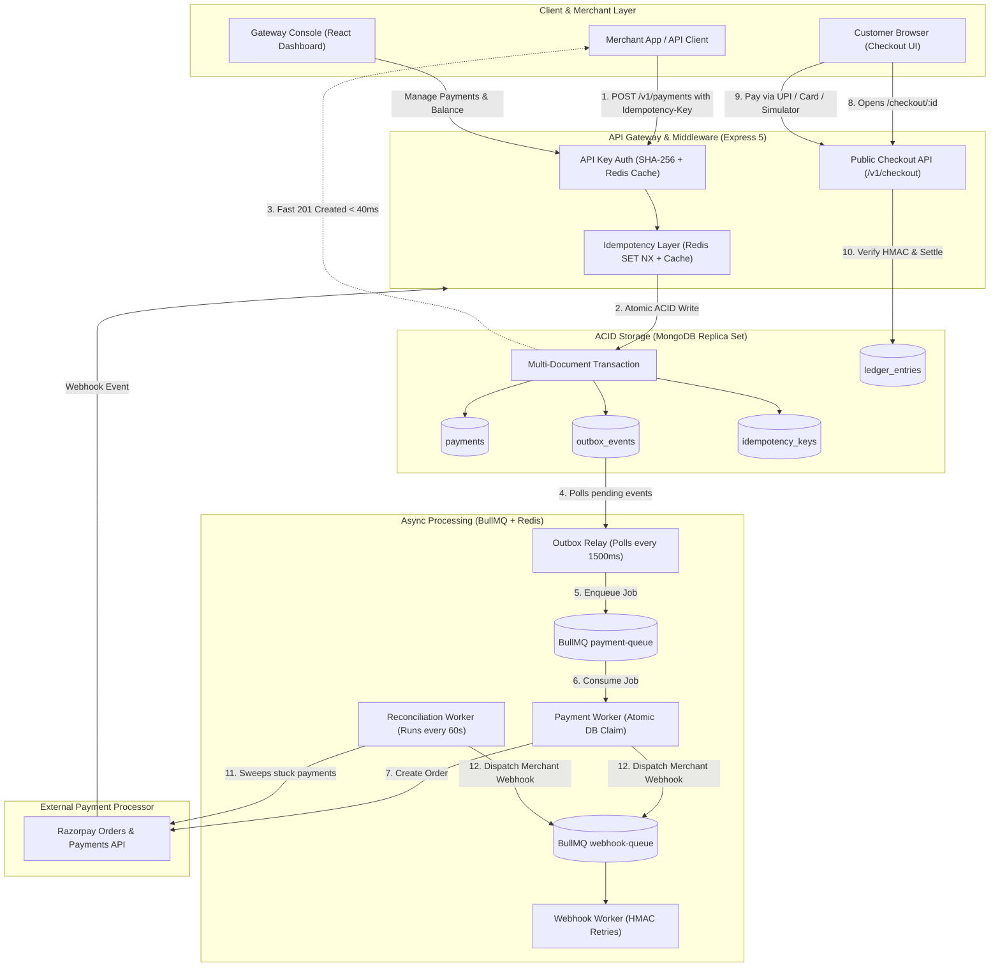

# ⚡ Event-Driven Payment Gateway & Ledger Engine

> A production-grade, fault-tolerant distributed payment gateway, customer checkout engine, and append-only financial ledger built with **Node.js (Express 5)**, **MongoDB (ACID Replica Set)**, **Redis**, **BullMQ**, **Razorpay**, and a **React 18 + Tailwind CSS** console.

[](https://nodejs.org/)
[](https://expressjs.com/)
[](https://www.mongodb.com/)
[](https://redis.io/)
[](./frontend)
[](./backend/package.json)

---

## 💡 Overview

Building mission-critical payment infrastructure demands zero tolerance for double charges, phantom states, dropped webhooks, or ledger discrepancies.

This project implements an **enterprise-grade, event-driven payment gateway**:
- **Zero Double-Charges:** Distributed idempotency layer backed by Redis atomic locks (`SET NX EX`) and MongoDB response caching.
- **No Lost Events:** Transactional Outbox pattern guarantees multi-document ACID consistency between database writes and background message queues without two-phase commit (2PC).
- **Sub-40ms Ingestion:** Fast API acknowledgment via asynchronous BullMQ workers and atomic document claiming (`findOneAndUpdate`).
- **Financial Auditability:** Append-only double-entry ledger that records immutable credits and debits instead of mutating account balances in-place.
- **Self-Healing Reconciliation:** Automated background sweeper queries upstream processor APIs every 60s to heal payments stuck in indeterminate states.
- **Hosted Customer Checkout UI:** Complete merchant & customer checkout experience supporting UPI QR, Cards, NetBanking, and Sandbox Simulation with cryptographic HMAC verification.

> 📖 **Deep Dive Available:** For detailed failure recovery models, state machines, and concurrency patterns, see **[ARCHITECTURE.md](./ARCHITECTURE.md)**.

---

## 🏛 Architecture at a Glance



---

## 🧩 The 6 Core Pillars

| Pillar | Engineering Pattern | Problem It Solves |
| :--- | :--- | :--- |
| **1. Ingestion Guard** | **Distributed Idempotency** (`SET NX EX` in Redis) | Prevents duplicate payments when users double-click or client networks retry requests. |
| **2. Event Durability** | **Transactional Outbox Pattern** (MongoDB ACID) | Eliminates dual-write hazards. Database records and outbox events commit together atomically. |
| **3. Async Processing** | **BullMQ Workers & Atomic DB Claims** (`findOneAndUpdate`) | Eliminates thread blocking and prevents race conditions across horizontally scaled workers. |
| **4. Financial Ledger** | **Append-Only Double-Entry Ledger** | Never mutates balances in-place. Every transaction is an immutable audit record; balances are aggregated on-the-fly. |
| **5. Self-Healing** | **Scheduled Reconciliation Sweeper** | Detects network drops or interrupted browser checkouts; syncs status directly with upstream Razorpay API. |
| **6. Checkout & Verification** | **Hosted Checkout UI & HMAC Verification** | Provides a seamless customer payment portal with Razorpay signature verification and sandbox simulator. |

---

## 🛠 Tech Stack

- **Runtime:** Node.js 20+ (ES Modules)
- **Framework:** Express 5.x
- **Database:** MongoDB 7.x (Replica Set required for multi-document ACID transactions)
- **Cache & Queue Broker:** Redis 7.x & BullMQ
- **Payment Processor:** Razorpay Node.js SDK
- **Security & Logging:** Helmet, CORS, Morgan, Winston, SHA-256 / HMAC-SHA256
- **Frontend Dashboard:** React 18, Vite, Tailwind CSS, Lucide Icons

---

## 📂 Project Structure

```text
├── backend/
│   ├── src/
│   │   ├── config/              # MongoDB Replica Set, Redis client, Winston logger
│   │   ├── middleware/          # API Key Auth, Idempotency lock, Morgan HTTP logger
│   │   ├── modules/
│   │   │   ├── checkout/        # Public checkout session, signature verify & simulation
│   │   │   ├── ledger/          # Double-entry ledger service & aggregation pipeline
│   │   │   ├── merchants/       # Merchant registration, API key generation & hashing
│   │   │   ├── payments/        # Payment models, outbox model & controllers
│   │   │   ├── processors/      # Razorpay upstream API wrapper & signature verifier
│   │   │   └── webhooks/        # Incoming Razorpay webhook & delivery models
│   │   ├── queues/              # BullMQ queue declarations (payment-queue, webhook-queue)
│   │   ├── workers/             # Background workers
│   │   │   ├── outbox.relay.js          # Polls outbox_events and enqueues to BullMQ
│   │   │   ├── payment.worker.js        # Claims jobs atomically and creates Razorpay orders
│   │   │   ├── reconciliation.worker.js # Sweeps stuck payments and reconciles with Razorpay
│   │   │   └── webhook.worker.js        # Dispatches signed webhooks with exponential retries
│   │   └── app.js               # Application entrypoint & background worker initialization
│   ├── .env.example
│   └── package.json
├── frontend/                    # Gateway Console & Customer Checkout Web App
│   ├── src/
│   │   ├── components/          # Reusable UI components, AppShell, layouts
│   │   ├── context/             # AuthContext (x-api-key) & ToastContext
│   │   ├── hooks/               # useFetch, useHealth pollers
│   │   ├── lib/                 # api.js client, formatters, constants
│   │   ├── pages/               # Dashboard, Payments, Detail, Ledger, Webhooks, Checkout
│   │   │   ├── CheckoutPage.jsx # Hosted customer payment portal (UPI, Card, Simulator)
│   │   │   ├── DashboardPage.jsx# System metrics & balance overview
│   │   │   ├── PaymentsPage.jsx # Payments table & idempotent creation
│   │   │   ├── LedgerPage.jsx   # Double-entry ledger audit journal & balance
│   │   │   └── ...
│   │   └── App.jsx              # Routes configuration
│   ├── .env.example
│   └── package.json
├── ARCHITECTURE.md              # Deep dive architectural documentation & failure modes
└── README.md                    # Project documentation
```

---

## 📡 API Reference

### 1. Merchant Management
| Method | Endpoint | Auth | Description |
| :--- | :--- | :--- | :--- |
| `POST` | `/v1/merchants` | Public | Register merchant; returns plaintext API key (shown once). |
| `GET` | `/v1/merchants/me` | `x-api-key` | Fetch authenticated merchant profile. |

### 2. Payments & Ingestion
| Method | Endpoint | Auth | Description |
| :--- | :--- | :--- | :--- |
| `POST` | `/v1/payments` | `x-api-key` + `Idempotency-Key` | Create payment (sub-40ms atomic transaction). |
| `GET` | `/v1/payments` | `x-api-key` | List merchant payments with pagination. |
| `GET` | `/v1/payments/:id` | `x-api-key` | Retrieve specific payment by ID. |
| `POST` | `/v1/payments/verify` | `x-api-key` | Verify payment signature and credit ledger. |

### 3. Customer Checkout & Sandbox Simulation
| Method | Endpoint | Auth | Description |
| :--- | :--- | :--- | :--- |
| `GET` | `/v1/checkout/:id` | Public | Fetch public checkout session details for customer UI. |
| `POST` | `/v1/checkout/verify` | Public | Verify customer checkout signature from Razorpay. |
| `POST` | `/v1/checkout/simulate` | Public | Simulate instant `SUCCEEDED` or `FAILED` in test mode. |

### 4. Ledger & Accounting
| Method | Endpoint | Auth | Description |
| :--- | :--- | :--- | :--- |
| `GET` | `/v1/ledger/balance` | `x-api-key` | Aggregated live balance (`totalCredits - totalDebits`). |
| `GET` | `/v1/ledger/entries` | `x-api-key` | Paginated immutable double-entry journal records. |

### 5. Webhooks & Health
| Method | Endpoint | Auth | Description |
| :--- | :--- | :--- | :--- |
| `POST` | `/v1/webhooks/razorpay` | Razorpay Signature | Inbound webhook handler for payment events. |
| `GET` | `/health` | Public | Service health & Redis connection status. |

---

## 🚀 Getting Started

### 1. Prerequisites
- **Node.js:** v18+ (Node 20+ recommended)
- **Redis:** Running locally on port `6379`
- **MongoDB:** Running as a **Replica Set** on port `27017` *(Required for ACID transactions)*
- **Razorpay Account:** Free test keys from the [Razorpay Dashboard](https://dashboard.razorpay.com/#/access/api-keys)

### 2. Configure Backend Environment
```bash
cd backend
cp .env.example .env
```

Configure your `.env` parameters:
```ini
PORT=3000
NODE_ENV=development
MONGODB_URI=mongodb://127.0.0.1:27017/payment_gateway?directConnection=true
REDIS_HOST=127.0.0.1
REDIS_PORT=6379
RAZORPAY_KEY_ID=rzp_test_your_key_id
RAZORPAY_KEY_SECRET=your_key_secret
RAZORPAY_WEBHOOK_SECRET=your_webhook_secret
```

### 3. Start Backend
```bash
cd backend
npm install
npm run dev
```
The gateway API will boot at `http://localhost:3000`.

### 4. Start Frontend Console
```bash
cd frontend
npm install
cp .env.example .env     # VITE_API_BASE_URL defaults to http://localhost:3000
npm run dev
```
Open `http://localhost:5173` in your browser.

---

## 🧪 Quick Testing Guide (cURL)

### 1. Register a Merchant
```bash
curl -X POST http://localhost:3000/v1/merchants \
  -H "Content-Type: application/json" \
  -d '{"name": "Nova Store", "email": "dev@novastore.io", "webhookUrl": "https://webhook.site/test"}'
```
> 📌 *Save the returned `apiKey` for use in subsequent headers.*

### 2. Create an Idempotent Payment
```bash
curl -X POST http://localhost:3000/v1/payments \
  -H "Content-Type: application/json" \
  -H "x-api-key: <YOUR_MERCHANT_API_KEY>" \
  -H "Idempotency-Key: order_checkout_101" \
  -d '{"amount": 2500, "currency": "INR", "customerEmail": "customer@example.com"}'
```
*Returns `201 CREATED` in `< 40ms` with `paymentId`.*

### 3. Verify Idempotency Protection (Try to Double Charge!)
Execute the exact same `curl` command above again:
- The gateway instantly detects the active key and returns the **identical cached response**.
- **No duplicate order is created, and no extra charges occur.**

### 4. Open Customer Checkout Portal
Open in your browser:
```text
http://localhost:5173/checkout/<PAYMENT_ID>
```
Test with the built-in Sandbox Simulator or UPI / Card options.

### 5. Check Ledger Balance & Entries
```bash
# Query calculated balance
curl http://localhost:3000/v1/ledger/balance \
  -H "x-api-key: <YOUR_MERCHANT_API_KEY>"

# Query audit journal entries
curl http://localhost:3000/v1/ledger/entries \
  -H "x-api-key: <YOUR_MERCHANT_API_KEY>"
```

---

## 📜 License

This project is licensed under the [ISC License](./backend/package.json).