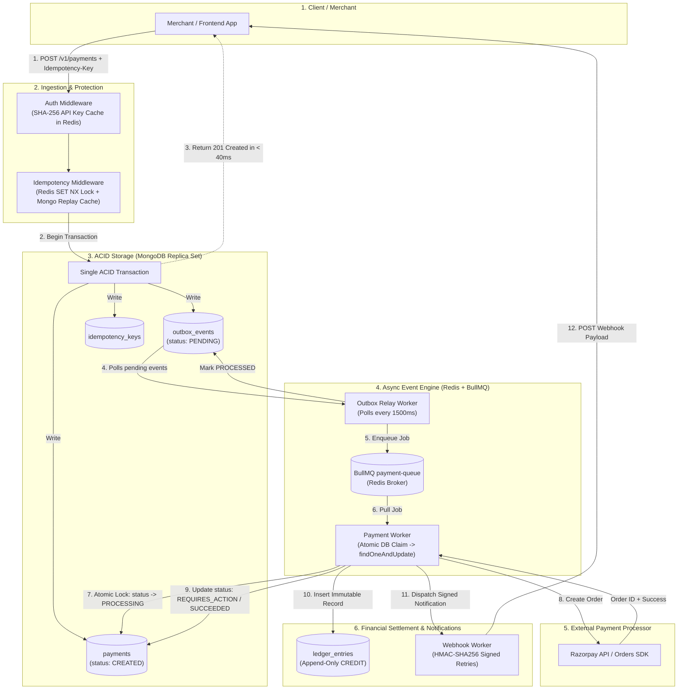
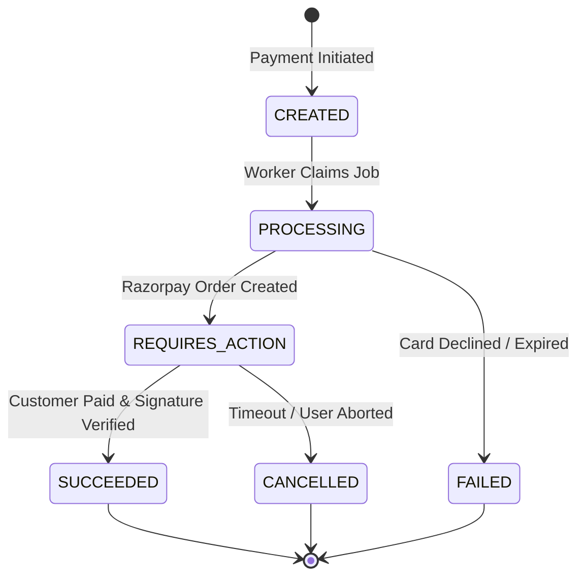

# ⚡ Event-Driven Payment Gateway & Ledger Engine

> **A production-grade, fault-tolerant payment gateway and append-only financial ledger built with Node.js, MongoDB (ACID Replica Set), Redis, BullMQ, and Razorpay.**

---

## 📖 Table of Contents
1. [The Problem: Why Traditional Payment APIs Fail](#-the-problem-why-traditional-payment-apis-fail)
2. [What This Project Does](#-what-this-project-does)
3. [The Complete Mental Model (At a Glance)](#-the-complete-mental-model-at-a-glance)
4. [System Architecture Diagram](#-system-architecture-diagram)
5. [The Life of a Payment (End-to-End Walkthrough)](#-the-life-of-a-payment-end-to-end-walkthrough)
6. [Core Architectural Patterns Explained Simply](#-core-architectural-patterns-explained-simply)
   - [A. Distributed Idempotency (Zero Double-Charges)](#a-distributed-idempotency-zero-double-charges)
   - [B. The Transactional Outbox Pattern (No Lost Events)](#b-the-transactional-outbox-pattern-no-lost-events)
   - [C. Atomic Worker Claim (No Race Conditions)](#c-atomic-worker-claim-no-race-conditions)
   - [D. Append-Only Immutable Ledger (Financial Integrity)](#d-append-only-immutable-ledger-financial-integrity)
   - [E. Payment State Machine](#e-payment-state-machine)
7. [Tech Stack & System Roles](#-tech-stack--system-roles)
8. [Project Directory Tour](#-project-directory-tour)
9. [Getting Started (Step-by-Step)](#-getting-started-step-by-step)
10. [Step-by-Step Testing Guide (cURL)](#-step-by-step-testing-guide-curl)
11. [Implementation Phases](#-implementation-phases)

---

## 💥 The Problem: Why Traditional Payment APIs Fail

Most tutorials teach building a payment endpoint like this:

```javascript
// ❌ NAIVE APPROACH — DO NOT USE IN PRODUCTION
app.post("/pay", async (req, res) => {
  const charge = await razorpay.charge(req.body);   // Step 1: Call gateway
  await db.payments.create({ ...charge });           // Step 2: Save to DB
  await db.users.updateOne({ $inc: { balance } });   // Step 3: Mutate balance
  res.json({ success: true });
});
```

### Why this breaks catastrophically in the real world:
1. **The Double-Click Disaster:** A user clicks "Pay" twice on a slow mobile connection. Both requests hit the server concurrently, charging the customer's card **twice**.
2. **The "Dual-Write" Hazard:** Step 1 charges the customer's bank account. But immediately after, your database crashes before Step 2 commits. **The money left the customer's bank, but your database has zero record of it.**
3. **The Balance Mutation Trap:** Running `balance = balance + amount` makes it impossible to audit financial history or resolve disputes. If a bug occurs, you cannot reconstruct how much money was moved or when.
4. **Slow APIs & Timeouts:** Calling an external bank API directly inside an HTTP route blocks the connection. If the bank takes 8 seconds to respond, your server runs out of connection threads.

---

## 🎯 What This Project Does

This project solves all 4 problems using industry-standard distributed systems patterns:

- **Idempotency Guarantee:** Duplicate requests within a 24-hour window return the cached response with zero duplicate charges.
- **Transactional Outbox:** Payment records and background event dispatches are committed **in the exact same MongoDB ACID transaction**.
- **Asynchronous Decoupling:** APIs acknowledge payments in `< 40ms` (`201 CREATED`). Workers handle upstream processor communications in the background via BullMQ.
- **Append-Only Double-Entry Ledger:** Balances are never overwritten. Every transaction creates an immutable credit or debit record, and balances are derived dynamically using aggregation.

---

## 🧠 The Complete Mental Model (At a Glance)

Think of this system as an airport luggage handling system:

| Step | Component | Real-World Analogy |
| :--- | :--- | :--- |
| **1. Check-In** | API Gateway + Idempotency | The airline counter checks your passport and gives you a boarding pass with a unique barcode. If you ask for another pass, they hand you a duplicate of the original. |
| **2. Secure Storage** | MongoDB ACID Outbox | Your luggage is locked inside the airport cargo vault along with a written manifest tag. |
| **3. Belt Conveyor** | Outbox Relay Worker | A baggage handler constantly checks the cargo vault and loads pending suitcases onto the high-speed conveyor belt. |
| **4. Cargo Plane Loading** | BullMQ + Payment Worker | Ground crew workers pick suitcases off the belt one by one, lock their claim on them, and deliver them to the actual aircraft (Razorpay). |
| **5. Audit Book** | Immutable Ledger Engine | The airline logs an indelible entry in the flight logbook: *Cargo Loaded (+2500 kg)*. Nothing is ever erased. |
| **6. SMS Updates** | Webhook Engine | The airline sends a signed text message to your phone: *"Your baggage has landed safely."* |

---

## 🏛 System Architecture Diagram



---

## 🚶 The Life of a Payment (End-to-End Walkthrough)

Here is exactly what happens when a merchant collects **₹2,500** for an order:

```
[Merchant] ──(1) POST /v1/payments──> [Gateway]
                                          │
                               (2) Redis SET NX lock
                                          │
                        (3) MongoDB ACID Transaction
                        ┌───────────────────────────────┐
                        │ • payment = CREATED           │
                        │ • outbox  = PENDING           │
                        │ • idemKey = SAVED             │
                        └───────────────────────────────┘
                                          │
[Merchant] <──(4) HTTP 201 CREATED (Immediate ack)
                                          │
                        (5) Outbox Relay pushes to BullMQ
                                          │
                        (6) Worker claims payment (PROCESSING)
                                          │
                        (7) Worker calls Razorpay Orders API
                                          │
                        (8) Worker records in Immutable Ledger
                                          │
[Merchant] <──(9) Webhook: payment.succeeded (Signed HMAC)
```

### Detailed Breakdown:

#### 1. Ingestion & Authentication
- The merchant sends `POST /v1/payments` with an `x-api-key` header and an `Idempotency-Key` header.
- The `auth.js` middleware computes the SHA-256 hash of the API key, checks Redis cache (sub-millisecond), and attaches the `merchant` entity to `req.merchant`.

#### 2. The Idempotency Guard
- The `idempotency.js` middleware attempts to acquire an atomic lock in Redis:
  ```text
  SET idem:order_123_attempt_1 "IN_FLIGHT" NX EX 30
  ```
- **If the lock already exists:** Another request with the same key is running right now; the gateway returns `409 Conflict`.
- **If this key was completed in the past:** The middleware finds the saved response in MongoDB and **replays it immediately**. No new payment is created.
- **If it is a new key:** The lock is granted, and execution moves to the controller.

#### 3. Atomic Multi-Document Transaction (The Outbox Pattern)
Instead of calling Razorpay right now, the payment controller starts a MongoDB session and executes a single ACID transaction:
```javascript
session.startTransaction();
// 1. Create Payment record with status: "CREATED"
await Payment.create([{ merchantId, amount: 2500, currency: "INR", status: "CREATED" }], { session });

// 2. Create Outbox event record
await Outbox.create([{ eventType: "PaymentCreated", aggregateId: payment._id, status: "PENDING" }], { session });

// 3. Cache the idempotency response
await Idempotency.create([{ key, responseBody: payment }], { session });

await session.commitTransaction();
```
The gateway responds to the merchant with `201 Created` in under **40 milliseconds**.

#### 4. The Outbox Relay
A background polling loop runs every 1,500ms. It queries:
```javascript
Outbox.find({ status: "PENDING" }).limit(50);
```
For each event, it pushes a job into BullMQ's `payment-queue` on Redis and updates the outbox status to `PROCESSED`. Even if the server crashes right here, the event will safely be picked up on reboot.

#### 5. Asynchronous Payment Processing & Atomic Claim
A BullMQ worker picks up the job. To ensure no other worker process handles the same payment, it executes an **atomic state claim**:
```javascript
const payment = await Payment.findOneAndUpdate(
  { _id: paymentId, status: "CREATED" },
  { $set: { status: "PROCESSING" } },
  { new: true }
);
if (!payment) return; // Another worker already claimed it!
```
The worker then calls the official **Razorpay Orders API** (`razorpay.orders.create`), attaches the `razorpay_order_id`, and transitions the state to `REQUIRES_ACTION` (ready for checkout) or `SUCCEEDED`.

#### 6. Financial Ledger Recording
When a payment reaches `SUCCEEDED`, the ledger service appends a new document to `ledger_entries`:
- `merchantId`: Merchant's ID
- `paymentId`: Payment's ID
- `entryType`: `PAYMENT_CAPTURED`
- `amount`: `2500`
- `direction`: `CREDIT`

**No existing document is edited.** To find the merchant's balance at any time, we run an aggregation query that sums all credits minus debits.

#### 7. Webhook Delivery
The webhook engine prepares a payload, signs it using `HMAC-SHA256(merchant.webhookSecret, payload)`, and sends it to the merchant's configured webhook endpoint with exponential backoff retries.

---

## 🔬 Core Architectural Patterns Explained Simply

### A. Distributed Idempotency (Zero Double-Charges)
```
Request 1 (00:00.000): POST /payments [Idempotency-Key: ORD_01] ──> Processes & caches response
Request 2 (00:00.010): POST /payments [Idempotency-Key: ORD_01] ──> 409 Conflict (Lock Active)
Request 3 (00:05.000): POST /payments [Idempotency-Key: ORD_01] ──> Returns cached response (No re-run)
```
- **Redis `SET NX EX`:** Ensures mutual exclusion across clustered server instances.
- **Persistent Cache:** MongoDB retains response status codes and bodies for 24 hours.

### B. The Transactional Outbox Pattern (No Lost Events)
In microservices and distributed systems, writing to the database and publishing to a queue are two separate operations. If one fails, data gets out of sync.
- **Solution:** Write both the business entity (`payments`) and the event (`outbox_events`) into the same database using an ACID transaction.
- **Guarantee:** If the transaction succeeds, the event is guaranteed to be saved. If it fails, nothing is saved. The relay process ensures the event reaches the message broker.

### C. Atomic Worker Claim (No Race Conditions)
When scaling to 10 background worker instances, how do we make sure two workers don't process the same payment at the same time?
- Traditional databases use relational table locks (`SELECT FOR UPDATE`).
- In MongoDB, we use `findOneAndUpdate({ _id, status: "CREATED" }, { status: "PROCESSING" })`. Because MongoDB operations on a single document are strictly atomic, exactly **one** worker will receive the document, while the other receives `null` and gracefully exits.

### D. Append-Only Immutable Ledger (Financial Integrity)
Why should you never run `balance = balance + 100`?
```text
❌ MUTATING PATTERN:
Balance = 0 ──(+100)──> Balance = 100 ──(+50)──> Balance = 150
(If balance is 120, who took 30? There is no audit log!)

✅ IMMUTABLE DOUBLE-ENTRY PATTERN:
Entry 1: [CREDIT] +100  (Order #1)
Entry 2: [CREDIT] +50   (Order #2)
Entry 3: [DEBIT]  -30   (Refund #1)
Net Balance = Σ(Credits) - Σ(Debits) = 120
Every single rupee can be tracked back to a transaction ID, timestamp, and signature.
```

### E. Payment State Machine
Payment transitions are strictly validated. No unexpected status jumps are allowed:



---

## 🛠 Tech Stack & System Roles

| Technology | Purpose in System |
| :--- | :--- |
| **Node.js (ESM)** | Asynchronous, event-driven runtime for high I/O throughput. |
| **Express 5** | REST API gateway routing, rate-limiting, and middleware orchestration. |
| **MongoDB Replica Set** | Source of truth with multi-document ACID transactions across payments, outbox, and ledger. |
| **Redis** | High-performance sub-millisecond cache for API keys and atomic distributed locks (`SET NX`). |
| **BullMQ** | Robust job queue engine managing workers, retries, exponential backoffs, and concurrency. |
| **Razorpay SDK** | Real-world upstream financial processor handling orders and signature verification. |
| **Winston & Morgan** | Structured audit logging with correlation request IDs. |

---

## 📂 Project Directory Tour

```text
backend/src/
├── app.js                         # Application entrypoint & Express server
├── config/
│   ├── db.js                      # MongoDB connection (with Replica Set support)
│   ├── redis.js                   # Redis client & BullMQ connection setup
│   └── logger.js                  # Winston structured logging
├── middleware/
│   ├── auth.js                    # API key validation & Redis caching
│   ├── idempotency.js             # Distributed locking & replay middleware
│   └── morgan.middleware.js       # HTTP request logger
├── modules/
│   ├── merchants/                 # Merchant registration & API key generation
│   ├── payments/                  # Payment CRUD, status checks & Outbox model
│   ├── processors/                # Razorpay SDK integration wrapper
│   ├── ledger/                    # Double-entry ledger recording & balance aggregation
│   └── webhooks/                  # Razorpay incoming HMAC & outgoing dispatch
├── queues/
│   └── payment.queue.js           # BullMQ queue declaration
└── workers/
    ├── outbox.relay.js            # Transactional outbox polling relay (1.5s interval)
    └── payment.worker.js          # Asynchronous BullMQ payment worker
```

---

## 🚀 Getting Started (Step-by-Step)

### 1. Prerequisites
- **Node.js:** v18+ (Node 20 recommended)
- **Redis:** Running locally on port `6379`
- **MongoDB:** Running as a **Replica Set** on port `27017` *(A replica set is required for MongoDB ACID transactions!)*
- **Razorpay Account:** Free test keys from the [Razorpay Dashboard](https://dashboard.razorpay.com/#/access/api-keys).

> **💡 Quick Tip on MongoDB Replica Set:**
> If running standalone MongoDB locally, convert it to a single-node replica set by starting mongod with `--replSet rs0` and running `rs.initiate()` in `mongosh`.

### 2. Environment Setup
Navigate to the `backend/` directory:
```bash
cd backend
cp .env.example .env
```

Open `.env` and configure your credentials:
```ini
PORT=3000
NODE_ENV=development

# MongoDB Connection String (directConnection=true is required for local replica sets)
MONGODB_URI=mongodb://127.0.0.1:27017/payment_gateway?directConnection=true

# Redis Connection
REDIS_HOST=127.0.0.1
REDIS_PORT=6379

# Razorpay Test API Credentials
RAZORPAY_KEY_ID=rzp_test_your_key_id
RAZORPAY_KEY_SECRET=your_key_secret
RAZORPAY_WEBHOOK_SECRET=your_webhook_secret
```

### 3. Install & Start
```bash
# Install dependencies
npm install

# Start in development mode (hot-reloading enabled)
npm run dev
```

You will see:
```text
Connected to MongoDB (Replica Set Active)
Redis Client Ready
🚀 Gateway API running at http://localhost:3000
Outbox Relay active (polling every 1500ms)
```

---

## 🧪 Step-by-Step Testing Guide (cURL)

Follow this quick tutorial to see the entire flow working live on your machine:

### 1. Health Check
```bash
curl http://localhost:3000/health
```
```json
{"status":"OK","timeStamp":"...","service":{"api":"UP","redis":"OK"}}
```

---

### 2. Register a Merchant
```bash
curl -X POST http://localhost:3000/v1/merchants \
  -H "Content-Type: application/json" \
  -d '{
    "name": "Nova Tech Store",
    "email": "payments@novatech.io",
    "webhookUrl": "https://webhook.site/test"
  }'
```
**Response:**
```json
{
  "success": true,
  "data": {
    "merchantId": "670c8a1b2...",
    "name": "Nova Tech Store",
    "apiKey": "mp_live_5fa19b024e..."
  }
}
```
> ⚠️ **Copy the `apiKey` from the response!** You will need it in the `x-api-key` header for all remaining requests.

---

### 3. Create a Payment (Idempotent)
Create a payment of **₹2,500** with an `Idempotency-Key`:

```bash
curl -X POST http://localhost:3000/v1/payments \
  -H "Content-Type: application/json" \
  -H "x-api-key: <YOUR_MERCHANT_API_KEY>" \
  -H "Idempotency-Key: order_checkout_101" \
  -d '{
    "amount": 2500,
    "currency": "INR",
    "description": "Order #101: Mechanical Keyboard"
  }'
```
**Response (in < 40ms):**
```json
{
  "success": true,
  "data": {
    "paymentId": "670c8b9...",
    "status": "CREATED",
    "amount": 2500,
    "currency": "INR"
  }
}
```

---

### 4. Test Idempotency (Try to Double Charge!)
Run the **exact same command** above a second time with the same `Idempotency-Key`:
```bash
curl -X POST http://localhost:3000/v1/payments \
  -H "Content-Type: application/json" \
  -H "x-api-key: <YOUR_MERCHANT_API_KEY>" \
  -H "Idempotency-Key: order_checkout_101" \
  -d '{
    "amount": 2500,
    "currency": "INR",
    "description": "Order #101: Mechanical Keyboard"
  }'
```
**Result:** You get the identical cached response instantly. Behind the scenes, **no second payment was created, no outbox event was duplicated, and the customer was NOT charged twice.**

---

### 5. Check Payment Status
```bash
curl http://localhost:3000/v1/payments/<PAYMENT_ID> \
  -H "x-api-key: <YOUR_MERCHANT_API_KEY>"
```
You will see that the background Outbox Relay picked up the event, BullMQ dispatched it to the worker, and the status moved forward asynchronously.

---

### 6. Check Merchant Ledger Balance
```bash
curl http://localhost:3000/v1/ledger/balance \
  -H "x-api-key: <YOUR_MERCHANT_API_KEY>"
```
**Response:**
```json
{
  "success": true,
  "data": {
    "merchantId": "670c8a1b2...",
    "balance": 2500,
    "currency": "INR"
  }
}
```
The balance is computed directly by aggregating all immutable ledger entries for this merchant.

---

## 📚 Implementation Phases

This codebase was built methodically across 9 dedicated phases. If you want to study each layer in depth with code recipes and explanations, check out the guides in the [`phases/`](./phases/) folder:

| Phase | Guide | Topics Covered |
| :--- | :--- | :--- |
| **Phase 1** | [Setup & Infrastructure](./phases/PHASE_1_SETUP_AND_INFRASTRUCTURE.md) | Node.js ESM, MongoDB Replica Set, Redis, Winston logger |
| **Phase 2** | [Auth & Merchants](./phases/PHASE_2_AUTH_AND_MERCHANTS.md) | SHA-256 API key hashing, Redis auth cache, Merchant models |
| **Phase 3** | [Idempotency Layer](./phases/PHASE_3_IDEMPOTENCY_LAYER.md) | Redis `SET NX` locks, cached replay response in MongoDB |
| **Phase 4** | [Payments & Outbox](./phases/PHASE_4_PAYMENT_SERVICE_AND_OUTBOX.md) | Multi-document ACID transactions, Transactional Outbox pattern |
| **Phase 5** | [BullMQ & Workers](./phases/PHASE_5_BULLMQ_AND_PAYMENT_WORKER.md) | Outbox Relay, atomic document claiming, Razorpay Orders SDK |
| **Phase 6** | [Immutable Ledger](./phases/PHASE_6_IMMUTABLE_LEDGER.md) | Double-entry append-only ledger, balance aggregation pipeline |
| **Phase 7** | [Webhooks Engine](./phases/PHASE_7_WEBHOOKS_AND_DELIVERY_WORKER.md) | HMAC-SHA256 signature verification, exponential retry worker |
| **Phase 8** | [Reconciliation](./phases/PHASE_8_RECONCILIATION_AND_TESTING.md) | Self-healing cron sweeper, stuck payment resolution |
| **Phase 9** | [Refund Engine](./phases/PHASE_9_REFUND_ENGINE.md) | Over-refund protection, partial refunds, ledger debit entries |

---

## 📜 License

This project is licensed under the [ISC License](./backend/package.json).