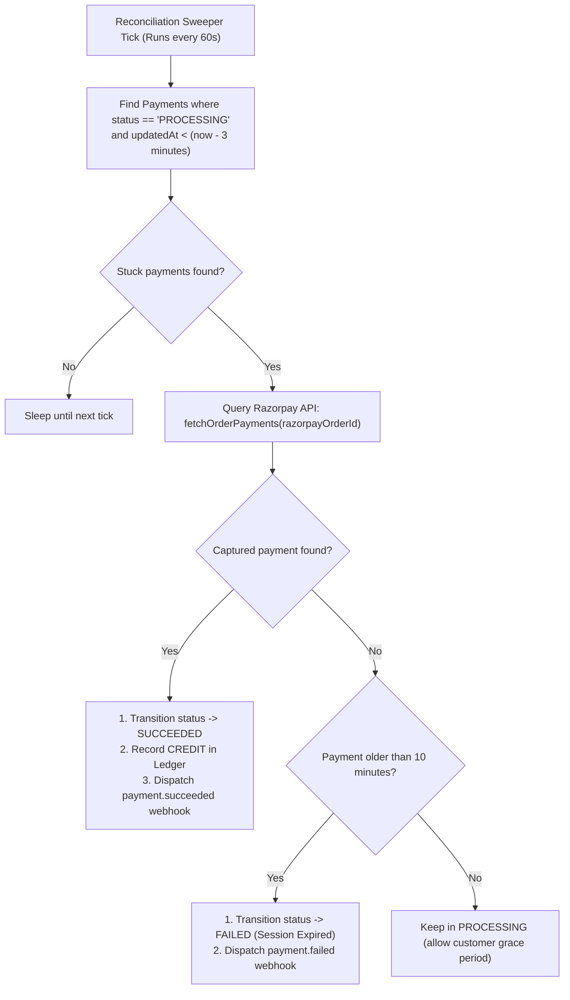

# ⚡ Event-Driven Payment Gateway & Ledger Engine

> An enterprise-grade, distributed payment gateway, customer checkout engine, append-only financial ledger, and asynchronous refund processing platform. Engineered with **Node.js (Express 5)**, **MongoDB (ACID Replica Set)**, **Redis**, **BullMQ**, **Razorpay**, and a **React 18 + Tailwind CSS** merchant console.

[](https://nodejs.org/)
[](https://expressjs.com/)
[](https://www.mongodb.com/)
[](https://redis.io/)
[](./frontend)
[](./backend/package.json)

---

## 📑 Table of Contents
1. [Overview & Core Mission](#-overview--core-mission)
2. [The 7 Architectural Pillars](#-the-7-architectural-pillars)
3. [System Architecture Diagram](#-system-architecture-diagram)
4. [Comprehensive File-by-File & Directory Guide](#-comprehensive-file-by-file--directory-guide)
   - [Backend Core Architecture (File Breakdown)](#backend-core-architecture-file-breakdown)
   - [Frontend Architecture (File Breakdown)](#frontend-architecture-file-breakdown)
5. [End-to-End Execution Flows](#-end-to-end-execution-flows)
   - [Flow 1: Sub-40ms Idempotent Payment Ingestion](#flow-1-sub-40ms-idempotent-payment-ingestion)
   - [Flow 2: Outbox Relay & BullMQ Worker Processing](#flow-2-outbox-relay--bullmq-worker-processing)
   - [Flow 3: Customer Checkout & Cryptographic HMAC Verification](#flow-3-customer-checkout--cryptographic-hmac-verification)
   - [Flow 4: Append-Only Immutable Double-Entry Ledger](#flow-4-append-only-immutable-double-entry-ledger)
   - [Flow 5: Asynchronous Refund Engine & Ledger Reversal](#flow-5-asynchronous-refund-engine--ledger-reversal)
   - [Flow 6: Self-Healing Reconciliation Sweeper](#flow-6-self-healing-reconciliation-sweeper)
   - [Flow 7: Outbound Webhook Delivery with Exponential Retries](#flow-7-outbound-webhook-delivery-with-exponential-retries)
6. [API Reference & cURL Cheatsheet](#-api-reference--curl-cheatsheet)
7. [Local Setup & Getting Started](#-local-setup--getting-started)
8. [Architectural Deep Dive](#-architectural-deep-dive)

---

## 💡 Overview & Core Mission

Payment and fintech platforms operate in environments where failure is inevitable: servers reboot unexpectedly, mobile clients lose internet connectivity midway through checkout, upstream processor APIs experience transient timeouts, and webhooks arrive out of sequence or repeatedly.

A naive payment integration that mutates database balances directly (`balance += amount`) or dispatches message queue events after saving a database record introduces **catastrophic financial bugs**:
- **Double Charges:** A customer clicks "Pay Now" twice, charging their credit card twice.
- **Dual-Write Hazard:** The database transaction succeeds, but the message broker crashes before receiving the event, permanently orphaning the order.
- **Ledger Inconsistency:** Modifying balances in-place leaves zero historical trace of changes, rendering forensic financial audits impossible.
- **Lost Transactions:** A customer successfully pays on Razorpay but closes the browser before redirection, leaving the payment stuck in `PROCESSING` forever.

**This engine solves all of these problems through distributed systems patterns:**
- 🛡️ **Zero Double-Charges:** Distributed idempotency guard using Redis atomic locks (`SET NX EX`) and MongoDB response replay caching.
- 📦 **Transactional Outbox Pattern:** Guarantees atomicity between MongoDB state changes and BullMQ background queue dispatches with zero dual-write risk.
- ⚡ **Sub-40ms API Ingestion:** Immediate client acknowledgment; heavyweight processor operations are handed off asynchronously to background workers.
- 🔒 **Append-Only Double-Entry Ledger:** Balances are never modified in-place. Immutable `CREDIT` and `DEBIT` journal entries preserve a 100% auditable transaction history.
- 💸 **Asynchronous Refund Engine:** Partial and full refund workflows with remaining-balance validation, upstream processor refunding, automatic ledger debiting, and compensation rollbacks.
- 🩺 **Autonomous Self-Healing Sweeper:** Runs every 60s, querying upstream processor APIs to automatically recover stuck payments or cleanly expire abandoned sessions.
- 💳 **Hosted Customer Checkout UI:** Complete portal supporting UPI QR, Cards, NetBanking, and Sandbox Simulation with strict HMAC-SHA256 signature verification.

---

## 🏛 The 7 Architectural Pillars

| Pillar | Engineering Pattern | Problem It Solves |
| :--- | :--- | :--- |
| **1. Distributed Idempotency** | Redis `SET NX EX` + MongoDB 24h Response Replay Cache | Eliminates duplicate payment/refund requests caused by network retries or client double-clicks. |
| **2. Transactional Outbox** | Multi-Document ACID Transactions (MongoDB Replica Set) | Eliminates dual-write anomalies; database records and message queue events commit atomically or not at all. |
| **3. Non-Blocking Async Ingestion** | BullMQ + Redis + Document-level Atomic Claims | Unblocks HTTP threads for sub-40ms latency; prevents competing worker instances from duplicate processing. |
| **4. Double-Entry Financial Ledger** | Append-Only Journal (`CREDIT` / `DEBIT`) & Aggregation | Eliminates drift and balance corruption; balances are calculated dynamically from an immutable audit trail. |
| **5. Full & Partial Refund Engine** | Asynchronous Refund Pipeline with Ledger Inversion | Safely issues refunds against captured payments, updates remaining balances, and writes balancing `DEBIT` entries. |
| **6. Self-Healing Reconciliation** | 60-second Periodic Sweeper with Processor Polling | Automatically recovers payments interrupted during browser redirection or missed webhook deliveries. |
| **7. Cryptographic Security** | Raw-Buffer HMAC-SHA256 Signature Verification | Prevents payload tampering and spoofed webhooks from malicious third parties. |

---

## 📊 System Architecture Diagram

```mermaid
flowchart TD
    subgraph ClientLayer["1. Client & Merchant Layer"]
        Merchant["Merchant App / API Client"]
        Customer["Customer Browser (Hosted Checkout Portal)"]
        Console["Gateway Console (React 18 + Tailwind)"]
    end

    subgraph SecurityLayer["2. Ingestion & Security Guard"]
        AuthMiddleware["API Key Auth (SHA-256 in Redis)"]
        IdemMiddleware["Distributed Idempotency (Redis SET NX EX + Cache)"]
        PublicCheckoutAPI["Public Checkout API (/v1/checkout/*)"]
    end

    subgraph StorageLayer["3. ACID Storage (MongoDB Replica Set)"]
        Tx["Atomic Multi-Document Transaction"]
        PaymentsCol[("payments")]
        OutboxCol[("outbox_events")]
        RefundsCol[("refunds")]
        LedgerCol[("ledger_entries")]
        IdemCol[("idempotency_keys")]
    end

    subgraph AsyncEngine["4. Async Processing Engine (BullMQ + Redis)"]
        OutboxRelay["Outbox Relay (Polls every 1500ms)"]
        PaymentQueue[("BullMQ: payment-queue")]
        RefundQueue[("BullMQ: refund-queue")]
        WebhookQueue[("BullMQ: webhook-queue")]
        PayWorker["Payment Worker (Atomic DB Claim)"]
        RefundWorker["Refund Worker (Debit Ledger & Razorpay)"]
        Reconciler["Reconciliation Worker (Runs every 60s)"]
        HookWorker["Webhook Worker (Exponential Backoff)"]
    end

    subgraph ProcessorLayer["5. External Payment Processor"]
        Razorpay["Razorpay API (Orders, Payments, Refunds)"]
    end

    %% Ingestion Flow
    Merchant -->|POST /v1/payments (Idempotency-Key)| AuthMiddleware
    Console -->|Manage Payments, Refunds, Ledger| AuthMiddleware
    AuthMiddleware --> IdemMiddleware
    IdemMiddleware -->|1. Atomic Write| Tx
    Tx --> PaymentsCol
    Tx --> OutboxCol
    Tx --> IdemCol
    Tx -.->|2. Immediate 201 Created < 40ms| Merchant

    %% Async Payment Flow
    OutboxCol -->|3. Polls pending events| OutboxRelay
    OutboxRelay -->|4. Push Job| PaymentQueue
    PaymentQueue -->|5. Claim Job| PayWorker
    PayWorker -->|6. Create Order| Razorpay
    PayWorker -->|7. Update status: REQUIRES_ACTION| PaymentsCol

    %% Customer Checkout Flow
    Customer -->|8. GET /v1/checkout/:id| PublicCheckoutAPI
    Customer -->|9. Pay via UPI / Card / Simulator| PublicCheckoutAPI
    PublicCheckoutAPI -->|10. Verify HMAC & Mark SUCCEEDED| PaymentsCol
    PublicCheckoutAPI -->|11. Record CREDIT entry| LedgerCol

    %% Refund Flow
    Merchant -->|12. POST /v1/refunds| AuthMiddleware
    AuthMiddleware -->|13. Record PENDING Refund & Outbox| RefundsCol
    RefundsCol -->|14. Enqueue Job| RefundQueue
    RefundQueue -->|15. Process Refund| RefundWorker
    RefundWorker -->|16. Call Razorpay Refund API| Razorpay
    RefundWorker -->|17. Record DEBIT entry| LedgerCol
    RefundWorker -->|18. Update Refund -> SUCCEEDED| RefundsCol

    %% Self Healing & Webhooks
    Reconciler -->|19. Polls stuck payments > 3m| Razorpay
    Reconciler -->|20. Auto-reconcile to SUCCEEDED| PaymentsCol
    PayWorker & RefundWorker & Reconciler -.->|21. Enqueue Webhook| WebhookQueue
    WebhookQueue --> HookWorker
    HookWorker -->|22. Signed HMAC HTTP POST| Merchant
```

---

## 📂 Comprehensive File-by-File & Directory Guide

This section describes **every single file** in the repository, explaining its purpose, internal code flow, dependencies, and architectural takeaway.

### Backend Core Architecture (File Breakdown)

```text
backend/
├── src/
│   ├── app.js                          # Application bootstrap & background task supervisor
│   ├── config/                         # Infrastructure connections & clients
│   │   ├── db.js                       # MongoDB Replica Set connection & event handlers
│   │   ├── logger.js                   # Winston structured JSON logger
│   │   ├── razorpay.js                 # Razorpay SDK initialization & key validation
│   │   └── redis.js                    # ioredis singleton client for locks & BullMQ
│   ├── middleware/                     # Express HTTP middleware pipeline
│   │   ├── auth.js                     # API key authentication with SHA-256 & Redis caching
│   │   ├── idempotency.js              # Distributed idempotency with Redis SET NX & replay cache
│   │   └── morgan.middleware.js        # HTTP access logging routed to Winston
│   ├── modules/                        # Domain-driven feature modules
│   │   ├── checkout/                   # Public customer checkout session & verification
│   │   │   ├── checkout.controller.js  # Session fetching, HMAC verification, sandbox simulation
│   │   │   └── checkout.routes.js      # Public /v1/checkout route definitions
│   │   ├── ledger/                     # Double-entry append-only accounting engine
│   │   │   ├── ledger.model.js         # Mongoose schema for immutable CREDIT / DEBIT records
│   │   │   ├── ledger.routes.js        # Authenticated /v1/ledger endpoints
│   │   │   └── ledger.service.js       # Transactional credit/debit writing & aggregation pipeline
│   │   ├── merchants/                  # Merchant onboarding & credential management
│   │   │   ├── merchant.controller.js  # Merchant signup & profile retrieval
│   │   │   ├── merchant.model.js       # Merchant schema with hashed API keys & webhook URLs
│   │   │   └── merchant.routes.js      # /v1/merchants endpoints
│   │   ├── payments/                   # Payment ingestion, schema, and outbox model
│   │   │   ├── outbox.model.js         # Transactional Outbox schema (pending/processed events)
│   │   │   ├── payment.controller.js   # Fast payment creation & payment listing
│   │   │   ├── payment.model.js        # State machine schema with processing locks & audit trails
│   │   │   └── payment.routes.js       # /v1/payments endpoints with idempotency middleware
│   │   ├── processors/                 # Upstream payment service integrations
│   │   │   └── razorpay.processor.js   # Razorpay Orders/Payments API wrappers & signature checks
│   │   ├── refunds/                    # Phase 9: Full & Partial Refund Engine
│   │   │   ├── refund.controller.js    # Refund endpoint handlers & query lookups
│   │   │   ├── refund.model.js         # Refund schema (PENDING, PROCESSING, SUCCEEDED, FAILED)
│   │   │   ├── refund.routes.js        # /v1/refunds routes with idempotency guard
│   │   │   └── refund.service.js       # Refund validation, remaining balance checks, outbox write
│   │   └── webhooks/                   # Inbound and outbound webhook processing
│   │       ├── razorpay.webhook.js     # Inbound Razorpay webhook signature verification
│   │       ├── webhook.model.js        # Webhook delivery audit logs & retry state
│   │       └── webhook.routes.js       # /v1/webhooks endpoints
│   ├── queues/                         # BullMQ queue instantiations
│   │   ├── payment.queue.js            # BullMQ "payment-queue" instance
│   │   ├── refund.queue.js             # BullMQ "refund-queue" instance
│   │   └── webhook.queue.js            # BullMQ "webhook-queue" instance
│   └── workers/                        # Distributed background workers
│       ├── outbox.relay.js             # Polls outbox_events and enqueues to BullMQ
│       ├── payment.worker.js           # Claims payments atomically & creates Razorpay orders
│       ├── reconciliation.worker.js    # 60s periodic sweeper that heals stuck payments
│       ├── refund.worker.js            # Calls Razorpay refund API & writes ledger DEBIT
│       └── webhook.worker.js           # Dispatches signed webhooks with exponential retries
```

#### Detailed Breakdown of Backend Files

| File Path | Purpose & Responsibilities | Code Flow & Triggers | Architectural Takeaway |
| :--- | :--- | :--- | :--- |
| **`app.js`** | Main server entrypoint. Configures Express 5, security middleware (Helmet, CORS, raw body parsing), mounts routes, connects MongoDB, and initializes background workers. | Runs on `npm run dev`. Configures Google/Cloudflare DNS fallbacks, starts DB connection, launches the Outbox Relay (1.5s interval), and starts the Reconciliation Sweeper (60s interval). | Central supervisor ensuring all asynchronous subsystems boot harmoniously with the HTTP server. |
| **`config/db.js`** | Manages Mongoose connection to MongoDB Replica Set. | Invoked during startup; binds `error`, `disconnected`, and `reconnected` listeners. Enables multi-document transactions. | Guarantees that replica set requirements for ACID transactions are satisfied before accepting traffic. |
| **`config/logger.js`** | Winston logging configuration. | Outputs structured JSON in production and readable colorized logs in development. | Standardizes log formatting for centralized observability (Datadog, Loki, CloudWatch). |
| **`config/razorpay.js`**| Instantiates the official Razorpay SDK client with credentials from `.env`. | Exported as `razorpayClient` for order creation, payment lookup, and refund execution. | Isolates SDK initialization and validates API keys on startup. |
| **`config/redis.js`** | Singleton `ioredis` client for distributed locks, caching, and BullMQ queues. | Configured with automatic reconnection (`retryStrategy`) and max reconnect retries. | High-performance in-memory foundation for distributed locks and messaging queues. |
| **`middleware/auth.js`** | Validates `x-api-key` header on incoming requests. | Computes SHA-256 hash of API key; queries Redis cache first; falls back to MongoDB lookup on cache miss; attaches merchant to `req.merchant`. | Prevents plaintext key storage; achieves sub-1ms auth checks via Redis caching. |
| **`middleware/idempotency.js`** | Distributed idempotency filter. | Checks Redis for active `IN_FLIGHT` lock via `SET NX EX 30`. If locked, returns `409 Conflict`. If previously executed, returns cached MongoDB response. Otherwise, intercepts response and caches payload. | Guarantees exactly-once semantics for payment and refund creation requests. |
| **`modules/checkout/checkout.controller.js`** | Customer checkout handlers. | `getSession`: returns safe payment metadata without exposing secret keys. `verifySignature`: validates HMAC-SHA256 signature and credits ledger. `simulatePayment`: instant sandbox testing. | Provides a public-facing API for customer browser interaction while maintaining zero-trust cryptographic verification. |
| **`modules/checkout/checkout.routes.js`** | Route definitions for public checkout (`/v1/checkout`). | Maps public HTTP routes to controller methods. No API key required. | Exposes public access to customer checkout sessions while strictly securing merchant endpoints. |
| **`modules/ledger/ledger.model.js`** | Mongoose schema for ledger entries. | Defines immutable fields: `merchantId`, `paymentId`, `refundId`, `type` (`CREDIT` / `DEBIT`), `amount`, `currency`, `description`. | Contains no update methods; serves as an append-only write journal. |
| **`modules/ledger/ledger.service.js`** | Double-entry ledger operations. | `recordCredit()`: appends credit for successful payments. `recordDebit()`: appends debit for refunds. `getMerchantBalance()`: executes aggregation pipeline (`$group` sum of credits vs debits). | Core accounting engine ensuring balances are calculated dynamically with zero drift. |
| **`modules/merchants/merchant.model.js`** | Merchant account schema. | Stores `name`, `email`, hashed `apiKey` (SHA-256), `webhookUrl`, and `webhookSecret`. | Employs one-way cryptographic hashing for API keys; plaintext keys are never persisted. |
| **`modules/payments/outbox.model.js`** | Schema for Transactional Outbox events. | Stores `aggregateType`, `aggregateId`, `eventType`, `payload`, and `status` (`PENDING`, `PROCESSED`, `FAILED`). | Bridging mechanism guaranteeing database writes and queue jobs stay 100% consistent. |
| **`modules/payments/payment.model.js`** | Master payment schema & state machine. | Enforces valid status transitions (`CREATED`, `PROCESSING`, `REQUIRES_ACTION`, `SUCCEEDED`, `FAILED`, `CANCELLED`). Stores `processingLock` and refund tallies. | Document-level atomicity prevents competing workers from duplicate execution. |
| **`modules/payments/payment.service.js`** | Transactional payment ingestion. | Opens MongoDB ACID transaction; writes `Payment`, `OutboxEvent`, and `IdempotencyKey` atomically; commits and returns in < 40ms. | Eliminates dual-write anomalies through multi-document atomic commits. |
| **`modules/processors/razorpay.processor.js`** | Upstream Razorpay client wrapper. | Abstracts `orders.create()`, `payments.fetch()`, and cryptographic signature verification. | Decouples business logic from specific payment gateway SDK interfaces. |
| **`modules/refunds/refund.model.js`** | Schema for merchant refunds. | Tracks `merchantId`, `paymentId`, `processorPaymentId`, `processorRefundId`, `amount`, `status` (`PENDING`, `PROCESSING`, `SUCCEEDED`, `FAILED`), and `reason`. | Provides full auditability for every refund attempt with processor tracking IDs. |
| **`modules/refunds/refund.service.js`** | Core refund business logic. | Validates refundable balance (`amount <= payment.amount - refundedAmount`); creates pending `Refund`; updates payment `refundedAmount`; pushes to `refund-queue`. | Guarantees that refunds never exceed collected amounts and enforces state consistency. |
| **`modules/refunds/refund.controller.js`** | HTTP request handlers for refunds. | Handles refund creation, pagination, query filtering, and direct ID lookups. | Standardizes JSON responses and error serialization for the refund engine. |
| **`modules/refunds/refund.routes.js`** | Route definitions for `/v1/refunds`. | Protects refund endpoints with `authenticateApiKey` and `idempotency()` middleware. | Ensures refunds cannot be triggered without valid credentials and prevents double-refunds. |
| **`modules/webhooks/razorpay.webhook.js`** | Inbound webhook verification. | Verifies raw body signature against `RAZORPAY_WEBHOOK_SECRET`; dispatches internal state transitions. | Prevents webhook spoofing by validating HMAC signatures on raw, unparsed request buffers. |
| **`queues/payment.queue.js`** | BullMQ Payment Queue declaration. | Exports `paymentQueue` instance configured with Redis connection and default retry strategies. | Provides persistent message queuing for asynchronous order creation. |
| **`queues/refund.queue.js`** | BullMQ Refund Queue declaration. | Exports `refundQueue` instance configured for asynchronous refund job execution. | Decouples refund API requests from upstream processor latency. |
| **`queues/webhook.queue.js`** | BullMQ Webhook Queue declaration. | Exports `webhookQueue` instance for reliable outbound merchant webhook deliveries. | Manages scheduled retries and exponential backoff for merchant webhook endpoints. |
| **`workers/outbox.relay.js`** | Background polling process for outbox events. | Runs every 1500ms; queries `outbox_events` with status `PENDING`; pushes jobs to `payment-queue`; updates status to `PROCESSED`. | Guarantees at-least-once job delivery from database outbox to BullMQ without two-phase commit. |
| **`workers/payment.worker.js`** | BullMQ consumer for payment processing. | Atomically claims payment (`findOneAndUpdate` with `PROCESSING`); calls Razorpay to create order; updates payment to `REQUIRES_ACTION`. | Prevents worker race conditions and moves heavy network calls outside the client request path. |
| **`workers/reconciliation.worker.js`**| Autonomous self-healing sweeper. | Runs every 60s; finds payments in `PROCESSING` older than 3 minutes; checks status on Razorpay API; settles captured payments to `SUCCEEDED`. | Catches dropped network calls, closed browser tabs, or missed webhooks with zero manual intervention. |
| **`workers/refund.worker.js`** | BullMQ consumer for refund execution. | Atomically sets refund status to `PROCESSING`; calls Razorpay refund API; appends `DEBIT` entry to ledger; emits `refund.succeeded` webhook. | Executes financial reversals safely with automatic rollback if processor rejects the refund. |
| **`workers/webhook.worker.js`** | Outbound merchant webhook dispatcher. | Pulls jobs from `webhook-queue`; computes HMAC signature; makes HTTP POST request; handles exponential retries on failure. | Guarantees reliable delivery of event notifications to merchant callback URLs. |

---

### Frontend Architecture (File Breakdown)

```text
frontend/
├── src/
│   ├── main.jsx                        # React root entrypoint & provider mounting
│   ├── App.jsx                         # Application router & route layout hierarchy
│   ├── index.css                       # Tailwind CSS directives & custom animations
│   ├── components/
│   │   ├── layout/
│   │   │   ├── AppShell.jsx            # Authenticated layout with Sidebar, Topbar, and Outlet
│   │   │   ├── ProtectedRoute.jsx      # Route guard requiring valid merchant API key
│   │   │   ├── SearchModal.jsx         # Global CMD+K search modal across payments & refunds
│   │   │   ├── Sidebar.jsx             # Navigation sidebar with status badges
│   │   │   └── Topbar.jsx              # Header with live environment badge, search & profile
│   │   ├── refunds/
│   │   │   └── RefundModal.jsx         # Interactive dialog to issue partial or full refunds
│   │   └── ui/                         # Design system primitive components
│   │       ├── Badge.jsx               # Status indicators (SUCCEEDED, PENDING, FAILED)
│   │       ├── Button.jsx              # Button component with loading spinner states
│   │       ├── Card.jsx                # Modern surface card container
│   │       ├── CopyButton.jsx          # One-click clipboard copy utility
│   │       ├── EmptyState.jsx          # Visual placeholder for empty lists
│   │       ├── InfoRow.jsx             # Label-value pair with copy support
│   │       ├── Input.jsx               # Form text input with validation styling
│   │       ├── PageHeader.jsx          # Standardized page title, description & actions
│   │       ├── Select.jsx              # Dropdown selector
│   │       ├── Skeleton.jsx            # Shimmer loading skeleton
│   │       ├── Spinner.jsx             # Animated loading spinner
│   │       └── StatCard.jsx            # High-impact metric card with trends & icons
│   ├── context/
│   │   ├── AuthContext.jsx             # Manages merchant API key, profile & connection state
│   │   └── ToastContext.jsx            # Global notification toast provider
│   ├── hooks/
│   │   ├── useFetch.js                 # Polling-capable data fetching hook
│   │   └── useHealth.js                # Background health poller (/health)
│   ├── lib/
│   │   ├── api.js                      # Dependency-free typed HTTP API client
│   │   ├── constants.js                # App constants, navigation links & status maps
│   │   ├── format.js                   # Currency formatters, date helpers & status colors
│   │   └── paymentStore.js             # Local storage persistence for simulated payments
│   └── pages/
│       ├── ApiReferencePage.jsx        # Interactive in-console documentation & cURL generator
│       ├── CheckoutPage.jsx            # Hosted customer checkout portal (UPI, Card, Simulator)
│       ├── ConnectPage.jsx             # Merchant API key entry & onboarding screen
│       ├── DashboardPage.jsx           # Gateway overview metrics, live balance & recent activity
│       ├── LedgerPage.jsx              # Double-entry ledger audit journal & balance breakdown
│       ├── NotFoundPage.jsx            # 404 handler
│       ├── PaymentDetailPage.jsx       # Deep inspection of transaction, outbox, and refunds
│       ├── PaymentsPage.jsx            # Payments list, filters & creation modal
│       ├── RefundsPage.jsx             # Refunds list, direct lookup & real-time live polling
│       ├── SettingsPage.jsx            # Merchant credentials & webhook endpoint settings
│       └── WebhooksPage.jsx            # Webhook delivery logs & payload inspector
```

#### Detailed Breakdown of Frontend Files

| File Path | Purpose & Responsibilities | Code Flow & UI Interaction | Architectural Takeaway |
| :--- | :--- | :--- | :--- |
| **`main.jsx`** | Bootstraps React 18 application with `BrowserRouter`, `AuthProvider`, and `ToastProvider`. | Mounts root DOM element into `index.html`. | Provides unified context providers to all downstream routes. |
| **`App.jsx`** | Central routing declaration using React Router v6. | Defines public routes (`/connect`, `/checkout/:id`) and authenticated dashboard routes guarded by `ProtectedRoute`. | Clean separation between public customer-facing checkout and merchant console. |
| **`context/AuthContext.jsx`** | Manages merchant authentication state in `localStorage`. | Validates `x-api-key` against `/v1/merchants/me`; supplies `apiKey`, `merchant`, and `logout()` to components. | Centralized credential management avoiding prop drilling across pages. |
| **`lib/api.js`** | Thin, dependency-free HTTP client wrapper around `fetch`. | Handles JSON parsing, attaches `x-api-key` and `Idempotency-Key`, and standardizes `ApiError` exceptions. | Single source of truth for all network communication with backend. |
| **`pages/DashboardPage.jsx`** | Executive console overview. | Fetches live merchant balance, transaction volumes, recent payments, and system health status. | Provides immediate visibility into financial and operational metrics. |
| **`pages/PaymentsPage.jsx`** | Merchant payment management interface. | Displays paginated payments; allows creating test payments; includes **live auto-polling** for in-flight transactions. | Real-time transaction monitoring with automatic status updates without manual refreshes. |
| **`pages/PaymentDetailPage.jsx`** | Deep inspection of an individual payment. | Shows transaction metadata, customer details, raw outbox event logs, attached refunds, and live polling indicator. | Full forensic visibility into the exact lifecycle and state changes of a transaction. |
| **`pages/RefundsPage.jsx`** | Comprehensive refund management interface. | Lists all refunds, supports direct lookup by Refund ID or Payment ID, and features **live auto-polling** for pending refunds. | Enables merchants to track reversals and inspect upstream processor refund IDs. |
| **`components/refunds/RefundModal.jsx`** | Interactive modal dialog to trigger refunds. | Validates refundable balance; supports full or partial refunds; generates unique `Idempotency-Key`. | Client-side guard preventing over-refunds before dispatching to the API. |
| **`pages/CheckoutPage.jsx`** | Hosted customer checkout portal. | Public customer page displaying order summary, UPI QR code, credit/debit card form, and Developer Sandbox simulator. | Seamless customer payment experience supporting both real Razorpay checkout and instant simulation. |
| **`pages/LedgerPage.jsx`** | Accounting audit journal. | Displays aggregated ledger balance (`totalCredits - totalDebits`) and immutable double-entry journal records. | Verifiable financial records ensuring zero discrepancies between gateway and bank accounts. |
| **`pages/WebhooksPage.jsx`** | Merchant webhook monitoring portal. | Inspects delivered webhook events, HTTP response codes, and signed payload previews. | Empowers merchants to debug and verify integration with their external backend servers. |

---

## 🔄 End-to-End Execution Flows

### Flow 1: Sub-40ms Idempotent Payment Ingestion

```text
[Client / Merchant] ──(1) POST /v1/payments (Idempotency-Key: KEY_123)──> [API Gateway]
                                                                                │
                                                            (2) Redis: SET idem:KEY_123 IN_FLIGHT NX EX 30
                                                                                ├── Key already exists? ──> Return 409 Conflict
                                                                                │
                                                            (3) Start MongoDB ACID Multi-Document Session
                                                            ┌───────────────────────────────────────────────┐
                                                            │ • Insert Payment (status: CREATED)            │
                                                            │ • Insert OutboxEvent (status: PENDING)        │
                                                            │ • Insert IdempotencyKey (cache response)      │
                                                            └───────────────────────────────────────────────┘
                                                                                │
                                                            (4) Commit Transaction & End Session
                                                                                │
[Client / Merchant] <──(5) HTTP 201 Created (< 40ms response)───────────────────┘
```

1. Merchant sends `POST /v1/payments` with an `x-api-key` and an `Idempotency-Key` header.
2. The `idempotency` middleware attempts an atomic Redis `SET NX EX 30`. If another request with the same key is active, it immediately rejects with `409 Conflict`.
3. If previously resolved, the cached response payload is immediately replayed from MongoDB.
4. If new, a MongoDB transaction atomically writes the `Payment` record, `OutboxEvent` record, and idempotency cache document in a single commit.
5. The API returns `201 CREATED` in under 40 milliseconds without waiting for external payment processor calls.

---

### Flow 2: Outbox Relay & BullMQ Worker Processing

```text
[Outbox Relay Worker] ──(1) Polls MongoDB: outbox_events WHERE status = 'PENDING'
        │
        ├──(2) Pushes Job to BullMQ 'payment-queue' (JobId: outbox_<id>)
        │
        └──(3) Updates outbox_events status = 'PROCESSED'
                     │
                     ▼
[Payment Worker] ──(4) Pulls Job from BullMQ 'payment-queue'
        │
        ├──(5) MongoDB Atomic Claim: findOneAndUpdate({ _id, status: 'CREATED' }, { status: 'PROCESSING' })
        │       └── If payment not in CREATED state: Worker exits cleanly (Prevents duplicate processing)
        │
        ├──(6) Calls Razorpay Orders API: razorpay.orders.create({ amount, currency, receipt })
        │
        └──(7) Updates Payment in DB:
                status = 'REQUIRES_ACTION'
                razorpayOrderId = order.id
```

---

### Flow 3: Customer Checkout & Cryptographic HMAC Verification

```text
[Customer Browser] ──(1) Opens Checkout Link: /checkout/:id
        │
        ├──(2) GET /v1/checkout/:id ──> Returns order amount, currency, and merchant name
        │
        ├──(3) Customer completes payment (UPI, Card, or Simulator)
        │
        └──(4) POST /v1/checkout/verify
                Payload: { razorpayOrderId, razorpayPaymentId, razorpaySignature }
                     │
                     ▼
[Gateway API] ──(5) Cryptographic HMAC-SHA256 Verification:
                    expected = HMAC_SHA256(orderId + "|" + paymentId, RAZORPAY_KEY_SECRET)
                    assert(expected === razorpaySignature)
                     │
                     ├──(6) Update Payment: status = 'SUCCEEDED', razorpayPaymentId
                     ├──(7) Append Ledger Entry: type = 'CREDIT', amount = payment.amount
                     └──(8) Dispatch Merchant Webhook: event = 'payment.succeeded'
```

---

### Flow 4: Append-Only Immutable Double-Entry Ledger

```text
❌ INCORRECT (In-Place Mutation):
Account Balance: ₹1,000 ──(+ ₹500)──> ₹1,500 ──(- ₹200)──> ₹1,300
(Zero audit trail. If balance corrupts to ₹1,100, forensic reconstruction is impossible.)

✅ CORRECT (Append-Only Immutable Ledger):
┌────────────┬─────────┬──────────────┬──────────┬───────────┬──────────────────────┐
│ Entry ID   │ Type    │ Reference ID │ Amount   │ Currency  │ Timestamp            │
├────────────┼─────────┼──────────────┼──────────┼───────────┼──────────────────────┤
│ ledger_001 │ CREDIT  │ pay_882910   │ ₹500.00  │ INR       │ 2026-10-18 10:00:00  │
│ ledger_002 │ CREDIT  │ pay_882911   │ ₹500.00  │ INR       │ 2026-10-18 10:05:00  │
│ ledger_003 │ DEBIT   │ ref_441029   │ ₹200.00  │ INR       │ 2026-10-18 10:15:00  │
└────────────┴─────────┴──────────────┴──────────┴───────────┴──────────────────────┘

Merchant Available Balance = Σ(CREDIT) - Σ(DEBIT) = ₹1,000 - ₹200 = ₹800.00
Every single transaction is mathematically provable and permanently auditable.
```

---

### Flow 5: Asynchronous Refund Engine & Ledger Reversal

```text
[Merchant Console] ──(1) POST /v1/refunds (paymentId, amount, reason)
        │
        ├──(2) Validates Payment status is 'SUCCEEDED'
        ├──(3) Validates amount <= (payment.amount - payment.refundedAmount)
        ├──(4) Inserts Refund document (status: 'PENDING')
        ├──(5) Updates Payment: increments refundedAmount, updates refundStatus ('PARTIAL' | 'FULL')
        ├──(6) Writes OutboxEvent (eventType: 'REFUND_CREATED')
        └──(7) Enqueues Job in BullMQ 'refund-queue'
                     │
                     ▼
[Refund Worker] ──(8) Atomically claims refund (status: 'PROCESSING')
        │
        ├──(9) Calls Razorpay Refund API: razorpay.payments.refund(processorPaymentId, { amount })
        │
        ├──(10) On Success:
        │        • Update Refund status = 'SUCCEEDED' and record processorRefundId
        │        • Write Ledger Entry: type = 'DEBIT', amount = refund.amount
        │        • Dispatch Webhook: event = 'refund.succeeded'
        │
        └──(11) On Terminal Failure (after max retries):
                 • Update Refund status = 'FAILED'
                 • Rollback payment.refundedAmount by decrementing refund.amount
                 • Restore payment.refundStatus
                 • Dispatch Webhook: event = 'refund.failed'
```

---

### Flow 6: Self-Healing Reconciliation Sweeper



---

### Flow 7: Outbound Webhook Delivery with Exponential Retries

```text
[Gateway Engine] ──(1) Generates Event: payload + eventType (e.g. payment.succeeded)
        │
        ├──(2) Computes HMAC Signature:
        │       signature = HMAC_SHA256(JSON.stringify(payload), merchant.webhookSecret)
        │
        ├──(3) Pushes to BullMQ 'webhook-queue' with exponential backoff configuration:
        │       attempts: 5, backoff: { type: 'exponential', delay: 10000 }
        │
        ▼
[Webhook Worker] ──(4) HTTP POST to merchant.webhookUrl
        │               Headers: { 'X-Gateway-Signature': signature }
        │
        ├── 2xx Success: Job completed; delivery logged in MongoDB
        └── 5xx / Network Error: BullMQ schedules retry (10s, 20s, 40s, 80s, 160s)
```

---

## 📡 API Reference & cURL Cheatsheet

### 1. Merchant Onboarding
```bash
# Register a new merchant
curl -X POST http://localhost:3000/v1/merchants \
  -H "Content-Type: application/json" \
  -d '{
    "name": "Acme Store",
    "email": "dev@acmestore.io",
    "webhookUrl": "https://webhook.site/test"
  }'
```
*Response returns the plaintext `apiKey` and `webhookSecret` (displayed once).*

```bash
# Get merchant profile
curl -X GET http://localhost:3000/v1/merchants/me \
  -H "x-api-key: your_api_key_here"
```

---

### 2. Payment Ingestion & Management
```bash
# Create payment (Sub-40ms atomic transaction)
curl -X POST http://localhost:3000/v1/payments \
  -H "Content-Type: application/json" \
  -H "x-api-key: your_api_key_here" \
  -H "Idempotency-Key: ORD_TEST_9901" \
  -d '{
    "amount": 250000,
    "currency": "INR",
    "customerEmail": "sarah@example.com",
    "customerPhone": "+919876543210"
  }'
```
*Note: Amount is specified in smallest currency unit (e.g., ₹2,500.00 = 250000 paisa).*

```bash
# List merchant payments
curl -X GET "http://localhost:3000/v1/payments?page=1&limit=20" \
  -H "x-api-key: your_api_key_here"

# Get payment by ID
curl -X GET http://localhost:3000/v1/payments/67128f9d0c24b \
  -H "x-api-key: your_api_key_here"
```

---

### 3. Customer Hosted Checkout (Public)
```bash
# Fetch checkout session for customer UI
curl -X GET http://localhost:3000/v1/checkout/67128f9d0c24b

# Verify Razorpay checkout signature
curl -X POST http://localhost:3000/v1/checkout/verify \
  -H "Content-Type: application/json" \
  -d '{
    "paymentId": "67128f9d0c24b",
    "razorpayOrderId": "order_OZ019283",
    "razorpayPaymentId": "pay_OZ091238",
    "razorpaySignature": "3f4a...signature"
  }'

# Sandbox simulation (Instant test settlement)
curl -X POST http://localhost:3000/v1/checkout/simulate \
  -H "Content-Type: application/json" \
  -d '{
    "paymentId": "67128f9d0c24b",
    "status": "SUCCEEDED"
  }'
```

---

### 4. Refund Engine (Phase 9)
```bash
# Create full or partial refund
curl -X POST http://localhost:3000/v1/refunds \
  -H "Content-Type: application/json" \
  -H "x-api-key: your_api_key_here" \
  -H "Idempotency-Key: REF_TEST_001" \
  -d '{
    "paymentId": "67128f9d0c24b",
    "amount": 100000,
    "reason": "customer_requested"
  }'

# List merchant refunds
curl -X GET "http://localhost:3000/v1/refunds?page=1&limit=20" \
  -H "x-api-key: your_api_key_here"

# Get refund by ID
curl -X GET http://localhost:3000/v1/refunds/671291b2c458d \
  -H "x-api-key: your_api_key_here"

# Get all refunds for a specific payment
curl -X GET http://localhost:3000/v1/refunds/payment/67128f9d0c24b \
  -H "x-api-key: your_api_key_here"
```

---

### 5. Double-Entry Ledger & Health
```bash
# Get merchant available balance
curl -X GET http://localhost:3000/v1/ledger/balance \
  -H "x-api-key: your_api_key_here"

# Inspect immutable ledger entries
curl -X GET "http://localhost:3000/v1/ledger/entries?page=1&limit=20" \
  -H "x-api-key: your_api_key_here"

# Health probe
curl -X GET http://localhost:3000/health
```

---

## 🚀 Local Setup & Getting Started

### 1. Prerequisites
- **Node.js:** v18+ (Node 20+ recommended)
- **Redis:** Running locally on port `6379`
- **MongoDB:** Running as a **Replica Set** on port `27017` *(Required for multi-document ACID transactions)*
- **Razorpay Account:** Test API keys from the [Razorpay Dashboard](https://dashboard.razorpay.com/#/access/api-keys)

#### MongoDB Replica Set Initiation (If running standalone)
If your local MongoDB is not yet running as a replica set, start mongod with `--replSet rs0` and run in `mongosh`:
```javascript
rs.initiate({
  _id: "rs0",
  members: [{ _id: 0, host: "127.0.0.1:27017" }]
})
```

---

### 2. Configure Backend Environment
```bash
cd backend
cp .env.example .env
```

Ensure your `.env` contains:
```ini
PORT=3000
NODE_ENV=development
MONGODB_URI=mongodb://127.0.0.1:27017/payment_gateway?directConnection=true
REDIS_HOST=127.0.0.1
REDIS_PORT=6379
RAZORPAY_KEY_ID=rzp_test_your_key_id
RAZORPAY_KEY_SECRET=your_key_secret
RAZORPAY_WEBHOOK_SECRET=your_webhook_secret
```

Install dependencies and start the backend:
```bash
cd backend
npm install
npm run dev
```
*The API boots at `http://localhost:3000`.*

---

### 3. Configure Frontend Console
```bash
cd frontend
npm install
cp .env.example .env     # VITE_API_BASE_URL defaults to http://localhost:3000
npm run dev
```
*The console boots at `http://localhost:5173`.*

---

## 📖 Architectural Deep Dive

For in-depth analysis of distributed failure recovery, state machines, concurrency controls, and ledger aggregation mathematics, refer to:
👉 **[ARCHITECTURE.md](./ARCHITECTURE.md)**