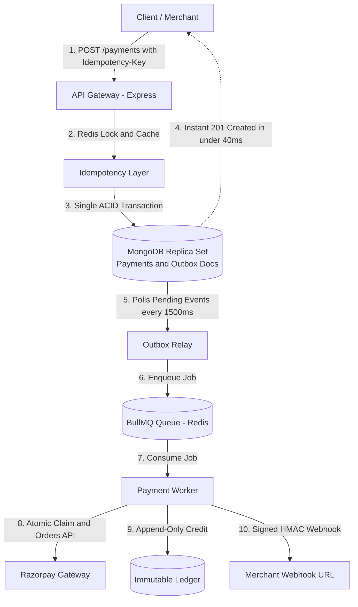

# ⚡ Event-Driven Payment Gateway & Ledger Engine

> A production-grade, fault-tolerant payment gateway and append-only financial ledger built with **Node.js**, **Express**, **MongoDB (ACID Replica Set)**, **Redis**, **BullMQ**, and **Razorpay**.

[](https://nodejs.org/)
[](https://expressjs.com/)
[](https://www.mongodb.com/)
[](https://redis.io/)
[](./backend/package.json)

---

## 💡 Overview

Building payment systems requires handling real-world distributed failures: network timeouts, concurrent retries, accidental double-charges, and data divergence between databases and external banks.

This project implements an **event-driven, fault-tolerant payment pipeline**:
- **Zero Double-Charges:** Distributed idempotency layer backed by Redis atomic locks (`SET NX EX`) and MongoDB response caching.
- **No Lost Events:** Transactional Outbox pattern guarantees consistency between database writes and asynchronous message queues without distributed two-phase commit (2PC).
- **Sub-40ms Ingestion:** Fast API acknowledgment via BullMQ background workers and atomic document claims.
- **Financial Auditability:** Append-only double-entry ledger that records immutable credits and debits instead of mutating balances.

> 📖 **Deep Dive Available:** For the complete architectural design, failure recovery models, and code patterns, see **[ARCHITECTURE.md](./ARCHITECTURE.md)**.

---

## 🏛 Architecture at a Glance



---

## 🧩 The 4 Core Pillars

| Pillar | Engineering Pattern | Problem It Solves |
| :--- | :--- | :--- |
| **1. Ingestion Guard** | **Distributed Idempotency** (`SET NX EX` in Redis) | Prevents duplicate payments when users double-click or client networks retry requests. |
| **2. Event Durability** | **Transactional Outbox Pattern** (MongoDB ACID) | Eliminates dual-write bugs. State writes and outbox events commit together or fail together. |
| **3. Async Processing** | **BullMQ Workers & Atomic Claims** (`findOneAndUpdate`) | Prevents API thread blocking and eliminates race conditions across multiple worker instances. |
| **4. Financial Ledger** | **Append-Only Double-Entry Ledger** | Never mutates balances. Every transaction is an immutable audit record; balances are aggregated on-the-fly. |

---

## 🛠 Tech Stack

- **Runtime:** Node.js (ES Modules) & Express 5
- **Database:** MongoDB (Replica Set required for multi-document ACID transactions)
- **Cache & Queue Broker:** Redis & BullMQ
- **Upstream Processor:** Razorpay Node.js SDK
- **Logging & Security:** Winston, Morgan, Helmet, CORS

---

## 📂 Project Structure

```text
├── backend/
│   ├── src/
│   │   ├── config/              # MongoDB, Redis, and Winston logger setup
│   │   ├── middleware/          # API Key Auth, Idempotency lock & Morgan logging
│   │   ├── modules/
│   │   │   ├── merchants/       # Merchant registration & API key hashing
│   │   │   ├── payments/        # Payment CRUD, status checks & Outbox models
│   │   │   ├── processors/      # Razorpay upstream API wrapper
│   │   │   ├── ledger/          # Double-entry ledger service & aggregation
│   │   │   └── webhooks/        # Incoming Razorpay webhook & delivery models
│   │   ├── queues/              # BullMQ queue declarations
│   │   ├── workers/             # Outbox Relay & BullMQ Payment Worker
│   │   └── app.js               # Application entrypoint
│   ├── .env.example
│   └── package.json
├── ARCHITECTURE.md              # In-depth architectural breakdown & deep-dive patterns
└── README.md
```

---

## 🚀 Getting Started

### 1. Prerequisites
- **Node.js:** v18+ (Node 20 recommended)
- **Redis:** Running locally on port `6379`
- **MongoDB:** Running as a **Replica Set** on port `27017` *(Required for ACID transactions)*
- **Razorpay Account:** Free test keys from the [Razorpay Dashboard](https://dashboard.razorpay.com/#/access/api-keys)

### 2. Configure Environment
```bash
cd backend
cp .env.example .env
```

Set your values in `.env`:
```ini
PORT=3000
NODE_ENV=development
MONGODB_URI=mongodb://127.0.0.1:27017/payment_gateway?directConnection=true
REDIS_HOST=127.0.0.1
REDIS_PORT=6379
RAZORPAY_KEY_ID=rzp_test_your_key_id
RAZORPAY_KEY_SECRET=your_key_secret
RAZORPAY_WEBHOOK_SECRET=your_webhook_secret
```

### 3. Install & Run
```bash
# Install dependencies
npm install

# Start development server
npm run dev
```

The gateway will start at `http://localhost:3000`.

---

## 🖥️ Frontend — Gateway Console

A responsive React + Vite + Tailwind merchant dashboard lives in [`frontend/`](./frontend).

```bash
cd frontend
npm install
cp .env.example .env     # VITE_API_BASE_URL defaults to http://localhost:3000
npm run dev              # http://localhost:5173
```

It authenticates with your merchant **`x-api-key`** (there is no login endpoint) and calls **only the endpoints implemented in this backend**. Screens that need endpoints which don't exist yet show an honest **"Endpoint not implemented"** state — no mock data — and a matching TODO comment has been added to the relevant backend route file describing the API to build.

See [`frontend/README.md`](./frontend/README.md) for the full list of required endpoints and how to wire them up.

---

## 🧪 Quick Testing Guide (cURL)

### 1. Register a Merchant
```bash
curl -X POST http://localhost:3000/v1/merchants \
  -H "Content-Type: application/json" \
  -d '{"name": "Nova Store", "email": "dev@novastore.io", "webhookUrl": "https://webhook.site/test"}'
```
> 📌 *Save the returned `apiKey` for use in the `x-api-key` header.*

### 2. Create an Idempotent Payment
```bash
curl -X POST http://localhost:3000/v1/payments \
  -H "Content-Type: application/json" \
  -H "x-api-key: <YOUR_MERCHANT_API_KEY>" \
  -H "Idempotency-Key: order_checkout_101" \
  -d '{"amount": 2500, "currency": "INR", "description": "Order #101"}'
```
*Returns `201 CREATED` in `< 40ms`.*

### 3. Verify Idempotency (Try to Double Charge!)
Execute the exact same `curl` command above again:
- The gateway instantly returns the **identical cached response**.
- **No duplicate payment is created, and no extra charge occurs.**

### 4. Query Merchant Ledger Balance
```bash
curl http://localhost:3000/v1/ledger/balance \
  -H "x-api-key: <YOUR_MERCHANT_API_KEY>"
```
*Returns the aggregate calculated directly from immutable ledger credit entries.*

---

## 📜 License

This project is licensed under the [ISC License](./backend/package.json).